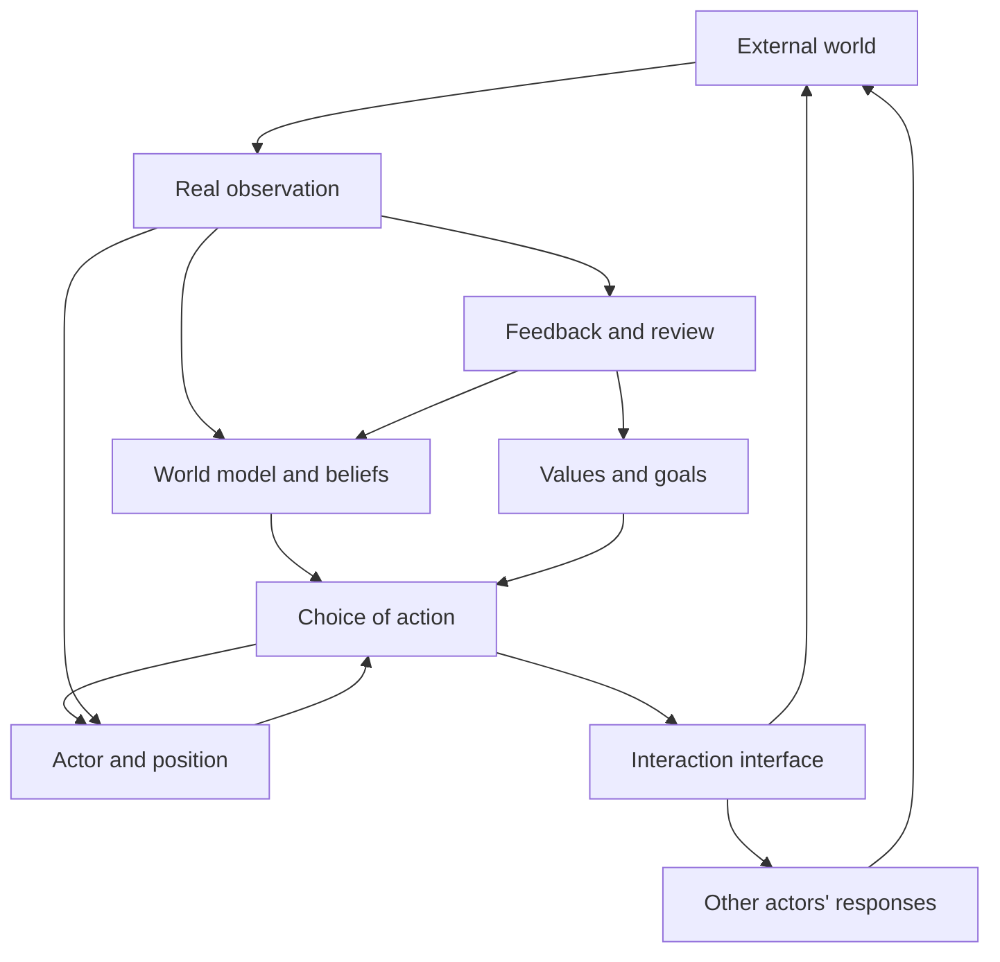

# Reflexive Practice: Private Canon

Version: 2.0.0  |  Effective baseline date: 2026-10-15  |  Protocol version: RP-2.0.0

> English translation of [01_反身实践私典_理论全本.md](01_反身实践私典_理论全本.md). The Chinese original is authoritative; terms follow [docs/glossary.md](../docs/glossary.md).

## A unified closed-loop theory of world, actor, value, interaction, decision and evolution

> **Master proposition**: A finite actor does not directly grasp the world; it forms conditional knowledge of the world under constraints and uncertainty. The actor chooses interventions according to its value goals, actual position and capacity to act; interventions change external states, change other actors' cognition and strategies, and in turn change the actor itself. Effective practice takes testable causal hypotheses as its medium, action within bounded risk as its method, calibratable feedback as its source of knowledge, and the actor's continued survival, realization of values and future optionality as its boundary.

---

# Prologue: General outline of the theory

## 0.1 Object of the theory

Reflexive practice studies the following question: in a dynamic environment jointly generated by material conditions, institutional rules, social cognition, multi-actor behavior and nonlinear feedback, how can an actor with limited cognition and resources form relatively reliable conditional judgments, identify variables open to intervention, choose actions according to its own values and constraints, and continually revise its understanding of the world, of itself and of the mechanisms of action through the results of practice?

Its object is neither an isolated external world nor individual will detached from the environment, but the **actor–environment coupled system**:

1. The world imposes constraints on the actor and offers unequal opportunities and entry points.
2. The actor constructs a world model from limited information; the model shapes attention, choice and action.
3. The actor's actions change part of the environment's state through specific mechanisms.
4. Other actors can perceive, interpret and respond to this change.
5. The results of action in turn change the actor's resources, capabilities, beliefs and goals.
6. Continuous interaction changes the distribution of future states without guaranteeing that any single path is realized.

Reflexive practice therefore has six attributes at once: world analysis, actor design, value judgment, causal identification, sequential action and feedback governance.

## 0.2 Boundaries of application

This theory is an **analysis–decision–action framework** for open complex systems. It is not a complete explanation of all phenomena, nor a predictive law applicable without evidence.

Its applicability is constrained by the following conditions:

- **Observability**: key phenomena have at least partly observable facts or proxy signals.
- **Intervenability**: the actor can identify at least one real action, or can change future decisions by acquiring information.
- **Value articulability**: the actor can state the values it is protecting and pursuing, or explicitly takes clarifying values as the current task.
- **Risk governability**: the boundaries of action and major irreversible losses can be identified and limited in advance.
- **Revisability**: judgments in the model can accept counter-evidence, retain uncertainty and change in light of new information.

For problems lacking conditions for intervention, the theory can still serve cognitive and explanatory purposes, but must not invent operable interfaces; for problems that cannot be reliably verified, the boundaries of judgment must be stated explicitly; for judgments touching high professional risk, appropriate professional evidence and independent review must be brought in.

## 0.3 Three kinds of propositions

Statements in the theory must be distinguished into three kinds, which must not be mixed.

**Descriptive propositions** describe states and mechanisms of the world and must be subject to empirical testing.

**Normative propositions** specify values the actor considers worth pursuing or necessary to avoid; they must be subject to value consistency and ethical review and cannot be derived from empirical data alone.

**Decision propositions** choose actions under specific factual, value and resource constraints, and must satisfy both descriptive reliability and normative acceptability.

The theory cannot elevate a normative choice into a universal fact merely because some action had a favorable result, nor presume a behavior worth doing merely because it is effective.

## 0.4 Basic principles and normative commitments

1. **Principle of the finite actor**: the actor's cognition, resources, time, attention and executive capacity are all limited.
2. **Principle that the model is not reality**: any world model is a purposeful compression of information and is not the same as reality itself.
3. **Principle of conditional judgment**: a judgment holds only within its factual, temporal, arena and structural conditions.
4. **Principle of reflexive coupling**: the actor's knowledge may, through action, change the system being known.
5. **Principle of causal priority**: correlation, explanation and intervenable causal effects must be distinguished.
6. **Principle of values before optimization**: the capacity to optimize is a means; the values and boundaries the actor acknowledges determine the direction of optimization.
7. **Principle of limited interfaces**: action can affect a system only through action paths that actually exist.
8. **Principle of multi-actor response**: strategies involving other actors should take into account their cognition, incentives and subsequent adjustments.
9. **Principle of explicit uncertainty**: unprovable certainty must not be replaced by strength of language.
10. **Principle of fallible feedback**: observation records may contain measurement and recording errors, and causal interpretations of observations may also be wrong; the two layers of error are examined separately.
11. **Principle of sequential choice**: acquiring information, waiting, committing and exiting are all comparable actions.
12. **Principle of irreversibility first**: unbearable losses must be limited first, before potential gains are discussed.
13. **Principle of optionality**: future eligibility to act and the set of choices have independent decision value.
14. **Principle of revisable goals**: the realization of values must not be permanently held hostage by fixed means or existing goals.
15. **Principle of structural update**: feedback can change the strength of beliefs, model structure, rules of action and the actor's capabilities.
16. **Principle of meta-governance**: the theory's own validity, complexity and cost of use are likewise subject to testing.
17. **Principle of non-transferable responsibility**: models, automated systems and outside advice cannot replace the acting actor in bearing responsibility.
18. **Principle of local validity**: a mechanism effective in one domain must not be extrapolated directly to other domains without testing.

These principles serve descriptive, normative or procedural constraint functions respectively; they do not form a proof system that deduces all conclusions from one set of formal axioms. Normative commitments should state who adopts them, their scope and how conflicts are handled.

## 0.5 Basic objects and notation

To avoid confusing different levels, this theory uses the following unified notation.

| Symbol | Name | Definition |
|---|---|---|
| \(W_t\) | World state | The external state that objectively exists at time \(t\) and cannot be fully and directly known by the actor |
| \(\widehat W_t\) | World model | The actor's revisable representation of the world's state, mechanisms and constraints |
| \(U_t\) | Actor structure | The actor's resources, capabilities, condition, self-narrative and execution mechanisms |
| \(P_t\) | Actor position | The actor's informational, resource, relational and institutional position in the world |
| \(V_t\) | Value system | The value commitments, priority relations and their versions acknowledged in the current period; some commitments are relatively stable |
| \(G_t\) | Goal structure | Phase goals and action goals derived from the value system for a particular period |
| \(B_t\) | Belief state | Evidence-conditional knowledge about environmental states, mechanisms and future paths |
| \(I_t\) | Interaction interface | A specific channel through which the actor's actions can affect external variables |
| \(H_t\) | Mechanism hypothesis | A statement, to be tested, about the relationship among intervention, path of action and result |
| \(L_t\) | Leverage structure | Intervention points that may produce relatively high net effect under given goals, constraints and cycles |
| \(a_t\) | Action | The actor's choice in the current period: observe, probe, build momentum, maintain, double down or withdraw |
| \(O_{t+1}\) | Observed result | External and internal observation records obtained after the action |
| \(F_{t+1}\) | Feedback interpretation | Causal attribution of observed results, analysis of prediction error and suggested model revisions |
| \(K_t\) | Governance boundary | Ethical, legal, safety, maximum-loss and irreversibility limits |
| \(\Pi_t\) | Action policy | Rules deciding the next action based on available information and constraints |

These symbols denote conceptual objects and their relations and do not presuppose that all variables can be quantified. Where measurement methods, functional forms or identification conditions are not defined, symbolic relations have only **structural expressive** meaning and no automatic computational power.

## 0.6 The overall actor–world loop

| Stage | Core relation |
|---|---|
| Case and real boundaries | Determine the case, information cut-off, world model, constraints, arena and time |
| Actor and values | Identify actor and position; clarify value goals and the actor conditions needed to achieve them |
| Interfaces and explanation | Identify interaction interfaces, compare mechanisms and competing hypotheses, review causal evidence |
| Candidates and choice | Form leverage candidates, consider strategic responses, compare value, risk and optionality |
| Commitment and action | Freeze the chosen plan; fix phase, scale, permissions and feedback conditions |
| Observation and learning | Record actual changes, evaluate results and attribution, calibrate predictions and beliefs |
| Update and continuation | Update the relevant models and record versions separately, keep historical commitments and enter the next round |

The governance boundary \(K\) runs through all stages; the value system \(V\) keeps an independent constraint on the legitimacy of goals and means; multi-actor responses and environmental changes continue to occur between actions.

---

## 0.7 Four kinds of validity that cannot substitute for each other

**Conceptual validity** requires clearly defined objects, consistent levels and no circular substitution. **Empirical validity** requires descriptive or mechanism propositions to be supported within their declared conditions. **Procedural validity** requires operating rules to be executable and reviewable, and to improve decisions relative to a reasonable baseline. **Normative legitimacy** requires value commitments, permissions and others' rights to be appropriately justified.

Each bears its own burden of proof. Conceptual coherence does not guarantee that a mechanism holds; empirical success does not automatically make an action legitimate; procedural completeness does not automatically make decisions better than simple methods. Claims in the theory without test results should keep the status of "to be verified".

## 0.8 Factual state, cognitive state and record state

Reality changing, the actor learning of the change, and the change being recorded are different events. Every key record should, as far as possible, distinguish time of occurrence, time learned, time recorded and time a rule takes effect. Times that cannot be determined should be stated as unknown; recording time must not stand in for time of occurrence.

The world state \(W_t\) is not directly rewritten by interpretation; what the actor updates is \(\widehat W_t\) and the beliefs \(B_t\). Real changes caused by action need separately recorded evidence. The dossier keeps judgments already made and their basis; updates are expressed by adding versions, not by retroactively rewriting earlier knowledge.

---

# Volume 1: The generative structure of the world

## 1.1 The world is not a static collection of objects

The world is generated by interacting processes of resources, institutions, cognition, action and feedback. The reality an actor observes at any particular moment is a phased result of prior states, external shocks, participants' behavior and system constraints acting together.

World analysis includes at least seven interrelated dimensions that cannot simply be multiplied together:

1. **Material conditions \(M\)**: time, space, energy, bodies, capital, information carriers and technical facilities.
2. **Constraint structure \(C\)**: physical limits, contracts, institutions, resource bottlenecks, opportunity costs and behavioral boundaries.
3. **Social arena \(S\)**: organizational structures, market rules, platforms, evaluation mechanisms and resource-allocation systems.
4. **Cognitive narratives \(N\)**: beliefs, expectations, identities, trust, perceived legitimacy and structures of meaning.
5. **Multi-actor behavior \(D\)**: actions formed by different actors under their own information, incentives and capabilities.
6. **Feedback structure \(Q\)**: reinforcement, suppression, delay, lock-in, offsetting and nonlinear response.
7. **Temporal state \(T\)**: structural evolution, path dependence, external shocks and phase transitions.

Conceptually this can be expressed as:

\[
W_t=\mathcal W(M_t,C_t,S_t,N_t,D_t,Q_t,T_t)
\]

where \(\mathcal W\) stands for a system composition relation still to be defined for each specific domain, not a known numerical function.

## 1.2 Distinguishing material, institution and narrative

Material conditions set the boundaries of feasibility for certain behaviors; institutional rules change the permission, cost and incentives of behavior; cognitive narratives act on reality by affecting actors' choices.

The three cannot be reduced to one another.

- Material constraints do not disappear merely because cognition changes.
- Institutional boundaries cannot be lawfully cancelled merely by individual will, but may change through procedures the institution permits.
- Narrative cannot directly replace material conditions, yet may produce real effects through investment, collaboration, coordination and expectations.

For any constraint, its **level of action, time scale, actor permissions and conditions for change** must be stated. A so-called hard constraint is not an abstract label detached from time and place, but a feasibility judgment relative to the current actor and decision deadline.

## 1.3 Three layers of constraint

**Hard constraints \(C_h\)**: boundaries that cannot be effectively changed under the given action period, technology and permissions, or whose violation causes unacceptable consequences.

**Semi-hard constraints \(C_m\)**: conditions that are costly to change in the short term but can be changed gradually through training, accumulation, organizational reform, technological progress or moving to another arena.

**Soft constraints \(C_s\)**: conditions maintained mainly by rule arrangements, information distribution, coordination conventions, shared identity and incentive mechanisms, which can be changed at relatively low cost through lawful, legitimate interaction.

The three kinds of constraints should be classified by **current changeability**, not by surface origin. A constraint's type changes with resources, time scale and institutional environment.

## 1.4 Social arena and positional effects

An arena is a relatively stable set of participation rules, resource-allocation rules and evaluation rules. It determines which behaviors are rewarded, which capabilities have exchange value, which information can reach the actor, and which actions require permission or cooperation.

An actor's capabilities cannot be valued apart from the arena. How capabilities play out is constrained by the following factors:

\[
\text{realized effect}=\Phi(\text{capability},\text{arena},\text{position},\text{coordination},\text{time})
\]

This expression is a structural relation; any concrete estimate requires a separately built model.

Analysis of an arena must identify together: entry points, payoff rules, exit costs, key dependencies, information asymmetries and institutional changeability.

## 1.5 The mechanism of reflexivity

Reflexivity contains two processes running in opposite directions yet coupled to each other:

- **Cognitive process**: the actor forms an interpretation of reality from limited observations.
- **Participatory process**: the actor acts on that interpretation, and action may in turn change reality.

If the participatory process changes the object that cognition refers to, the actor is in a reflexive structure.

The strength of reflexivity depends on the reach of the actor's actions, participants' sensitivity to signals, the elasticity of rules and resources, feedback delays and other actors' responses.

Not every observation significantly changes the observed object, and not every narrative can turn into real force. Reflexivity must have an explainable mediating mechanism.

## 1.6 System boundaries and externalities

Analysis must first define the system boundary: which variables are treated as internal states, which are external conditions, and which are influences not yet observed.

A boundary that is too narrow easily mistakes external shocks for internal mechanisms; one that is too wide easily makes identification, action and verification impossible.

An appropriate boundary should serve the current case, allow dynamic expansion based on evidence, and continuously audit externalities for other actors, other time scales and the environment.

---

# Volume 2: Dynamic loops and temporal structure

## 2.1 The difference between causal chains and feedback loops

A causal chain is a directed path of action; a feedback loop is a closed structure in which the result of an action returns via other paths and affects the original variable.

A system may have clear causal chains without any reinforcing loop; an observed circular association may also not represent real feedback.

Identifying a loop requires stating at least: nodes, edges, direction of influence, time delays, mediating conditions, nonlinear thresholds and possible common causes.

## 2.2 Six kinds of dynamic structure

**Reinforcing loop**: a change further reinforces itself through a feedback process, though its gain may change with the state.

**Balancing loop**: a change triggers offsetting forces that move the system toward a local constraint or regulating target.

**Lock-in loop**: existing resource allocation, institutional incentives or actor cognition make actions deviating from the status quo persistently costly.

**Reversal mechanism**: constraints, competition, fragility or resource pressure accumulated in an earlier reinforcing process gradually weaken marginal effects and may even reverse their direction.

**Delayed loop**: a time delay between action and result makes the actor prone to misreading immediate feedback or overcorrecting.

**Coupled loops**: several feedback processes interact, so local effects cannot simply be added up into global effects.

Loop categories are analytical language, not direct evidence. Confirming a real loop requires observing responses under different states, mechanism evidence and, where necessary, intervention tests.

## 2.3 Dominant tension

The dominant tension is the conflict relation in the current system that has substantial explanatory and intervention significance for deviation from goals, structural instability or the distribution of future states.

Judging the dominant tension should distinguish:

1. **Salience**: whether the variable is easy to observe or provokes strong feelings.
2. **Causal contribution**: whether changing the variable substantively affects the target outcome.
3. **Intervenability**: whether the actor has a path to change the variable.
4. **Decision value**: whether the net benefit after intervention beats alternatives.

A salient variable is not necessarily the dominant tension; the dominant tension is not necessarily intervenable; an intervenable tension is not necessarily worth handling first.

## 2.4 Cycles as latent states

A cycle is not a fixed sequence that every system must go through in order, but a **latent-state model** describing the main mechanisms and characteristic responses of a system.

The following state vocabulary can be used: emergence, expansion, saturation, destabilization, contraction, reorganization, re-stabilization.

These states can coexist, repeat or skip, and may appear simultaneously at different levels and time scales.

Cycle judgments should be supported by observable variables definable in the relevant domain, including growth, marginal returns, participant structure, constraint pressure, response speed and persistence of state.

Phase transitions must not be inferred directly from narrative heat, local fluctuations or a handful of observations alone.

## 2.5 Multi-scale evolution

The same behavior may have different effects in the short, medium and long term.

Short-term positive feedback can accompany long-term depletion of resources; short-term negative feedback can accompany long-term accumulation of capability. A decision therefore needs to distinguish at least:

- immediate effects and delayed effects;
- first-order effects and second-order effects after strategic responses;
- local effects and system-level externalities;
- improvements in state and changes in structure;
- reversible fluctuations and irreversible path changes.

Every judgment about trends, turning points and timing should state its scale of analysis and period of validity.

---

# Volume 3: The finite actor and the position model

## 3.1 A structural definition of the actor

The actor is not a fixed personality label but a finite action system that continuously perceives, judges, chooses and executes in a particular environment.

\[
U_t=(R_t^{u},K_t^{u},E_t^{u},N_t^{u},A_t^{cap},\Gamma_t)
\]

where:

- \(R_t^{u}\): available resources and their liquidity;
- \(K_t^{u}\): knowledge, skills and reliable capability to complete tasks;
- \(E_t^{u}\): physical energy, cognitive load and emotional regulation;
- \(N_t^{u}\): self-narrative, self-understanding of identity and habitual expectations;
- \(A_t^{cap}\): capacity to organize, execute and recover;
- \(\Gamma_t\): the coordinating structure among resources and capabilities.

The actor's effective capability depends not only on the level of each element but also on whether the elements can work together.

## 3.2 The difference between position and actor

The actor structure describes what the actor has; position describes what those structures can reach once embedded in the world.

Position includes at least: resource position, capability position, information position, relational position, institutional position and narrative position.

Position determines where samples of information come from, the reachability of outside cooperation, the marginal cost of action and the feasible set of goals.

An actor can change position by accumulating capability, and can also release existing capabilities by changing position. The two paths need separate evaluation of cost, time and reversibility.

## 3.3 The limits of bounded rationality

A finite actor inevitably faces incomplete information, sampling bias, scarce attention, memory limits, estimation error, emotional influence and execution costs.

Bounded rationality does not mean abandoning rationality; it means rationality must include its own costs.

If the expected incremental benefit of further analysis is lower than the cost of analysis plus the loss of the window, stopping analysis and taking controlled action may be more reasonable; if errors could cause irreversible harm, the value of further evidence-gathering and independent review rises accordingly.

## 3.4 Internal reflexivity

The actor's interpretation of itself changes its behavioral tendencies; the results of behavior in turn affect the actor's capabilities, resources and self-interpretation.

\[
N_t^{u}\rightarrow E_t^{u}\rightarrow a_t\rightarrow O_{t+1}
\rightarrow N_{t+1}^{u}
\]

This is only a simplified structure of internal reflexivity and does not exclude external factors or two-way influences.

Self-narrative can help the actor organize action, but can also lock in identity and capability assessments. The purpose of internal governance is not to keep producing positive narratives, but to form a revisable self-model that is compatible with evidence and can sustain the capacity to act.

## 3.5 Deriving actor structure backward from goals

Given world conditions \(W\) and goal \(G\), the actor structure a goal requires is not a single template but a set of feasible structures:

\[
\mathcal U^{*}(W,G,K)=\{U:\exists\,\Pi\text{ such that the goal has an acceptable possibility of realization within governance constraints}\}
\]

The key to actor design is not to raise all capabilities in the abstract, but to find the critical gaps between current capabilities and the feasible conditions for the goal.

Gaps can be classed as: resources, capabilities, condition, relationships, information, identity and action system. Priority should go to gaps whose closure expands the feasible action set, improves several goals or relieves structural bottlenecks.

## 3.6 Limits of self-engineering

Reshaping the actor itself consumes resources and may harm health, relationships and autonomy.

The actor cannot be treated merely as a tool for achieving goals. Its basic safety, dignity, capacity to recover and long-term integrity are independent value constraints.

Actor design should therefore satisfy: a legitimate purpose, sustainable load, observable change, the ability to stop when necessary, and retention of the right to re-evaluate the goal itself.

---

## 3.7 Relational consistency of actor, position and environment

Actor structure and position are interrelated analytical perspectives and should not be double-counted as independent resources. Position is the relational state between the actor and the environment; if the same qualification, relationship or asset appears under several perspectives, mark that they refer to the same real object.

Insufficient capability, restricted entry, goal misfit and execution error should be diagnosed separately. Reshaping the actor and moving arenas must be compared with plans that keep using existing conditions; one cannot presume that self-reshaping always comes first.

---

# Volume 4: Values, goals and optionality

## 4.1 Distinguishing the levels of value and leverage

**Value \(V\)** answers which states of life, relationships, practices and results are worth the actor pursuing.

**Leverage \(L\)** answers in what structural ways the actor can influence reality more effectively.

Leverage is capability and position; it does not automatically constitute ultimate value. Expanded capability does not necessarily mean values are realized; increased local gains do not necessarily mean the actor's overall situation improves.

## 4.2 Value structure

The value system should accommodate together:

1. **Ultimate values**: states worth pursuing in themselves, not merely as means to other goals.
2. **Instrumental values**: capabilities, resources and positions that help realize other values.
3. **Floor values**: safety, rights and ethical boundaries that cannot be exchanged for ordinary gains.
4. **Relational values**: mutual trust, commitments and common interests not paid for by exhausting one side's gains.
5. **Optionality value**: the capacity to engage in different value practices in the future.

Values may be incommensurable. The actor can state priority relations, set inviolable floors, or adopt non-inferior multi-goal solutions, without forcibly compressing everything into a single number.

## 4.3 Four-level goal structure

- **\(V\): value level**: determines which results are worth pursuing and which costs must not be paid.
- **\(G_0\): strategic capability level**: specifies the actor capabilities, degrees of freedom and optionality to be maintained or expanded over the long term.
- **\(G_1\): phase result level**: specifies identifiable states to be achieved within an explicit time frame.
- **\(G_2\): action change level**: specifies the smallest state changes that can be implemented, observed and reviewed in the current period.

Goals are not related by one-way command. Lower-level results may prompt re-clarification of higher levels, and value conflicts may lead to rearranging the whole set of goals.

## 4.4 Goal conflicts and multi-goal choice

Goals compete for resources, conflict in time, are correlated in risk and involve irreversible loss of opportunity.

Multi-goal decisions should review at least:

- whether each goal is consistent with core values;
- how intensely different goals compete for scarce resources;
- which goals have deadlines and windows that cannot be recovered;
- which goals reinforce or weaken one another;
- which losses cannot be compensated by other gains;
- whether the decision still keeps the ability to reallocate resources in the future.

When a single utility cannot be reasonably synthesized, judge using **Pareto non-inferiority, floor screening, ordinal relations and scenario robustness**.

## 4.5 Future optionality

Future optionality refers to the set of feasible actions the actor can enter in the future, and the realizability of these actions under future information conditions.

More options are not automatically better; options that are worthless, unexecutable or too costly to maintain do not constitute effective degrees of freedom.

Preserving optionality should pay particular attention to: liquidity, transferability of skills, credibility of relationships, identity and compliance qualifications, physical and cognitive capacity, channels of information, and exit costs.

## 4.6 Goal re-evaluation mechanism

When the following conditions arise, the goal itself should be re-evaluated rather than merely changing execution methods:

1. The goal's results persistently diverge from core values;
2. New information changes the goal's real cost or benefit;
3. The actor's value ranking or living conditions change substantively;
4. Achieving the goal depends on unacceptable ethical or safety costs;
5. Long-term commitment keeps shrinking the actor's future set of effective choices.

Revising a goal is not the same as avoiding difficulty. Distinguishing an invalid goal, an invalid path and insufficient execution requires keeping the corresponding evidence for each.

---

## 4.7 Procedure for ruling on value conflicts

First divide limits into: rights and legal boundaries that the current actor cannot lift on its own; minimum survival and recovery conditions the actor committed to in advance; and goal preferences that can be traded off. State for each limit its basis, period of application, trigger definition and who has authority to interpret or revise it.

Within the feasible set, first exclude plans clearly dominated by other plans; then compare the remaining plans' effects on high-priority values, phase goals and future capability. Pareto non-inferiority can only narrow the set; it is not responsible for producing a unique answer.

If plans remain incomparable, the decision should explicitly give one of the following outputs: a conditional recommendation and its reversal conditions; the value ranking that needs to be supplied; an information task that can distinguish the plans; or the smallest bearable commitment adopted within the decision deadline. An undefined composite score must not be used to create the appearance of a unique optimum.

When floors conflict with one another or the feasible set is empty, make the conflict public, re-examine goals, deadlines, scope of action and lawful alternative paths, and distinguish harm actively caused from real losses that cannot be fully avoided. A prohibited plan must not regain eligibility automatically by renaming the harm or raising its benefit score.

## 4.8 Value change and dual evaluation

The value system contains relatively stable commitments and rankings that can be adjusted through reflection. Value changes must be connected to new knowledge, changes in living conditions or independent normative reasons, and cannot be driven merely by whether a particular result was favorable.

Each substantive change should keep both: the achievement result assessed against the prior goal, and the significance of continued action assessed under current values. The latter can change the next round's decisions but cannot retroactively turn the former's non-achievement into achievement. The evaluation definition of the old goal, its period of validity and unfinished responsibilities remain traceable.

An actor may take on meaningful risks on an informed, voluntary basis and with the corresponding capacity. Survival and recovery thresholds are explicit governance commitments; they do not require everyone to adopt the same preference toward every risk.

---

# Volume 5: Interaction interfaces and intervenability

## 5.1 Definition of an interaction interface

An interaction interface is a causal channel through which action affects the state or behavioral distribution of a target object. Whether the channel exists is a descriptive judgment; whether the actor can implement it is a judgment of capability and permission; whether implementation is allowed is a normative judgment.

Denote the set of actual or candidate channels as \(\mathcal I^{possible}\), the currently implementable set as \(\mathcal I^{feasible}\), and the adoptable set after governance screening as \(\mathcal I^{admissible}\). Actual actions can only be chosen from the last set. All three sets may contain cognitive errors.

\[
I:\quad a\longrightarrow X\longrightarrow Y
\]

where \(a\) is an executable input, \(X\) the mediating mechanism actually affected, and \(Y\) the goal-related result. The arrows indicate causal directions to be verified, not effects already proven.

The existence of an interface does not mean its effect is significant; a significant effect does not mean it is worth intervening; being worth intervening does not mean unlimited commitment is allowed.

## 5.2 Four kinds of objects of action

| Type | Criterion | General handling principle |
|---|---|---|
| Currently not intervenable | No real path of action within the required time and permissions | Adapt, avoid, wait or change the boundary of the case |
| Indirectly intervenable | Requires changing prerequisite capabilities, resources, relationships or institutional conditions | Build momentum, construct capability, collaborate and commit long-term |
| Directly intervenable | An implementable and observable path of action exists | Design probes, evaluate the value of intervention |
| Should not be intervened | A path of action exists but violates floors or causes unacceptable harm | Exclude, exit or reset the goal |

These categories are relative to the actor and to time; they are not permanent essential properties of objects.

## 5.3 Five kinds of social interaction interfaces

**Information interfaces** change how information arrives, its intelligibility and the structure of information asymmetry.

**Incentive interfaces** change actors' expectations about gains, costs, responsibility and risk.

**Rule interfaces** change permission boundaries, default paths, collaboration procedures and enforcement conventions.

**Narrative interfaces** change interpretive structures concerning facts, identity, legitimacy and future expectations.

**Relational interfaces** change credible commitments, availability of collaboration, conditions of reciprocity and coordination costs.

Concrete interactions usually involve several interfaces at once, but the mediating mechanism actually at work must be identified, to avoid mistaking communication, exposure or contact itself for effective change.

## 5.4 Dimensions for evaluating interfaces

Each candidate interface should be evaluated on at least nine dimensions:

1. Causal credibility of the path of action;
2. The actor's actual permissions and executive capacity;
3. Strength of influence and its uncertainty;
4. Observability of feedback and time delay;
5. Implementation cost and opportunity cost;
6. Reversibility, dependency and exit cost;
7. Others' responses and strategic offsetting;
8. Externalities for core values and third parties;
9. Relative value compared with other available interventions.

There is no universal simple multiplicative score; corresponding estimation and ranking methods can be built in specific domains.

## 5.5 Level shifting

When the target variable lacks a direct interface, level shifting is allowed: from directly changing the result to changing the mediating mechanism; from changing the mediating mechanism to improving the actor's conditions; from changing the actor's conditions to changing the entry point into the environment.

Level shifting must have explicit costs and links to the goal; one cannot keep switching abstraction levels to evade the conclusion that "no actionable path currently exists".

---

## 5.6 Interface discovery and unreachability conclusions

Interface search covers changeable inputs, mediating conditions, resource allocation, entry qualifications, collaborative relationships, rule permissions and choice of environment. Each candidate interface must state the actual executor, minimal action, variable expected to be affected, source of basis and connections not yet verified.

When no currently reachable interface can be found, keep the unreachability conclusion and compare adaptation, waiting, capability building, collaboration, migration and goal adjustment. The number of searches or the length of analysis is not evidence that an interface exists. Candidates with no evidence of effect but controllable losses may enter the decision only as exploration.

---

# Volume 6: Multi-actor interaction and strategic response

## 6.1 The basic structure of a multi-actor world

A world involving actors is not only a system whose objective state changes over time, but also a strategic system in which participants adjust to one another according to their own information, beliefs, incentives and expectations.

For actor \(i\), its behavior can be written conceptually as:

\[
a_{i,t}=\pi_i(\mathcal I_{i,t},B_{i,t},G_{i,t},C_{i,t},\widehat a_{-i,t})
\]

where \(\mathcal I_{i,t}\) is the available information, \(B_{i,t}\) beliefs, \(G_{i,t}\) goals, \(C_{i,t}\) constraints, and \(\widehat a_{-i,t}\) expectations about other actors' behavior. The expression represents decision dependencies and does not presuppose full rationality or a known behavioral function.

## 6.2 Five strategic elements

Analysis of any arena of action with interdependence should identify at least:

1. **Set of participants**: which actors can affect results and rules.
2. **Information structure**: what each party sees, hides and believes.
3. **Preferences and incentives**: what results each party wants to achieve and what costs it must bear.
4. **Action sets**: what each party can choose, commit to, revoke or block.
5. **Response structure**: how other actors are most likely to adjust after one party acts, and how that adjustment acts back on the initial actor.

Identifying incentives does not mean presuming that all behavior comes from a single interest; norms, habits, misjudgments, bounded rationality and identity also influence strategies.

## 6.3 First-order effects and strategic responses

An actor's action can produce direct results, and can also cause other actors to change their actions, thereby changing the original result.

After the actor chooses an action, the object's state may first undergo a first-order change. Other actors observe, interpret and learn from it, and change the system's rules and payoff conditions through cooperation, competition, adaptation or counteraction. The initial actor therefore faces new decision conditions and needs to re-evaluate its original action.

Local intervention effects therefore cannot be extrapolated directly into long-term stable returns. Replicability depends on competitive entry, institutional response, capacity constraints, network structure and information diffusion.

## 6.4 Equilibrium, disequilibrium and path dependence

Equilibrium is a mutually stable relationship under given rules, information and strategies; it does not automatically mean efficiency, fairness or permanence.

Real systems may also remain unstable, oscillate cyclically, be locally locked in or have multiple equilibria for long periods. The actor must not infer a unique future path from a single equilibrium narrative.

Path dependence means early states and existing commitments change which future states are reachable. Identifying path dependence should focus on switching costs, accumulation effects, and coordination mechanisms of standards and institutions, rather than inferring merely from historical inertia.

## 6.5 Institutions and mechanism design

When the actor does not merely accept rules but can influence them, the object of decision should shift from a single action to the participation mechanism itself.

Mechanism design focuses on how rules affect participation, incentive compatibility, information disclosure, risk transfer and overall outcomes, given actors' limited preferences, information and behavior.

Interventions that change mechanisms generally have greater potential for structural influence, and may also carry greater governance responsibility and more serious externalities.

## 6.6 Cooperation and repeated interaction

Repeated interaction gives reputation, trust, commitment and the probability of future cooperation independent value.

Long-term relationships should be voluntary, intelligible, informationally legitimate, and should not infringe the other party's basic optionality.

The effect of short-term behavior on long-term relationships must be included in the full accounting of an action's gains. Advantages obtained through deception, coercion or exploiting major vulnerabilities cannot count as legitimate leverage.

## 6.7 Strategic robustness audit

Before taking key actions, construct at least the following set of responses: cooperative response, competitive response, rule adjustment, unexpected imitation and non-response.

For each response, evaluate the original plan's gains, risks, reversibility and alternative actions. If a strategy works only when other actors do not respond at all, its long-term scalability should receive special scrutiny.

---

# Volume 7: Epistemology, evidence and uncertainty

## 7.1 Beliefs are not facts

Factual statements, observation records, model inferences, subjective judgments and action suggestions must be kept separately.

What the actor has is not an unmediated whole picture of the world, but a set of information from a particular observational position and the belief state formed from it.

\[
B_t=\operatorname{Update}(B_{t-1},O_t,\mathcal M_t)
\]

where \(\mathcal M_t\) is the measurement and interpretation model currently used. The model itself may be wrong, so belief updates cannot rely only on the number of observations; the process generating the information and the model's conditions must also be reviewed.

## 7.2 Types of uncertainty

**Aleatory uncertainty** comes from state fluctuations that remain under the model's conditions.

**Epistemic uncertainty** comes from unknown parameters, insufficient data, measurement error and insufficient understanding of mechanisms.

**Structural uncertainty** comes from model omissions, institutional changes, shifts in behavioral mechanisms and unforeseeable feedback coupling.

**Strategic uncertainty** comes from other actors' hidden information, changeable goals and counteractions.

**Value uncertainty** comes from the actor not yet having clarified which results it truly pursues.

A single method, "get more information", cannot be applied uniformly to different uncertainties. Some uncertainty can be reduced through learning; some requires robust decisions, diversified exposure or preserved optionality.

## 7.3 Four independent properties of evidence

Evaluating evidence must consider together:

- **Reliability**: whether the source and measurement are trustworthy and reviewable.
- **Relevance**: whether it directly supports the current proposition or outcome variable.
- **Discriminating power**: whether it can distinguish competing mechanistic explanations.
- **Transferability**: whether the conclusion can reasonably extend to the target time, scale and arena.

Quantity of evidence is not quality of evidence. Multiple interdependent signals cannot mechanically be counted as the same number of independent proofs.

## 7.4 Layering of evidence status

| Status | Description | Inferential standing |
|---|---|---|
| Judgment to be proven | Intuition, narrative or unverified statement | Only for generating propositions to test |
| Preliminary observation | Recorded but with limited sample or single source | Constrains the range of hypotheses; supports low-risk exploration |
| Replicated observation | Repeated evidence obtained under comparable conditions | Supports conditional judgments of regularity |
| Causal evidence | Main competing explanations reasonably excluded | Supports intervention estimates within a limited scope |
| Extrapolable evidence | Has grounds for validity across periods, arenas or scales | Supports expanded application within the corresponding scope |
| Professional-constraint evidence | Has statutory, medical, safety or other domain authority and conditions of application | Used for high-risk boundaries and review of professional decisions |

This table distinguishes evidential functions; it is not a simple uniform low-to-high score. Professional evidence must also be reviewed for scope, timeliness and the specific object; a single causal study does not automatically gain the ability to be extrapolated across arenas.

## 7.5 Competing-hypothesis structure

Facing a key phenomenon, keep at least:

- the main explanation \(H_1\);
- the strongest competing explanation \(H_2\);
- the possibility of currently unidentified factors or model mismatch \(H_{\varnothing}\).

The quality of a judgment depends not on how complete the explanation is, but on whether it makes observable expectations different from the competing explanations.

The strongest counter-evidence is not a formal listing of objections, but active identification of conditions that would substantively lower the credibility of the main hypothesis.

## 7.6 Probabilistic beliefs and calibration

When there is interpretable prior information, repeated events and enough data, strength of belief can be expressed as probability:

\[
P(H\mid D)\propto P(D\mid H)P(H)
\]

Probabilities must correspond to an explicit proposition, time frame and reference class. Without a reliable basis for quantification, use bounded qualitative expressions of uncertainty; do not manufacture false decimal precision.

In domains with repeatable predictions, prior predictions and later outcomes should be used to evaluate probability calibration, discrimination and stability. Prediction accuracy cannot replace a calibration test, especially when base rates are highly imbalanced.

## 7.7 Belief updating and stopping rules

New evidence may lead to five outcomes: raising credibility, lowering credibility, redistributing weights among hypotheses, revising the structure of hypotheses, or making no substantive change for now.

"No change for now" can also be a reasonable update outcome, provided the information content of the new evidence has been reviewed.

Information gathering should stop when its expected value for improving future decisions is less than its cost plus the loss of timing; high-risk situations also need to consider professional review and tail losses.

---

## 7.8 Effect, mechanism and basis for action

The net intervention effect, the internal mechanism of action and the acceptability of the current action are three different questions. Credible comparative research may support an intervention effect without yet explaining all mediating mechanisms; a clear mechanistic narrative may also lack evidence of net effect.

Evidence review records separately: support for the effect, support for the mechanism, conditions for transfer and risk constraints. When the mechanism is unknown, limit extrapolation and monitor side effects; when the effect is unknown, evaluate the action as exploration in terms of information gain and loss budget. Low-risk exploration need not first prove the proposition it is testing, and high-consequence commitments cannot be permitted on the strength of a mechanistic narrative alone.

Probabilistic beliefs can express subjective uncertainty about a single event, but must state their basis and avoid false precision. Statistical calibration requires a set of comparable predictions with consistent definitions, registered in advance and already due; long-run calibration cannot be inferred from a single event.

---

# Volume 8: Causal identification and counterfactual inference

## 8.1 From correlation to intervention

Observing two variables change together only shows that a statistical or empirical association exists; it cannot directly prove that intervening on one variable will cause the other to change.

Valuable identification of leverage should make explicit at least:

1. The target outcome variable;
2. The implementable intervention variable;
3. The mediating mechanism;
4. Possible common causes;
5. Reverse causal paths;
6. Selection bias and measurement bias;
7. Other actors' responses;
8. The boundaries within which the intervention effect applies.

## 8.2 Causal structure

For a mechanism hypothesis \(H\), build a minimal sufficient causal structure made of nodes and directed edges.

The structure must state which relations come from theoretical presumption, which from observational support, and which still require experimental identification.

More nodes do not mean a stronger explanation. Add only variables that can change causal identification, choice of action or risk judgment.

## 8.3 Counterfactual question

What an action decision really needs to estimate is not "what happened after the action", but: under comparable conditions, what difference in results taking versus not taking the action would make.

In potential-outcome terms:

\[
\tau=\mathbb E[Y(1)-Y(0)]
\]

where \(Y(1)\) and \(Y(0)\) denote the potential outcomes with and without a specific intervention. For the same object at the same time, the two potential outcomes cannot both be directly observed, so causal effects depend on identification assumptions and research design.

Where multiple actors influence one another, interference between actors must be reviewed additionally; when an intervention affects others' behavior, a simple independent potential-outcomes framework may no longer apply.

## 8.4 Paths of causal identification

Where ethics, resources and practicality allow, intervention designs with valid controls and pre-specified metrics may be preferred.

When strict controls cannot be implemented, quasi-experiments, natural experiments, staged rollouts, time series, mechanism tracing or other observational identification methods may be evaluated according to domain conditions.

The choice of identification method must disclose its key assumptions; untested premises must not be hidden under technical terms.

If credible identification conditions are lacking, conclusions should fall back to "mechanism candidate" or "correlational judgment", and cannot claim that an intervention effect has been confirmed.

## 8.5 Identification quality of experiments

An effective probe must be able to provide decision-relevant information, not merely produce recordable activity results.

Probe design should include:

- one explicit main proposition to identify;
- a pre-defined main outcome metric;
- a control or counterfactual estimation method;
- a plan for handling the main confounders;
- the shortest reasonable observation period;
- an acceptable range of execution deviation;
- rules for handling insufficient sample or information;
- pre-set stop conditions and risk budget.

## 8.6 Transferability and scale effects

Local intervention effects can reasonably be extrapolated only when key mechanisms and constraints remain sufficiently similar.

Scaling up may change participant composition, resource prices, competitive reactions, institutional constraints and system feedback.

A successful probe therefore only shows some support under its identification conditions; it is no basis for unlimited expansion. Each significant jump in scale may require re-verification.

## 8.7 Minimum output of a causal audit

```text
Target outcome Y
Implementable intervention a
Main mechanism H1
Strongest competing mechanism H2
Key common cause C
Discriminating prediction D
Identification method ID
Acceptable counterfactual assumptions A_id
Boundary of application Scope
Where evidence is insufficient Unknown
```

---

## 8.8 Sequential intervention and adaptive identification

Multiple rounds of action change later samples, resources and the other side's strategies. Review should distinguish the local effect of the current round, the effect of the whole strategy sequence, and observed changes in the overall state. When an earlier round's action affects later confounders, results from different rounds cannot be mechanically pooled as independent and identically distributed samples.

Pre-specify the main metrics, valid observation windows and allowed adaptation rules; register added metrics and ad-hoc analyses separately as exploratory content. Risk stops and statistical evidence thresholds are set separately. Frequently checking results, choosing the best moment or keeping only successful batches changes the standing of the evidence's interpretation.

When a counterfactual cannot be reliably constructed, one may report observed changes, execution reliability and the degree of mechanism support, but must not directly label an observed difference as causal net gain.

---

# Volume 9: Generating leverage and structural effects

## 9.1 Definition of leverage

Leverage is not an alias for any one of importance, operability or strength of feedback.

**Leverage is a possible position at which the actor, under particular value goals, resource constraints, system structure and time window, can obtain through some implementable intervention a structural influence with relatively high net value compared with its input.**

A leverage judgment involves two different propositions:

- **Causal proposition**: under particular conditions, the intervention can affect the target state through some mechanism.
- **Decision proposition**: compared with other available actions, implementing the intervention better fits the actor's values, resources and risk conditions.

If the former does not hold, the existence of a mechanism must not be inferred backward from expected gains; if the latter does not hold, commitment must not be advocated merely because a mechanism exists.

## 9.2 Leverage generation sequence

1. Atomize the case and define variables that are observable or intervenable.
2. Identify constraints and the dominant tension, and reconstruct the relevant dynamic loops.
3. Build competing mechanisms and causal hypotheses; review cycles and strategic responses.
4. Screen interfaces open to interaction; form and compare leverage candidates.
5. Design probes that can distinguish explanations, and form conditional hit hypotheses.

The depth to which each step is expanded can be adjusted to task complexity, while causal identification, value comparison and governance boundaries keep full coverage. Adopting a simplified protocol is a procedural choice that must be declared explicitly; modules cannot be silently omitted.

## 9.3 Principle of atomization

Atomization breaks a vague problem into variables, and their relations, that can be defined, observed or intervened on.

Appropriate atomization should keep three kinds of consistency:

- **Semantic consistency**: variables are in the same explicit space of meaning as the problem studied.
- **Level consistency**: inputs, processes, results and evaluation metrics must not be lumped into one class.
- **Aggregability**: there is an explainable link between changes in local variables and the overall goal.

Over-atomization destroys information about system coupling; too coarse a granularity makes causal judgment impossible. The granularity of analysis should be determined by the identification precision the current decision requires.

## 9.4 Live loops and marginal effects

Effective leverage need not always sit in a self-reinforcing loop. Weakening harmful loops, releasing bottlenecks, changing default rules, building protective boundaries or improving information structures may also have higher value.

For candidate leverage, evaluate separately:

1. The incremental influence on the target variable;
2. The influence on the gain of system feedback;
3. Whether it changes other actors' behavior;
4. Whether it raises or lowers system fragility;
5. Whether the effect can be sustained;
6. Whether there are diminishing marginal returns, congestion or reverse effects.

## 9.5 Comparing candidate leverage

Candidate leverage cannot be ranked only by speed of feedback or surface gains; compare on the same decision scale:

| Domain of evaluation | Core judgment |
|---|---|
| Goal fit | Whether it advances a value-reviewed goal |
| Identification reliability | Whether the mechanism of action has sufficient evidence |
| Actor reachability | Whether the actor currently has eligibility and capacity to implement |
| Net incremental value | Whether it beats the status quo and other feasible plans |
| Information value | Whether implementation can effectively reduce important uncertainty |
| External response | Whether others' behavior will offset or reverse the effect |
| Scalability | Whether the mechanism holds after scaling up |
| Survival and reversibility | Whether key resources and future eligibility to act are protected |
| Time fit | Whether the observation window matches the real period of action |

If a candidate direction carries major unacceptable risk, it should be excluded first, not offset by raising its benefit score.

## 9.6 Hit hypothesis

A hit hypothesis \(H_{hit}\) is a falsifiable statement that a certain intervention, under particular conditions, can produce goal-related structural effects.

Its complete expression includes:

```text
Dominant problem Problem
Structural conditions Condition
Main mechanism Mechanism
Competing explanation Alternative
Action interface Interface
Intervention proposition Intervention
Observable outcome Outcome
Identification plan Identification
Scope of application Scope
Failure condition Falsifier
Risk boundary Risk
Follow-up choice rule Policy
```

A hit hypothesis can serve only as a decision input awaiting testing. Without support from external observation or identifiable intervention, it must not be upgraded into a confirmed regularity.

---

## 9.7 Bounded candidate generation

Candidate generation covers at least the current action baseline and one substantively different alternative direction. The search can enter from releasing bottlenecks, reorganizing resources, improving information, collaboration and commitment, building capability, moving arenas and adjusting goals; it is not required that every category produce a plan.

Differences between candidates must appear in the variables acted on, resource allocation, entry conditions or timing. Merely changing names, strength of wording or benefit assumptions does not count as an independent alternative. When domain knowledge is insufficient, first mark the unknown mechanism, and arrange materials, observations or professional input that can fill the key gap.

Each round of search sets a budget of time and number of candidates. The budget comes from the case's risk and decision deadline; it is an operating parameter and must not pose as a universal law. When no reliable improvement can be found, one may keep the baseline, carry out controlled exploration or reframe the case, but must not invent leverage to complete a template.

## 9.8 Distinguishability of plans

Each candidate plan should state: what it changes relative to the baseline, why it is expected to improve things, what evidence would make it step aside, and under what conditions alternatives would be better. Use the same observation period, cost definitions and known conditions for all plans; do not apply optimistic definitions to the preferred plan and pessimistic ones to alternatives.

---

# Volume 10: Decision value and sequential rationality

## 10.1 The goal of decision

Deciding is comparing feasible actions and subsequent strategies under value and governance constraints so that the actor's situation across time improves acceptably. Multi-stage decisions must include later information, adjustment rules and resource needs in the plan; the short-term gain of the current move cannot be taken as the value of the whole path.

When goals can reasonably be quantified and model conditions are clear, this can be expressed as:

\[
\pi^*\in\operatorname*{argmax}_{\pi\in\mathcal P_{admissible}}
\mathbb E[\mathcal U_{V^{(v)}}(Y_{t:t+T},U_{t:t+T})\mid B_t,\widehat W_t,\pi]
\]

where \(\pi\) is a strategy including later adjustment rules, \(V^{(v)}\) the value version frozen for this evaluation, and \(\mathcal P_{admissible}\) has already been screened for permissions, survival, risk budget and implementability. The evaluation does not require the true transition probabilities to be known, nor all values to be combined into a number.

When there is value or structural uncertainty that cannot be reliably quantified, use floors, priority orders, non-inferiority, sensitivity and scenario robustness, keeping the comparative uncertainty that cannot be eliminated. Risk thresholds, utility mappings and scenario sets must state their basis; abstract symbols must not replace estimation.

## 10.2 Six basic action phases

**Observation phase**: key uncertainties are not yet sufficient to support effective intervention; prioritize improving information quality and clarity of judgment.

**Probe phase**: there is an explicit proposition to verify, and discriminating information can be obtained at bearable cost.

**Momentum-building phase**: the goal and direction are conditionally reasonable, but some important prerequisite capability, timing or permission is not yet satisfied.

**Maintain phase**: the existing plan still meets goal, effect and risk requirements; keep executing and monitoring at the set scale, without forcibly interpreting stable exploitation as doubling down.

**Double-down phase**: existing evidence supports intervention gains within a limited scope, and the risk and resource budgets allow increased commitment.

**Withdrawal phase**: preset stop conditions are triggered, or the expected value of continuing is lower than a reasonable alternative; stop, scale down, exit or migrate.

These are decision phases, not actor identities. Action may move back and forth between phases, but the reasons for transitions must be traceable.

## 10.3 Exploration and exploitation

Exploration aims to reduce decision-relevant uncertainty; exploitation aims to obtain goal gains from actions with relatively credible effects.

The two compete for resources; exploration may itself produce direct gains, and exploitation may also provide information.

The optimal ratio depends on: time horizon, speed of environmental change, number of repeatable opportunities, transferability of information, losses from failure and the uncertainty of the current strategy.

Exploration should not be extended indefinitely; exploitation should not stop monitoring structural change because of temporary success.

## 10.4 Value of information

The value of information is not the amount of information itself, but whether obtaining a given piece of information can change a decision and improve expected results.

Where it can be calculated, the value of information should be defined as the difference between the optimal expected decision value after and before obtaining the information, minus the cost of acquisition; concrete estimates must avoid double-counting information value and action gains.

Valuable information usually has: discriminating power on key hypotheses, the possibility of changing the direction of action, timeliness, transferability and a relatively reasonable acquisition cost.

## 10.5 Waiting and optionality

Waiting is not inherently passive. For irreversible commitments and situations where information improves gradually, waiting may preserve flexibility for later decisions.

But waiting can also cause lost windows of opportunity, degraded capability, weakened relationships and accumulating time costs.

Waiting must therefore be treated as a formal plan subject to the same value and risk evaluation as immediate action, and cannot automatically gain exemption through "observe a bit more".

## 10.6 Scale of action and staged commitment

The scale of commitment should be determined jointly by marginal returns, strength of evidence, risk budget, related exposure and future funding needs.

**Small-scale success cannot prove that large-scale gains amplify proportionally.** Each significant double-down may change market reactions, institutional constraints, costs of action and the actor's load.

The purpose of staged commitment is to obtain new evidence, limit erroneous expansion and preserve room for adjustment, not to mechanically split a fixed total commitment into installments.

## 10.7 Conviction gate

The conviction gate is a review mechanism when moving from low-risk exploration to higher resource commitment; it is neither a psychological feeling of certainty nor some universal probability threshold.

Passing the review requires all of the following:

1. Evidence supporting the main mechanism meets the requirements of the current risk level;
2. The core competing explanations have been appropriately handled;
3. Metrics adequately represent the goal rather than only reflecting surface activity;
4. The scale of intervention is consistent with the range to which the evidence can be extrapolated;
5. Others' strategic responses and rule changes have been evaluated;
6. The commitment ceiling, liquidity needs and consequences of failure are clear;
7. Major irreversible risks are within acceptable bounds;
8. Triggers for stopping, scaling down, adjusting and exiting are preset;
9. The overall value of continued commitment beats feasible alternatives.

The conviction gate's conclusion can be: continue exploring, double down in stages, delay, redesign or exit. Failing the review does not automatically mean the direction is wrong; it may also mean evidence is insufficient.

## 10.8 Risk-adjusted comparison of actions

The components of a decision can be broken down into direct goal utility, information value, future optionality, implementation cost and risk impact, but these quantities must not be mechanically added up without a unified valuation definition.

Actual decisions should first apply floor constraints, then compare non-inferior plans, and then determine action according to value ranking, risk preference and strength of evidence.

When expected gains are high but tail losses are unbearable, the action does not enter the candidate set; risk is not a discount item that average gains can always compensate.

---

## 10.9 Conflict-ruling rules

| Conflict | Default ruling | Conditions that must be kept |
|---|---|---|
| Insufficient evidence vs window of opportunity | Compare a bearable small-scale commitment, waiting and giving up; insufficient evidence does not automatically rule out exploration | Basis for the window, cost of waiting, maximum exposure, latest decision time |
| Optionality vs sustained commitment | Compare the gains of flexibility with the capability, collaboration and accumulation gains of commitment | Switching costs, shortest effective commitment period, capability remaining after exit |
| Short-term survival vs long-term capability | First specify minimum recovery conditions, then allocate long-term commitment within the margin | Minimum resource line, rolling funding needs, reasonable lag of long-term commitment |
| Supported results vs unclear mechanism | Distinguish evidence of net effect from mechanistic explanation; limit use to the range of the evidence | Extrapolation boundary, side-effect monitoring, mechanisms not yet identified |
| Goal revision vs original commitment | Evaluate achievement of the old goal and value of current action separately | Original goal version, basis for revision, unfulfilled responsibilities |
| Fast execution vs strict review | Escalate review with irreversibility and consequences; in emergencies prioritize controllable damage-limiting measures | Authority, emergency basis, duration of temporary measures and retroactive entry |
| High expected gain vs unbearable tail loss | Plans exceeding declared floors do not enter benefit ranking | Source of risk, isolability, alternative scale |
| Several non-inferior plans coexist | Give a conditional recommendation or admit incomparability, then complete the choice with an explicit value ranking | Variables of disagreement, conditions reversing the recommendation, final chooser |

Default rules are the starting point of the decision procedure. Deviations should record their reason, period of application and review conditions before action; when emergencies prevent recording in advance, they must be honestly marked as retroactive entries.

## 10.10 Decision output under limited information

Each analysis may only make a grounded choice among the following conclusions: implement, explore, maintain, defer, withdraw, request a key judgment, or state explicitly that no unique ranking is currently possible. Each conclusion also provides the next action, owner, deadline, commitment boundary and review conditions.

Comparison does not require eliminating all unknowns. If changes to key assumptions within a reasonable range do not change the choice, and the remaining unknowns do not touch floors, analysis can stop after recording residual risk. If the recommendation is highly sensitive to one unknown, first evaluate the value of obtaining that information, shrinking the commitment or changing the plan.

---

# Volume 11: Survivability, irreversibility and risk governance

## 11.1 The actor's right to survive

Only by maintaining basic capacity to act can the actor take part in future probing, learning and realizing values. Every single decision must therefore obey the actor's intertemporal survivability constraint.

Survivability is not simply refusing risk, but distinguishing bearable fluctuations from losses that destroy eligibility to act.

The actor's core protected objects include: physical and mental health, legal safety, resources to maintain basic living, key credit and trust, necessary identity qualifications, and an irreplaceable minimum capacity to recover.

## 11.2 Reversibility is not a binary property

The reversibility of an action involves:

1. Whether material resources can be recovered;
2. Whether time already spent can be made up by future gains;
3. Whether commitments, identity and reputation can be restored;
4. Whether others' actions have already produced irrevocable consequences;
5. Whether exit leads to additional costs;
6. Whether causal effects have already spread to system levels beyond control.

An action that can apparently be stopped does not necessarily eliminate its accumulated losses or effects on third parties.

## 11.3 Ergodicity and the single path

Group average outcomes, long-run average gains and the single path the actor actually lives through cannot be treated as interchangeable.

When there are ruin boundaries, irreversible exits, strong path dependence or nonlinear compounding, average performance across actors cannot adequately describe what a single actor can bear.

If a strategy, when implemented repeatedly, has a substantial probability of prematurely ending the actor's eligibility to act, it cannot be judged reasonable on the strength of idealized average gains alone.

An ergodicity audit must evaluate: survival conditions, concentration of risk, consecutive unfavorable outcomes, recovery mechanisms and catastrophic tail events.

## 11.4 Risk budget

The risk budget is determined jointly by maximum bearable loss, resource liquidity, correlations among risks, external obligations and recovery periods.

The budget must cover together:

- money and time risk;
- physical and cognitive load;
- legal and liability risk;
- reputational and relational risk;
- systemic dependency and single points of failure;
- tail shocks and model failure.

The risk budget is not a value backed out from a target gain. One cannot, because expected gains are high, afterwards enlarge the maximum loss the actor in fact cannot bear.

## 11.5 Distinguishing stop-loss and failure

**Hypothesis failure** means the previously assumed mechanism or conditions of application have not received enough support.

**Metric trigger** means a pre-set risk or gain signal has crossed its boundary.

**Risk stop-loss** means continued exposure may damage the actor's core structure.

The three should not be confused. One poor short-term metric does not necessarily prove the mechanism wrong; a mechanism not yet falsified does not mean continued commitment fits the risk budget.

## 11.6 Multi-dimensional stop rules

Stop and scale-down rules should include:

- time boundaries;
- total cost and marginal cost boundaries;
- boundaries on the main goal metrics;
- main counter-evidence and model-mismatch signals;
- resource liquidity and actor load boundaries;
- legal, ethical, safety or trust boundaries;
- triggers for major changes in external rules.

Committed stop conditions are in principle executed as agreed in advance. When revision is truly necessary, complete the review on the basis of new independent evidence without increasing immediate high-risk exposure, and keep a record; unilaterally loosening boundaries because of sunk costs, emotion or existing positions is prohibited.

## 11.7 Identifying reversals

Candidate signals of state reversal include: abnormal volatility structure, declining system resilience, synchronization of previously dispersed risks, widening divergence of expectations, a shift in the dominant mechanism, growing residuals of historical models, and important changes in external institutions or the set of actors.

Combinations of these signals cannot rely on uncalibrated fixed counting rules. Evaluate them together with signal correlation, historical false-alarm rates, how far they lead actual risk, and base rates at different stages.

The moment that truly calls for withdrawal is determined by **pre-declared loss boundaries and calibrated decision rules**, not automatically by a fixed number of narrative omens.

## 11.8 Inoperable boundaries

No action may gain acceptability through the following mechanisms: deceptively depriving others of significant rights to be informed, coercion, exploiting significant vulnerabilities, infringing safety and lawful rights, unacceptable harm to third parties, or treating another party's lack of freedom of choice as a profitable interface.

That an action can influence others does not mean the actor has legitimacy to dominate them.

Profitability and ethical legitimacy are different dimensions of evaluation, and ethical floors come before benefit ranking.

---

## 11.9 Risk commitments and re-authorization

Risk budgets should be registered by case and plan version: the total, phase allowances, amount used, future required amounts and related exposure. Staging does not reset cumulative losses; when different cases share the same resource, the combined exposure must be accounted together.

When major counter-evidence, budget overrun, crossing a floor or failure of an important dependency occurs, stop adding the corresponding exposure and first execute the declared loss-limiting actions. Later additional commitment requires new evidence, budget and plan version; an overrun that already occurred cannot be erased by modifying the historical budget.

Reasonable revision of floors and loosening standards in order to continue existing commitments must be reviewed separately. Any necessary revision must keep the old value, new value, basis, decision-maker, effective time and future actions affected.

---

# Volume 12: Measurement, feedback and learning

## 12.1 Real results and feedback interpretation

\(O_{t+1}\) is the real observation record; \(F_{t+1}\) is the interpretation derived from observation, models and counterfactual judgment.

\[
O_{t+1}\neq F_{t+1}
\]

Observations have problems of source, error and completeness; interpretations have problems of attribution, model choice and cognitive bias. The two layers of uncertainty should be audited separately.

## 12.2 Three-layer structure of metrics

**Process metrics** record whether action occurred as designed and whether the mediating mechanism was triggered.

**Outcome metrics** record changes in state directly related to the current goal.

**Value metrics** record whether results truly improve the long-term situation the actor pursues.

An explainable mapping should be built among the three; optimizing process metrics cannot replace achieving results, still less can outcome metrics replace judgments of ultimate value.

## 12.3 Metric alienation and proxy failure

When a metric becomes a direct optimization target, the actor may change behavior to raise the metric without improving the real goal it originally represented.

Metric governance should include:

- a main metric and independent guardrail metrics;
- metric definitions, measurement conventions and sampling mechanisms;
- monitoring of behavior change by those being measured;
- supplementary measurement of lagging results and side effects;
- a procedure for redefinition when a metric fails.

Quantification does not equal precision; values that cannot be well quantified must not be silently excluded.

## 12.4 Multi-time-scale feedback

Feedback distinguishes at least immediate feedback, medium-term structural feedback and long-term value feedback.

Immediate feedback helps judge whether an action has started; medium-term feedback helps judge whether the mechanism is stable; long-term feedback is used to judge whether lasting value has been produced and whether invisible costs have formed.

Every feedback window must match the time lag of the real mechanism. Faster observation does not necessarily have higher decision value.

## 12.5 Feedback interpretation and attribution

Feedback analysis should proceed in the following order:

1. Fix the original observations and their sources;
2. Check measurement and sampling bias;
3. Compare prior predictions with actual results;
4. Assess baseline conditions and external shocks;
5. Compare the differing predictions of the main and competing hypotheses;
6. Check time lags of action, actor responses and phase changes;
7. Judge what degree of causal interpretation the evidence supports;
8. Specify the objects to update and the information needed for the next round.

A favorable result does not mean the mechanism is right; an unfavorable result does not mean the mechanism does not exist. Both cases must be analyzed with counterfactuals and statistical uncertainty.

## 12.6 Objects of structural update

Feedback may update:

| Object | Content of update |
|---|---|
| World model \(\widehat W\) | Institutions, constraints, cycles and system dynamics |
| Actor structure \(U\) | Capabilities, load, resources and execution mechanisms |
| Actor position \(P\) | Information entry points, relational position and accessibility |
| Goal structure \(G\) | Phase goals and their relation to core values |
| Beliefs \(B\) | Credibility of hypotheses and range of uncertainty |
| Interaction interfaces \(I\) | Truly effective intervention paths and permissions |
| Leverage judgment \(L\) | Strength of action, marginal effects and sustainability |
| Action policy \(\Pi\) | Phase transitions, scale, timing and stop rules |
| Governance boundary \(K\) | Understanding of sources of risk and protective mechanisms; necessary floors must not be cancelled after the fact |

An update may be a structural change, or merely parameter calibration or confirmation that existing judgments remain valid for now.

## 12.7 The reflexive cost of learning

Learning consumes time, attention and opportunities to act. Excessive review may produce new narratives that end up obscuring simple facts.

Effective learning should have: an explicit question, distinguishable increments of information, conclusions that can affect future decisions, and recording granularity matched to cost.

When a given review will not change beliefs, rules of action or the direction of future information gathering, the need for further analysis should be re-evaluated.

---

## 12.8 Observation status and handling of missing data

Observation status distinguishes at least: observed, not yet due, missing, unobservable, disputed and corrected. A numeric zero only means a real measurement of zero; it does not mean unknown, not occurred or no data. Correction records cite the original record, keeping the original value, the reason for the error and the correction time.

Each quantitative metric fixes its definition, unit, scope of objects, time window, denominator, collection method and data source. If any convention changes, create a new version and explain comparability. Original materials, processed results and interpretations are kept separately; same-source reposts or multiple descriptions of the same event are not accumulated as independent evidence.

## 12.9 Update diagnosis

| Problem observed | Check first | Permissible update |
|---|---|---|
| Data conflicts with common sense or other sources | Measurement, definitions, records and sources | Correct the observation or lower the evidence's weight |
| Action not implemented as planned | Permissions, resources, execution deviation | Revise the execution mechanism; do not directly conclude the theoretical mechanism failed |
| Prediction deviates but within reasonable fluctuation | Reference class, time lag and random fluctuation | Keep the judgment or adjust the strength of belief |
| Several competing explanations produce the same result | Discriminating power and counterfactual conditions | Keep competing explanations; design a discriminating information task |
| Original mechanism fails in a new environment | Changes in conditions, sample composition and strategic responses | Narrow the valid scope; revise the world model or migration plan |
| Results improve but do not fit core values | Metric proxies and goal setting | Re-evaluate goals or value ranking; keep evaluation under the old definitions |
| Analysis costs persistently exceed gains | Procedure and how modules are used | Simplify the working protocol and test its effect independently |

This table is used to set the order of review; it does not automatically map observed results to a single cause. One event may involve several levels at once; when evidence is insufficient, substantive judgments may be left un-updated for now.

## 12.10 Prior dossiers and posterior updates

Before implementation, each round's plan forms a frozen record: analysis version, information cut-off time, value and goal versions, hypotheses, alternative plans, predictions, metrics, scale, stop rules and review deadline. Freezing means saving the commitment made at that time, not that the conclusion is absolutely correct.

Feedback forms a review record; substantive changes form an update record. An update must link the old record, new evidence, object changed, content modified, scope of effect and next verification. The old plan remains responsible for results in its valid period; the new plan takes responsibility for later results. Even with no substantive change, the reason for keeping things and the next observation conditions must be recorded.

When there is no observable result yet, record "not yet due", "unobservable" or another true status; a completed analysis cannot substitute for loop verification. When there are still lagging results after action stops, keep the responsibility for follow-up observation.

---

# Volume 13: Evolution, paths and dynamic adaptation

## 13.1 The future is a set of conditional paths

The future is not a single pre-fixed route but a distribution of states formed under the joint influence of the existing state, unknown shocks, multi-actor choices and the actor's actions.

\[
\Pr(W_{t+1},U_{t+1}\mid W_t,U_t,B_t,a_t,\Omega_t)
\]

where \(\Omega_t\) summarizes external disturbances and other actors' choices not fully grasped by the current actor. This expression is a conditional state distribution and does not assume its true form is known.

The actor should focus on how action changes the distribution of reachable future paths, rather than insisting on announcing that a single future will inevitably happen.

## 13.2 Classification of paths

Paths can be classified according to the actor's goals and survival constraints as:

- **Favorable paths**: goal value increases, and key capabilities and eligibility to act are preserved or strengthened.
- **Baseline paths**: the main mechanisms continue, and the state is within the currently expected range of variation.
- **Unfavorable paths**: value is damaged, constraints tighten or the future set of choices shrinks noticeably.
- **Failure paths**: the model can no longer adequately represent reality, and the state space or object of decision must be redefined.

The classification serves scenario thinking and cannot automatically be interpreted as three or four mutually exclusive and exhaustive objective categories of the future.

## 13.3 Path intervention

Effective path intervention does not require accurately predicting the future; it requires identifying key variables and actionable moments that can change the distribution of paths.

The core of path management is: increase expected value, reduce unbearable tail risk, maintain adaptive capacity, and prevent dependence on a single scenario.

## 13.4 Path dependence and compounding capability

Resources, capabilities, reputation, organizational processes and learning outcomes accumulate across time, but their speed of accumulation, rate of depreciation and transferability differ.

Structures that can raise the quality of future action, lower repeated costs or widen opportunities for entry have potential compounding effects.

But compounding does not persist naturally. It depends on institutional stability, the actor's maintenance investment, competitive conditions and the scope within which accumulated assets apply.

## 13.5 Migration and repositioning

When marginal opportunities in the original arena decline, the actor can choose among staying, a partial turn and complete migration.

Migration decisions should evaluate: whether existing accumulation can transfer, the identifiability of the new arena's rules, switching costs, risk exposure, identity constraints, speed of entry and freedom of exit.

Changing position is itself a kind of structural action and should not simply be equated with failure or escape.

## 13.6 Adaptive capacity and robustness

Adaptability means the actor can change strategy according to new information; robustness means the actor can still maintain necessary functions under a set of unfavorable conditions.

The two are not the same. High-frequency adjustment does not necessarily increase robustness; maintaining a stable floor structure does not mean being unable to adapt.

Design together: rapid response capacity, necessary redundancy, risk isolation, independent information sources, and a degraded plan for major model failure.

---

# Volume 14: Governing knowledge and the meta-position

## 14.1 Definition of the meta-position

The meta-position is the cognitive position from which the actor, while taking part in real interaction, can keep reviewing the models, language, goals and emotional reactions it uses.

The meta-position is not an omniscient perspective detached from the world, nor an infinite postponement of action. It is the capacity to put the object of analysis and the analyst into the same testing structure.

## 14.2 Threefold governance

**Governance of facts**: correct erroneous information, selection bias, causal misjudgment and inaccurate prediction.

**Governance of action**: limit runaway scale, sunk costs, emotional drive and irreversible risk.

**Governance of values**: prevent means from replacing ends, local metrics from dominating life, and others from being completely instrumentalized.

The three complement one another. A strategy that is factually correct may still have to be abandoned because its values are illegitimate; a goal with legitimate values may temporarily be impossible to implement because the risks of action are unacceptable.

## 14.3 Overconfidence alarms

When the following appear, raise the strength of counter-evidence sought:

- inability to state clearly the conditions on which a judgment depends;
- repeated use of untestable universal conclusions;
- mistaking a smooth explanation for completed causal identification;
- accepting only evidence that supports one's own narrative;
- expressing psychological certainty through the scale of action;
- repeatedly redefining goals in the face of failure signals;
- changing only the story, not the testable propositions, when predictions are wrong;
- treating methodological language as proof of the actor's superiority.

## 14.4 Decision pre-commitment

Before being strongly swayed by results, record in advance: the main hypothesis, competing hypotheses, main metrics, acceptable loss, scale of action, review window and exit conditions.

The purpose of pre-commitment is not to cancel adaptability, but to prevent the actor from arbitrarily changing evidential standards under strong emotion or sunk costs.

For conditions that need revision, use independent re-review and versioned traces, distinguishing prior rules from posterior interpretation.

## 14.5 Private language and public expression

Private analysis may use highly compressed theoretical terms. Expression directed at others must be converted into: verifiable facts, explicit uncertainty, discussable interests and values, executable plans, and boundaries of risk and responsibility.

Abstract terms do not exempt one from the duty to argue; in joint decisions, any claim affecting others' major interests should have an intelligible, challengeable and traceable form of expression.

## 14.6 Governance of theoretical complexity

The existence of a theory module must improve at least one of the following: explanatory accuracy, causal identification, choice of action, risk governance, calibration of evidence or cross-context transfer.

If added complexity does not bring identifiable gains, or its explanatory cost persistently exceeds decision improvements, it should be merged, retired or simplified.

System completeness is not the number of modules; a high-quality method should have the minimal sufficient complexity matched to the problem's risk.

---

## 14.7 Practical allocation of analysis resources

Full analysis requires covering the necessary questions; it does not require every module to have the same length. Each module can be judged applicable, not applicable, carried over from verified records, or to be confirmed; the last three must state their basis and effect on the conclusion.

At the start of analysis, declare the cut-off time, resource ceiling and expected output. Stop conditions can use checkable procedural criteria: key floors have been reviewed; at least one implementable plan exists; main competing explanations have been appropriately handled; remaining unknowns, within reasonable ranges of variation, do not change the current action; further search is unlikely to change the choice within the deadline. When the value of information cannot be reliably estimated, use grounded ranges, sensitivity checks and budget constraints, without computing a falsely precise optimal stopping time.

When reusing a verified routine plan, only recheck whether environment, permissions, resources, goals and failure signals have changed. The basis for reuse must also be recorded. Completeness is measured by whether key judgments have been handled, not by volume of text or number of tables.

---

# Volume 15: Limits of AI-assisted reasoning

## 15.1 The role of AI

AI systems can assist with organizing materials, structural decomposition, generating mechanism hypotheses, searching for counter-evidence, formulating predictions, designing experimental plans and keeping decision records.

AI output is candidate content produced by training, input materials and contextual conditions; it does not automatically become external fact because it is coherent, long in reasoning or consistent across several models.

## 15.2 Four non-substitutable responsibilities

1. **Verification of external truth**: key facts must be confirmed by reliable sources and real observation.
2. **Responsibility for causal identification**: theoretical explanations must be tested by independent evidence and valid research design.
3. **Responsibility for values and ethics**: core values, legality and others' rights cannot be left for the model to decide on its own.
4. **Responsibility for bearing action**: final decisions and their consequences cannot be transferred to generative models.

## 15.3 Same-source bias

If multiple models share training distributions, external materials, prompt structures or systematic preferences, agreement among their answers cannot be directly stacked as independent evidence.

Judging reliability depends more on independent raw data, different hypothesis structures, tests capable of detecting errors and necessary professional review than on number of votes.

## 15.4 Working norms for AI assistance

```text
Input: case, conditions, sources, value boundaries, resource limits

Processing:
Separate facts from hypotheses
Set competing explanations side by side
Present uncertainty explicitly
Check the causal identification plan
Audit conditions of action and risk

Output:
Traceable facts
Candidate mechanisms
Items to verify
Optional actions
Failure conditions
Actor's final review points
```

For high-risk actions, expand fact checking, independent counter-evidence and outside professional verification, rather than merely increasing the number of model generations.

---

## 15.5 Recording constraints in AI collaboration

The AI should label the status of facts, inferences, value judgments, suggestions and items to be confirmed separately. Missing data stays missing; placeholders in files cannot be interpreted as real results. Only actually obtained external materials, tool results or information explicitly provided by the user can be registered as observational evidence.

The AI may propose updates but cannot rewrite a suggested status as an implemented status. Implementation permissions and recording permissions are configured separately; record freezing and plan adoption rely on explicit authorization or choices actually made. When continuing work across sessions, first read the current index, valid versions and open items, rather than reconstructing history from memory.

After the user enters new results, first keep the original wording and time, then match the corresponding case, plan and metric, and only then interpret and update. When the link is missing, mark it "to be linked" and do not force a match. When no actual result has been received, execution, gains or completion status must not be fabricated.

---

# Volume 16: Unified analysis and action protocol

## 16.1 Purpose of the protocol

This protocol is used, at limited cost, to turn a complex case into: structured state judgments, falsifiable mechanism hypotheses, value-consistent action choices, controllable risks and traceable feedback updates.

Every independent new case defaults to full coverage. Sub-actions in routine execution can cite a still-valid frozen analysis and check whether relevant conditions have changed; when key conditions change, redo the full analysis. The depth of argument for each module should match the degree of irreversibility, scale of consequences, information gaps and the extent to which other actors are affected.

## 16.2 The eleven-step loop

```text
S01 Define the case and decision deadline
S02 Identify world structure and constraints
S03 Locate actor, resources and position
S04 Clarify values, goals and floors
S05 Derive the required actor structure backward
S06 Identify interfaces open to interaction and multi-actor responses
S07 Build competing hypotheses and audit causal mechanisms
S08 Generate and compare candidate leverage
S09 Evaluate information value, action value and risk
S10 Choose the action phase and set governance conditions
S11 Observe, attribute, calibrate and evolve
```

## 16.3 S01: Defining the case

Input should include the object of the case, the decision need, available time, the owner of the result and the baseline consequences of not acting.

It must be identified whether the current case is fact identification, causal judgment, prediction, value trade-off, choice of action or risk governance; composite types are allowed, but different types must not be blended into one judgment.

Standard output:

```text
Problem: object of the case
Question_type: nature of the case
Decision_horizon: decision deadline
Baseline: baseline of not acting
Required_output: judgment or action to be formed
```

## 16.4 S02: World identification

Build a minimal sufficient world model \(\widehat W\) for the current case, distinguishing real evidence from model interpretation: material conditions, institutional and arena rules, relevant actors, sources of observation, core feedback, time scales and major external disturbances.

Standard output:

```text
W_observed: real state with evidence obtained
W_model: world model and its version
Constraints: hard / semi-hard / soft constraints
Field_rules: arena and rules
Actors: set of relevant actors
Dynamics: feedback and time lags
Regime: cycle state and its uncertainty
Unknown_W: important unknown conditions
```

## 16.5 S03: Diagnosing actor and position

Identify separately the internal capabilities the actor has, and the real accessibility of these capabilities in the current arena.

Standard output:

```text
U_current: current actor structure
P_current: current position
Resources: available resources
Execution_capacity: execution reliability
State_risk: load and condition risk
Access_limits: boundaries of entry and permission
```

## 16.6 S04: Clarifying values and goals

Distinguish ultimate values, strategic capability, phase results, minimal action goals and inviolable floors.

For goals that cannot be quantified uniformly, keep priority orders and explanations of trade-offs.

Standard output:

```text
V_version: core values and version
G0: long-term capability and effective optionality
G1: phase results
G2: currently observable goal changes
Value_conflicts: conflicts among values and goals
Forbidden_costs: unacceptable costs
```

## 16.7 S05: Actor gaps

Derive the necessary actor conditions backward from the goal's feasible region. Identify the main gaps among actor structure, environmental entry points and resource allocation.

Standard output:

```text
U_required: set of feasible structures for the goal
Delta_U: main actor gaps
Bottleneck_U: capability or resource bottleneck
Self_intervention: candidate actor reshaping
Self_cost: cost and boundaries of reshaping
```

## 16.8 S06: Interaction and strategic response

Distinguish objects that are currently not intervenable, indirectly intervenable, directly intervenable and should not be intervened; specify channels of action and the likely responses of key actors.

Standard output:

```text
Interface_set: set of interfaces open to interaction
Action_permissions: lawful permissions
Counterparty_response: others' likely responses
Reversibility: reversibility and exit cost
Externalities: third-party and intertemporal effects
```

## 16.9 S07: Causal hypotheses

Turn observational explanations into mechanism propositions that evidence can support or refute. Correlation, mechanism of action and net intervention effect must be distinguished.

Standard output:

```text
H_main: main mechanism hypothesis
H_alt: strongest competing hypothesis
Confounders: main confounders
Discriminating_evidence: evidence that can distinguish hypotheses
Identification_plan: causal identification plan
Validity_scope: scope of validity
```

## 16.10 S08: Screening leverage

Among intervenable variables, look for positions of action that, relative to the baseline plan, are most likely to improve goal value and have sufficient mechanistic credibility.

Standard output:

```text
L_candidates: candidate leverage
Mechanism_strength: degree of mechanism support
Strategic_robustness: robustness after responses
Marginal_effect: expected marginal effect
Alternative_actions: other feasible plans
Preferred_hypothesis: conditionally preferred intervention
```

## 16.11 S09: Decision value and risk

Compare immediate action, low-cost exploration, continued momentum-building, keeping the status quo and exit. First exclude plans that cross floors, then evaluate goal gains, information value, opportunity cost and future optionality.

Standard output:

```text
Candidate_actions: set of feasible actions
Value_ranking: value and non-inferiority ranking
Information_value: decision value of additional information
Opportunity_cost: opportunity cost
Risk_budget: allowed loss
Survival_audit: actor survivability audit
```

## 16.12 S10: Action protocol

Determine the current phase, minimal executable action, scale of commitment, preset observation window, stop conditions and external review requirements.

Standard output:

```text
Action_phase: observe / probe / build momentum / maintain / double down / withdraw
Action_next: next action
Sizing: scale of commitment
Gate: review conditions for moving to the next phase
Stop_conditions: stop and scale-down rules
Review_time: review checkpoints
Responsibility: final decision responsibility
```

## 16.13 S11: Feedback and evolution

Compare actual observations with the predictions and identification plan declared in advance, distinguishing random fluctuation, external shocks, mechanism misjudgment, execution deviation and mis-set goals.

Standard output:

```text
Observation: observation records
Prediction_error: prediction deviation
Attribution: attribution conclusions allowed
Evidence_update: calibration of beliefs and hypotheses
State_update: evidenced changes in real and actor states
Model_update: revisions to the world model, distinct from changes in real state
Goal_review: whether goals still fit values
Policy_update: next round's strategy
```

## 16.14 Conditions for a loop to hold

A decision loop satisfies at least:

1. The decision case and value boundaries have been declared;
2. The basis for action can be traced to conditional judgments;
3. A specific action has been taken or explicitly abandoned;
4. Usable results exist, or why results are missing is explicitly recorded;
5. Interpretation of results distinguishes facts from inferences;
6. Beliefs, states, goals or action strategy have been reasonably kept or updated after review;
7. The next round's decision rules can be stated.

A loop does not require changing the theoretical structure every time, nor does it guarantee that every action yields gains.

---

## 16.15 Dossier objects and their links

The loop is made up of records of cases, analyses, plans, actions, evidence, reviews, updates and rules. A case can have several analysis and plan versions; a plan can have several actions and observations; an update can rely on several pieces of evidence but must name the review that directly triggered it.

Each object has a stable ID, and version records cite the parent version. Readable titles may change; IDs must not be reused. When evidence or rules are shared across cases, keep the original ID and the relationship of application, rather than copying them into mutually independent proofs.

The case index holds the current valid pointers; historical texts keep the judgments of their time. Changes to current pointers should be explained by updates or status events; the index cannot simply be overwritten without a historical basis.

## 16.16 Status transitions of records

A case dossier passes through work statuses such as to be analyzed, under analysis, awaiting settlement, in execution, awaiting observation, awaiting review, awaiting update and closed; it may also be paused or awaiting materials. Work status and action phases such as observe, probe, build momentum, maintain, double down and withdraw are recorded separately.

Settlement requires the plan, metrics, loss boundaries, executor and review arrangements all to be explicitly handled. When they cannot be met, form a decision for limited exploration or gathering more information, rather than falsely reporting that formal implementation conditions are satisfied.

Closing requires stating executed and non-executed items, outcome status, evaluation against the original goal, the boundaries of attribution, the final update and follow-up responsibilities. When results are not yet due, the current execution items may be administratively closed, but observation tasks must be kept; it cannot be registered as completed verification of effects.

## 16.17 Four kinds of versions and scales of update

**Plan versions** record what action a case takes. **Case model versions** record factual understanding, mechanisms, actor state and value goals for the case. **Rule versions** record empirical rules with explicit scope, for reuse across several cases. **Theory and protocol versions** record shared concepts and operating procedures.

A single result first updates the current case's judgments or plan. Locally repeated evidence can propose candidate rules; reuse across tasks still requires checking transfer conditions. Only when conceptual conflicts, procedural defects or sufficient cross-case evidence appear is a theory or protocol update proposed.

Rule statuses are candidate, trial, adopted and retired. Status changes require recording evidence, scope, counterexamples, adopter and review conditions. Theory upgrades cannot be completed by automatically tallying successes.

## 16.18 Freezing, revision and correction

Freezing saves a snapshot of information and decisions at a point in time. Revision produces new content valid in the future; correction deals with factual or recording errors. The three should be registered separately. Correction must not hide the erroneous original; revision must not change the old version's metrics and evaluation periods.

Ordinary documents and workbooks are not inherently tamper-proof. Append-only dossier conventions, independent snapshots, checksum digests and off-site backups can improve traceability, but a file digest itself cannot prove the original facts true, nor on its own constitute trusted third-party proof of time.

---

# Volume 17: Decision depth and rules for applying to arenas

## 17.1 Full coverage and depth of review

Full analysis is this protocol's default. Every new case runs the eleven-step loop of Volume 16, covering world, actor, values, interfaces, strategic response, evidence, causality, plans, risk, execution, feedback and meta-governance. When a module does not apply, state why; when carried over, state the basis; when unknown, state the consequences; never skip silently.

**Standard depth** is used for ordinary full analysis and produces an executable plan and prior records. **Strict depth** is used for decisions involving high resource commitment, important identity changes, major irreversible consequences, significant third-party effects or high professional content; it adds independent information, extreme scenarios, permission review and necessary professional verification.

**Simplified depth** may be used only when explicitly chosen and under low-consequence, reversible conditions, keeping the necessary judgments: case, values, position, mechanism, counter-evidence, comparison of actions, risk and feedback. The reason for use and the omitted modules must be registered. It does not automatically replace the full-analysis requirement for a new case.

Later reviews use incremental checks: confirm "changed, unchanged, unknown or not applicable" for all modules, and expand only the changed parts and what they affect. If goals are rearranged, a key mechanism fails, the environment shifts or the scale changes significantly, redo the full analysis and form a new version.

The trigger thresholds for strict depth are defined in advance by the specific actor; there is no fixed amount, time or probability that applies to everyone. When thresholds are missing but consequences may be major, first identify and limit exposure, then supplement the judgment.

## 17.2 Business and product arenas

Key structures of business arenas include: demand, value exchange, acquisition and matching, trust, conversion, fulfillment, retention, cash flow, competition and institutional dependence.

Decisions in this arena must distinguish:

- value creation and value capture;
- scale growth and unit economics;
- revenue and returns after full costs;
- organic growth and exogenous growth allocated by platforms;
- process automation and genuine demand being established;
- local conversion optimization and long-term user value;
- replicable mechanisms and mechanisms that remain effective after competitors enter.

The focus of analysis is to identify the constraining bottleneck of the target result, confirm intervenable causal mechanisms, and audit the gain and risk structure after scaling up.

## 17.3 Arenas of actor growth and behavior

Actor growth consists jointly of capability learning, state regulation, environmental design, behavioral organization and long-term self-narrative.

Such cases must distinguish insufficient capability, insufficient resources, conflicting motives, mismatched execution mechanisms and inappropriate goals.

Understanding internal states should avoid simply moralizing complex behavior or essentializing it as personality.

The effectiveness of actor growth depends on whether capabilities transfer to real tasks, whether action reliability improves, and whether boundaries of physical and cognitive load are respected.

## 17.4 Arenas of relationship and cooperation

Structural variables of relational systems include: mutual expectations, trust, commitments, rights, degree of information symmetry, common interests and conflict-resolution mechanisms.

Relationship decisions cannot take one side's gain as the only goal; they must also review the other party's autonomy, right to be informed, fairness of collaboration and long-term commitments.

Any judgment about another party's inner state should distinguish observable behavior from inferences about subjective motives, keeping interpretive uncertainty.

## 17.5 Arenas of career and long-term paths

Career paths include at once capability accumulation, institutional entry, relational credit, identity and qualifications, mobility costs, stability of cash flow and risk of technological substitution.

Career goals cannot be ranked only by current market returns; transferability of capabilities, long-term optionality, institutional limits and phased survival constraints should also be reviewed.

Goals on different time scales may adopt different strategies, but short-term metrics must not hold value choices hostage in the long term.

## 17.6 Arenas of learning and research

The goal of learning is to generate structures of understanding that can transfer and be applied; the goal of research is to reduce uncertainty related to important questions.

Their loop includes problem definition, identifying existing knowledge, forming hypotheses, choosing methods, valid verification, expression and reproduction, and updating the boundaries of knowledge.

Distinguish information intake, conceptual understanding, skill automation, independent transfer and knowledge creation.

The quality of research results depends mainly on methods and evidence, not on the density of theoretical terms or the length of text.

## 17.7 Arenas of investment and high risk

Arenas involving irreversible financial loss or highly uncertain returns must list risk budget, leverage exposure, liquidity, tail losses, strategy crowding and trading rules as objects of hard-constraint audit.

Backtests and historical performance are sources of evidence, but data selection, parameter search, multiple testing, transaction costs, execution friction, structural change and extreme states must be considered.

Predictive ability, ability to earn returns and actual bearability must be evaluated separately; short-term high returns cannot replace robustness across states and the actor's conditions for survival.

## 17.8 General rule for applying to arenas

This theory provides a unified analytical structure, but specific causal effects, evaluation metrics, standards of proof and legal and ethical boundaries must be redefined by domain.

When transferring across arenas, first confirm which relations are structurally isomorphic and which are merely similar in language. The same mechanism must not be presumed to hold merely because the same vocabulary is used.

---

# Volume 18: Self-testing and the validity of the theory

## 18.1 Two objects of testing

**Validity of action rules**: whether decisions formed using the theory improve results relative to an explicit alternative decision method.

**Validity of mechanism propositions**: whether specific causal relations proposed by the theory are supported by evidence within their claimed conditions.

Valid action rules cannot automatically prove all mechanistic explanations correct; one mechanism holding does not mean the overall decision system beats simpler alternatives.

## 18.2 Principle of priority of prior records

Verification must rely first on predictions, goals, metrics and stop conditions recorded in advance.

Post-hoc narratives can be used to generate new propositions but must not be taken as evidence of successful prior predictions.

After the research objects and outcome metrics have already been observed, exploratory findings must still be clearly distinguished from independent verification.

## 18.3 Principle of comparison

Judgments of the theory's usefulness should be compared with implementable simplified baselines, current decision rules or other reasonable methods.

Comparisons should control as far as possible for case difficulty, risk level, information conditions and resource input, to avoid crediting accumulated experience, improvement in the external environment or case-selection bias entirely to the theory.

## 18.4 Dimensions for evaluating validity

1. **Epistemic accuracy**: whether factual errors and causal misjudgments decrease.
2. **Predictive calibration**: whether different strengths of belief match real frequencies of occurrence.
3. **Quality of action**: whether net goal-related results improve.
4. **Risk governance**: whether occurrence of and exposure to unbearable losses decrease.
5. **Information efficiency**: the degree of decision improvement per unit of analysis cost.
6. **Execution reliability**: whether action is carried out consistently according to the set plan.
7. **Generalization robustness**: whether usefulness is retained across different times, arenas and institutional states.
8. **Value consistency**: whether optimization still serves core values rather than proxy metrics.

## 18.5 Handling insufficient evidence

When independent testing is insufficient, keep the status "not yet confirmed" rather than declaring right or wrong as a binary choice.

Short-term practical success can constitute evidence of local feasibility and of value in continued research, but cannot alone prove a universal causal law.

When theoretical complexity increases without improvement in testable gains, first consider removing redundant modules, shortening the process or reverting to simpler decision rules.

## 18.6 Calibration protocol

```text
Prior registration: proposition, conditions, predictions, metrics, risks, comparison baseline
Data recording: original sources, implementation deviations, omissions and external shocks
Identification review: competing explanations, sources of bias, scope of application
Result evaluation: prediction quality, action gains, risks and analysis cost
Structural review: whether beliefs, mechanisms, goals and rules need to change
Retained conclusions: scope of validity, unresolved questions, conditions for the next round of testing
```

## 18.7 Boundaries of falsifiability

Not every philosophical value proposition can be falsified by empirical experiment; but any empirical mechanism proposition used to support real intervention should, as far as possible, specify observable failure conditions.

The theory's normative boundaries are reviewed by consistency of argument and ethical legitimacy; descriptive and decision effects are reviewed by evidence, counterfactuals and practical results.

---

## 18.8 Fixed objects of method validation

Validation targets a numbered version of the theory or protocol whose operating rules are explicit and which remains identifiable during the observation period. Declare in advance the comparison method, main outcomes, cost definitions, applicable tasks, observation period and allowed adaptation rules. Version changes during the period are recorded separately; effects of different versions cannot be mixed as results of the same method.

Comparisons should focus on net decision value, key omissions, factual errors, execution reliability and analysis cost. Equal information, resources and task difficulty are important conditions of comparison. Blind evaluation or random assignment can improve comparisons where appropriate and feasible, but the name of a procedure cannot replace concrete review of validity.

Truncating historical information can be used to check prior judgments; the consequences of alternatives not implemented usually remain unknown. Shadow decisions, narrative consistency or model scores cannot directly replace the effects of real action. Small-scale trial use is for discovering process problems and does not automatically produce universally valid conclusions.

## 18.9 Module contributions and testing predictions

When comparing the full protocol with a simplified one, also compare analysis costs. Studies that remove or replace a single module can identify marginal contributions, but must take into account interdependence among modules; differences across environments cannot be attributed directly to the removed module.

Binary probability predictions may use the Brier score \(\frac{1}{n}\sum_{i=1}^n(p_i-y_i)^2\), while also reporting the number of samples, event definitions, coverage of due predictions and a baseline on the same definitions. A lower score means smaller squared error on that set of resolved predictions; it does not automatically mean higher causal identification ability, real-world gains or cross-domain ability.

Predictions that are not yet due, missing, undeterminable or disputed are not scored as zero. Only the pre-specified prediction version is evaluated; revised predictions are kept but the most favorable version is not chosen after the fact. Related events, repeated predictions and sample selection need separate review.

---

# Volume 19: Systemic anti-patterns

## 19.1 Explanation replacing action

Treating endlessly expanded structural narratives as a completed decision, without defining implementable actions, a decision deadline or the need for further evidence.

Governance principle: bring the analysis to the minimal sufficient precision required by the current risk level, and state the decision output explicitly.

## 19.2 Narrative replacing causality

Concluding that a mechanism holds upon observing a coherent story, ignoring common causes, reverse causation and competing explanations.

Governance principle: limit narrative's interpretive authority with discriminating predictions and valid identification plans.

## 19.3 Cult of fast feedback

Equating easily obtained immediate metrics with long-term value, systematically excluding investments with longer lags.

Governance principle: design process, outcome and value metrics separately according to the mechanism's time lag.

## 19.4 Endless probe loop

Continually acquiring new information with very low marginal information value, while for a long time not taking on already acceptable limited decision risk.

Governance principle: compare information value with opportunity cost, and set stop conditions for exploration.

## 19.5 Treating doubling down as conviction

Taking scale of action, emotional excitement or past investment as proof that a judgment is correct.

Governance principle: scale of commitment is determined only jointly by value, evidence, risk budget and scalability.

## 19.6 Misattribution and survivorship bias

Recording only favorable results, ignoring failures, exits, missing samples and the baseline of not acting.

Governance principle: keep all obtainable decision records, and review sample selection and attribution of results.

## 19.7 Determinism of phase labels

Forcing complex, coexisting dynamic states into a single cycle label, then using the label in place of comparing the value of actions.

Governance principle: cycle judgments serve only as conditional inputs, allowing uncertain, mixed and transitional states.

## 19.8 Instrumentalizing goals

Continually expanding resources, efficiency and influence while losing review of core values and the actor's integrity.

Governance principle: value goals are independent of leverage evaluation; major commitments regularly undergo goal re-evaluation.

## 19.9 False precision of mathematical notation

Using undefined multiplication, functions and probabilities to create the appearance of something computable or verified.

Governance principle: distinguish conceptual symbols, formal models, statistical estimates and verified decision rules.

## 19.10 Same-source model voting

Treating answers from several models with common information and sources of bias as mutually independent proofs of fact.

Governance principle: prefer independent raw observations, traceable evidence and external identification tests.

## 19.11 Inflation of theoretical identity

The actor, because it possesses an explanatory system, gradually overestimates its own cognition and becomes less willing to accept counter-evidence.

Governance principle: continually review the theory's actual decision gains, and refuse to use density of terminology as evidence of cognitive superiority.

## 19.12 Over-governance

Treating every action as requiring the highest level of audit, causing missed windows of opportunity and exhausted attention.

Governance principle: make the depth of governance proportional to the scale of risk, irreversibility and informational uncertainty.

---

## 19.13 Complete format replacing valid judgment

Filling in every field without obtaining new facts, distinguishing competing explanations or changing executable choices.

Governance principle: each module states its specific contribution to this decision; expansions with no contribution can be omitted, but the reasons for non-applicability or carrying over are kept.

## 19.14 Updating replacing facing the test

After results appear, repeatedly changing goals, metrics or protocol versions so that the original claim never faces its original evaluation.

Governance principle: dual evaluation, parent-child versions, explicit effective times and keeping results under the original definitions; revisions change only later actions within their scope of effect.

## 19.15 Overwriting the index replacing historical records

Keeping only the latest plan, latest beliefs or latest amounts, so that the reasons for the evolution of decisions are lost.

Governance principle: the index can be updated; historical records are only appended to or corrected with new records; every change of a valid pointer links to a traceable basis for the change.

---

# Volume 20: Unified form and the final form of the theory

## 20.1 State, observation, belief and action

Reflexive practice can be expressed in the language of sequential decision-making with partial observability, multi-actor interaction and changeable internal states. The real world state \(W_t\), actor structure \(U_t\) and position \(P_t\) form the joint state; the world model \(\widehat W_t\) and beliefs \(B_t\) belong to the epistemic layer.

**Decision** chooses action according to the information and frozen commitments at the time:

\[
a_t\sim\Pi^{(v)}(\cdot\mid B_t,\widehat W_t,U_t,P_t,V^{(v)},G^{(v)},K^{(v)})
\]

**Post-action external and actor states** transition jointly:

\[
(\widetilde W_{t+1},\widetilde U_{t+1},\widetilde P_{t+1})
\sim T(\cdot\mid W_t,U_t,P_t,a_t,a_{-i,t},\xi_t)
\]

**Observation** is produced by the post-action state and measurement conditions:

\[
O_{t+1}\sim Q(\cdot\mid\widetilde W_{t+1},\widetilde U_{t+1},\widetilde P_{t+1},a_t)
\]

**Epistemic update** occurs after obtaining observations:

\[
(B_{t+1},\widehat W_{t+1})=
\mathcal R(B_t,\widehat W_t,a_t,O_{t+1},\mathcal M^{obs}_t)
\]

**Learning and internal adjustment** further form the actor at the next decision point:

\[
U_{t+1}=\mathcal L(\widetilde U_{t+1},O_{t+1},B_{t+1})
\]

where \(v\) denotes the commitment version adopted, \(a_{-i,t}\) the actions of actors other than the current actor \(i\), and \(\xi_t\) disturbances not explicitly modeled. \(T\) is the state-transition relation, \(Q\) the observation relation, \(\mathcal M^{obs}_t\) the assumptions about measurement and missingness mechanisms, \(\mathcal R\) the epistemic update rule, and \(\mathcal L\) the rule of learning and internal adjustment. Beliefs and the world model can be treated as epistemic components of the actor structure; they are listed separately to make responsibility for updating explicit, and must not be double-counted in resource or utility accounting.

Here \(W_{t+1}=\widetilde W_{t+1}\) and \(P_{t+1}=\widetilde P_{t+1}\); later external behavior caused by cognitive updates enters the next action step. If the object of study requires continuous reactions within the same period, refine the time step or build a separate explicit joint process.

Values, goals, governance boundaries and strategies are not automatically replaced by observations; after corresponding review they form new versions or explicitly keep the old version. Update records and state observations together explain the next round's choice.

These relations are used to clarify objects and timing; they do not claim that the transition kernel is known, that the process is universally Markovian, or that parameter identification has been completed. Structural unknowns, unquantifiable values and distribution shifts must be handled separately in specific models.

## 20.2 Goals and constraints

The order of evaluating actions is:

1. Review ethical and legal floors.
2. Review the actor's survivability and irreversibility boundaries.
3. Review consistency with core values and goals.
4. Compare feasible actions and their counterfactual consequences.
5. Compare information value, risk and future optionality.
6. Determine action phase, scale and execution arrangements.

This order embodies the governance logic of **first screening out unacceptable actions, then comparing value within the feasible set**.

## 20.3 The overall mechanism of reflexivity

The actor's cognition changes action; action changes the external state, other actors' strategies and the actor's own structure; the new state in turn changes cognition and goals.



Every relation of action in the loop may be modulated by conditions, delays, measurement error and other actors' behavior.

## 20.4 The minimal complete judgment

A minimal complete judgment capable of supporting real action contains ten items:

1. **Fact boundary**: what has been observed, and what remains unknown.
2. **Value goal**: why the result is worth pursuing.
3. **Actor position**: who acts, with what qualifications and capabilities.
4. **Mechanism hypothesis**: through what causal chain the intervention is expected to work.
5. **Competing explanation**: what else could make the judgment fail.
6. **Interaction interface**: which variable can concretely be changed.
7. **Comparison of actions**: why this action is chosen rather than feasible alternatives.
8. **Risk limits**: which losses cannot be borne, and how exposure is closed off in advance.
9. **Verification rules**: what to observe, when to observe, and how to attribute.
10. **Update conditions**: what new evidence would change the judgment, goals or action.

If any one of these is missing, the corresponding uncertainty or decision gap should be stated explicitly, rather than filled in with theoretical language.

## 20.5 Core precepts

1. The world exists before the model; the model must answer to reality.
2. The actor is inside the world; action also changes the actor itself.
3. Goals obey values, leverage obeys goals, means obey boundaries.
4. Observable does not mean explainable; explainable does not mean intervenable.
5. Able to intervene does not mean worth intervening; worth intervening does not mean unlimited commitment is allowed.
6. A claim of effect without an explicit interface is only an intention, not a plan of action.
7. An empirical judgment without conditions for counter-evidence cannot bear responsibility for major decisions.
8. Commitment without a risk budget is not governable.
9. Success without a valid comparison baseline is insufficient to prove a method superior.
10. Efficiency without long-term value review may only mean drifting from the goal faster.
11. Feedback can demand revision of judgments about the world, and can also demand revision of the actor and goals.
12. Preserving future optionality is for continuing to realize values, not for postponing choice indefinitely.
13. Complexity should serve identification and action, and should not become a pursuit in itself.
14. An actor's ability to bear errors and learn from them matters more than continually claiming to be right.
15. No decision method that cannot be jointly constrained by evidence, ethics and practice should call itself reliable.

## 20.6 Final definition

**Reflexive practice** is a revisable system of practice in which a finite actor, in a dynamic world made up of material conditions, social arenas, institutional constraints, multi-actor cognition and feedback processes, takes explicitly versioned value commitments and floors as its direction; through constructing world models, diagnosing actor and position, clarifying goals, screening interactions, identifying causes, comparing leverage, sequential action, risk governance and evidential feedback, and through prior freezing, real observation, attribution review and layered version updates, it continually calibrates beliefs, reorganizes capabilities, adjusts action and maintains future optionality.

Its shortest expression is:

> **Recognize reality, clarify values, locate the actor, identify interfaces, verify mechanisms, compare actions, limit losses, receive feedback, update the path.**

---

# Appendix 1: Glossary of core terms

| Term | Strict meaning |
|---|---|
| Reflexivity | The coupled relation in which the actor's interpretation of reality affects reality through action, and the new reality in turn affects interpretation |
| Finite actor | An actor constrained by information, capability, attention, resources, time and conditions of execution |
| World state | The real state that exists independently of the recorder's wishes, partially known through evidence |
| World model | An information structure compressing environmental states, mechanisms and constraints for a particular case; not the same as the real state |
| Actor structure | The combination of resources, capabilities, condition, narrative and organization of action |
| Position | The information, resources, rules and relational entry points the actor can reach in a particular arena |
| Value system | The organization of ultimate goals, legitimacy of relationships and non-exchangeable floors |
| Goal structure | Layered results and directions of action derived from the value system |
| Constraint | A condition limiting feasible actions, costs, permissions or acceptable consequences |
| Interaction interface | A concrete mechanistic channel through which implementable action affects external variables |
| Dominant tension | A structural conflict with relatively high explanatory or intervention significance for the current deviation from goals |
| Dynamic loop | A structure in which changes within a system return via paths of action and affect their original conditions |
| Cycle state | A latent environmental state reflecting the current main mechanisms and response characteristics |
| Causal hypothesis | A testable mechanistic statement of how a particular intervention affects results |
| Competing hypothesis | An explanation that may produce the same observations as the main explanation but has a different causal mechanism |
| Counterfactual | The potential result corresponding to an action not implemented under comparable conditions |
| Leverage structure | Intervention positions with relatively high potential for net influence under given goals and constraints |
| Probe | A low-risk, identifiable action implemented to distinguish important hypotheses |
| Conviction gate | Review of evidence, value, risk and extrapolability before raising resource commitment |
| Maintain | Continuing effective action at the set scale while monitoring changes in conditions |
| Double down | Increasing resource commitment supported by limited evidence and the risk budget |
| Withdraw | Ending, scaling down or migrating action on the basis of value comparison or stop rules |
| Ergodicity audit | Checking whether group-average judgments can support the survivability of a single actor's path |
| Value of information | The expected decision improvement new information brings by changing future choices of action |
| Optionality value | The ability to still take valuable action after future conditions change |
| Strategic response | The process by which other actors change strategy upon perceiving one's action |
| Observed result | A record of reality obtained through a defined measurement process |
| Feedback interpretation | Causal attribution, error judgments and update suggestions formed about observed results |
| Meta-position | The capacity to keep reviewing one's own judgments, goals, language and ways of using the theory |
| Governance boundary | Inviolable ethical, safety, legal and risk-tolerance constraints |
| Calibration | The process of comparing prior beliefs with later observations and revising predictive strength or model structure |
| Loop | Traceable links among judgment, action, observation, interpretation and subsequent decisions |
| Prior freezing | A version snapshot preserving pre-action information, predictions, plans and evaluation standards |
| Dual evaluation | Keeping separately the evaluation of achievement against the original goal and the evaluation of continued action under current values |
| Layered update | Revising case judgments, plans, cross-case rules and theory protocols separately |
| Current index | Updatable navigation pointing to the latest valid versions; does not replace the historical dossier |

---


# Appendix 2: Minimal sufficient conditions for a loop

A complete loop must be able to answer: what case was faced at the time; what was known and unknown; what values and judgments were adopted; why this plan was chosen; what was actually implemented; what was observed; what attribution is allowed; what was changed or kept; and who handles the next step, and when.

The dossier should contain analysis, prior plan, execution and observation, phase review, layered updates and closing responsibilities. Missing stages must keep their true status; nonexistent facts must not be filled in with theoretical language.

Recording granularity should be proportionate to consequences, irreversibility, information value and cost of use. Repeated data is linked by stable references; important commitments are fixed by version snapshots. All important revisions include their source and scope of effect.

---

# Appendix 3: Coverage relationships of full analysis

| Loop step | Main theoretical basis | Judgments that must be formed |
|---|---|---|
| S01 Defining the case | General outline, Volumes 16–18 | Case, deadline, baseline, responsibility, version and testing status |
| S02 World identification | Volumes 1, 2, 13 | Known reality, world model, constraints, loops, time and state changes |
| S03 Actor and position | Volume 3 | Resources, capabilities, load, permissions, position and conditions of execution |
| S04 Values and goals | Volume 4 | Value version, goals, conflicts, non-compensable losses and ranking |
| S05 Actor gaps | Volumes 3, 4, 13 | Feasible structures, bottlenecks, capability investment and migration plans |
| S06 Interaction and response | Volumes 5, 6 | Channels of action, feasible and permitted sets, others' responses |
| S07 Mechanisms and evidence | Volumes 7, 8 | Competing explanations, evidence of effect and mechanism, boundaries of identification and transfer |
| S08 Candidate generation | Volume 9 | Baseline, substantive alternatives, basis for generation and failure conditions |
| S09 Value and risk | Volumes 10, 11 | Comparison of plans, basis for trade-offs, risk budget, information value |
| S10 Settling action | Volumes 10, 11, 16 | Phase, scale, metrics, freezing, permissions, stopping and review |
| S11 Feedback and update | Volumes 12, 13, 18 | Raw observations, dual evaluation, attribution, layered updates, follow-up responsibilities |
| Cross-cutting review | Volumes 14, 15, 17, 19, 20 | Analysis cost, AI boundaries, module applicability, anti-patterns and object consistency |

The theory provides concepts and principles for rulings; the accompanying protocol specifies record fields and file links. Completing fields does not automatically mean the argument is complete, and a complete argument does not automatically mean effects have been verified.
