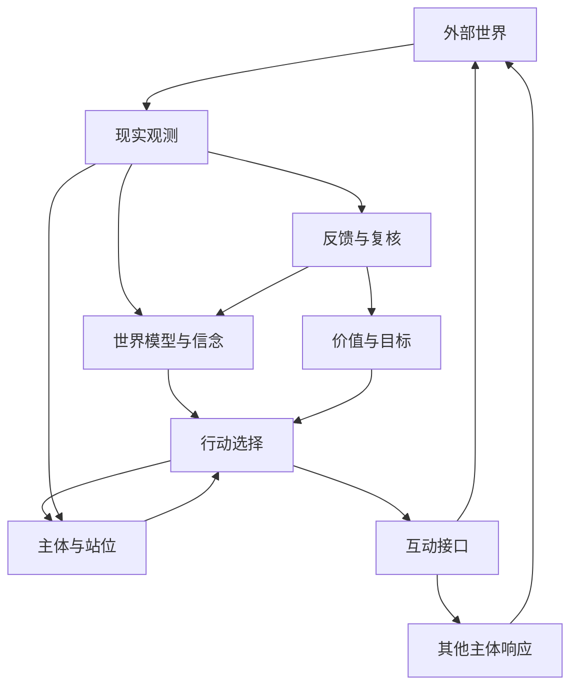

# 反身实践私典

版本：2.0.0　｜　生效基准日：2026-10-15　｜　协议版本：RP-2.0.0

## 世界—主体—价值—互动—决策—演化的统一闭环理论

> **总命题**：有限主体并不直接掌握世界，而是在约束与不确定性中形成关于世界的条件性认识；主体依据其价值目标、现实站位与行动能力选择干预；干预既改变外部状态，也改变其他主体的认知与策略，并反过来改变行动者自身。有效实践以可检验的因果假设为中介，以有限风险内的行动为方法，以可校准的反馈为认识来源，以主体的持续生存、价值实现和未来选择权为边界。

---

# 卷首　理论总纲

## 0.1 理论对象

反身实践研究如下问题：在由物质条件、制度规则、社会认知、多主体行为与非线性反馈共同生成的动态环境中，一个认知与资源均有限的主体，如何形成相对可靠的条件判断，识别可干预变量，依据自身价值与约束选择行动，并通过实践结果持续修正对世界、对自身和对行动机制的认识。

其对象不是孤立的外部世界，也不是脱离环境的个人意志，而是**主体—环境耦合系统**：

1. 世界对主体施加约束，并提供不均等的机会与入口。
2. 主体以有限信息构造世界模型，模型影响注意、选择与行动。
3. 主体行动通过具体机制改变部分环境状态。
4. 其他主体能够感知、解释并回应这种改变。
5. 行动结果反过来改变主体的资源、能力、信念与目标。
6. 连续的互动改变未来状态的分布，而不保证任何单一路径的实现。

因此，反身实践同时具有六重属性：世界分析、主体设计、价值判断、因果辨识、序贯行动与反馈治理。

## 0.2 适用边界

本理论是一套面向开放复杂系统的**分析—决策—行动框架**，不是关于一切现象的完备解释，也不是无需证据即可适用的预测定律。

其可适用性受以下条件约束：

- **可观测性**：关键现象至少具有部分可观察的事实或代理信号。
- **可干预性**：主体能够识别至少一种现实行动，或者能够通过信息获取改变未来决策。
- **价值可说明性**：主体能够说明正在保护和追求的价值，或明确将价值澄清本身作为当前任务。
- **风险可治理性**：行动边界与重大不可逆损失能够事前识别并受到限制。
- **可修正性**：模型中的判断能够接受反证、保留不确定性并根据新信息改变。

对缺少干预条件的问题，理论仍可承担认识与解释任务，但不能虚构可操作接口；对无法可靠验证的问题，必须明示判断边界；对触及专业性高风险的判断，必须引入相应专业证据与独立审查。

## 0.3 三类命题

理论中的语句须区分为三类，禁止混用。

**描述性命题**描述世界状态与机制，需接受经验检验。

**规范性命题**规定主体认为值得追求或必须回避的价值，须接受价值一致性与伦理审查，不能仅凭经验数据推出。

**决策性命题**在特定事实、价值与资源约束下选择行动，须同时满足描述性可靠性和规范性可接受性。

理论不能仅因某次行动获得有利结果，就把规范选择升格为普遍事实；也不能仅因某种行为有效，就推定它值得实施。

## 0.4 基本原则与规范承诺

1. **有限主体原则**：主体的认知、资源、时间、注意力与执行能力均有限。
2. **模型非现实原则**：任何世界模型都是有目的的信息压缩，不等同于现实本体。
3. **条件判断原则**：判断只在其事实、时间、场域和结构条件内成立。
4. **反身耦合原则**：主体的认识可能经由行动改变被认识的系统。
5. **因果优先原则**：相关、解释与可干预的因果效应必须区分。
6. **价值先于优化原则**：优化能力是手段，主体所承认的价值及边界决定优化方向。
7. **接口有限原则**：行动只能通过现实存在的作用路径影响系统。
8. **多主体响应原则**：涉及其他行动者的策略，应考虑对方的认知、激励和后续调整。
9. **不确定性显式原则**：无法证明的确定性不得以语言强度代替。
10. **反馈可错原则**：观测记录可能包含测量和记录误差，对观测的因果解释也可能错误；两层误差分别审查。
11. **序贯选择原则**：信息获取、保持等待、投入与退出均属于可比较的行动。
12. **不可逆优先原则**：必须先限制不可承受的损失，再讨论潜在收益。
13. **选择权原则**：未来行动资格与选择集合具有独立决策价值。
14. **目标可修正原则**：价值实现不能被固定手段或既有目标永久绑架。
15. **结构更新原则**：反馈可以改变信念强度、模型结构、行动规则和主体能力。
16. **元治理原则**：理论自身的有效性、复杂度和使用代价同样接受检验。
17. **责任不可转移原则**：模型、自动化系统与外部建议不能替代行动主体的责任承担。
18. **局部有效原则**：一个领域中的有效机制不得未经检验直接外推至其他领域。

这些原则分别承担描述、规范或程序约束功能，不构成由同一组形式公理演绎全部结论的证明系统。规范承诺应明确其采纳者、适用范围和冲突处理方式。

## 0.5 基础对象与记号

为避免不同层次混淆，本理论使用以下统一记号。

| 记号 | 名称 | 定义 |
|---|---|---|
| \(W_t\) | 世界状态 | 时刻 \(t\) 客观存在而不能被主体完整直接获知的外部状态 |
| \(\widehat W_t\) | 世界模型 | 主体对世界状态、机制与约束的可修正表示 |
| \(U_t\) | 主体结构 | 主体的资源、能力、状态、自我叙事与执行机制 |
| \(P_t\) | 主体站位 | 主体在世界中的信息、资源、关系与制度位置 |
| \(V_t\) | 价值系统 | 当期承认的价值承诺、优先关系及其版本；其中部分承诺具有较高稳定性 |
| \(G_t\) | 目标结构 | 特定时期从价值系统导出的阶段目标及行动目标 |
| \(B_t\) | 信念状态 | 对环境状态、机制和未来路径的证据条件性认识 |
| \(I_t\) | 互动接口 | 主体行动能够影响外部变量的具体作用通道 |
| \(H_t\) | 机制假设 | 关于干预、作用路径和结果之间关系的待检验陈述 |
| \(L_t\) | 杠杆结构 | 在既定目标、约束和周期下可能产生较高净作用的干预位置 |
| \(a_t\) | 行动 | 主体当期作出的观察、探针、蓄势、维持、加码或撤回选择 |
| \(O_{t+1}\) | 观察结果 | 行动之后获取的外部与内部观测记录 |
| \(F_{t+1}\) | 反馈解释 | 对观察结果的因果归因、预测误差分析与模型修正意见 |
| \(K_t\) | 治理边界 | 伦理、法律、安全、最大损失与不可逆限制 |
| \(\Pi_t\) | 行动策略 | 根据可用信息与约束决定下一步行动的规则 |

这些记号表示概念对象及其关系，不预设全部变量均可数值化。未定义测量方法、映射形式或识别条件时，符号关系只具有**结构表达**意义，不具有自动计算能力。

## 0.6 主体—世界总闭环

| 环节 | 核心关系 |
|---|---|
| 问题与现实边界 | 确定问题、信息截止、世界模型、约束、场域与时间 |
| 主体与价值 | 识别主体与站位，澄清价值目标及实现目标所需的主体条件 |
| 接口与解释 | 识别互动接口，比较机制与竞争假设，审查因果证据 |
| 候选与选择 | 形成杠杆候选，考虑战略响应，比较价值、风险与选择权 |
| 承诺与行动 | 冻结所选方案，确定相位、规模、权限与反馈条件 |
| 观测与学习 | 记录实际变化，评估结果和归因，校准预测与信念 |
| 更新与接续 | 分别更新相关模型与记录版本，保留历史承诺并进入下一轮 |

治理边界 \(K\) 贯穿所有环节；价值系统 \(V\) 对目标与手段的正当性保持独立约束；多主体回应和环境变化在行动之间持续发生。

---

## 0.7 四种不能互相替代的有效性

**概念有效性**要求对象定义清楚、层次一致且不发生循环偷换。**经验有效性**要求描述或机制命题在声明的条件内获得支持。**程序有效性**要求运行规则能够被执行、复核并相对合理基准改善决策。**规范正当性**要求价值承诺、权限与他人权利能够获得相应论证。

四者分别承担证明责任。概念自洽不保证机制成立，经验成功不自动使行动正当，程序完整也不自动使决策优于简单方法。理论中尚无检验结果的主张，应保持待验证身份。

## 0.8 事实状态、认知状态与档案状态

现实发生变化、主体得知变化、记录完成变化，是不同事件。每项关键记录应尽可能区分发生时间、获知时间、记录时间与规则生效时间。无法确定的时间应明确未知，不得用记录时间冒充发生时间。

世界状态 \(W_t\) 不由解释直接改写；主体更新的是 \(\widehat W_t\) 与信念 \(B_t\)。行动导致的现实变化需要另行记录证据。档案保存已经作出的判断及其依据，更新通过新增版本表达，不追溯改写原有认识。

---

# 第一卷　世界的生成结构

## 1.1 世界不是静态对象集合

世界由相互作用的资源、制度、认知、行动和反馈过程生成。主体在任何特定时刻所观察到的现实，都是前序状态、外部冲击、参与者行为与系统约束共同作用的阶段性结果。

世界分析至少包含七个相互联系但不可直接相乘的维度：

1. **物质条件 \(M\)**：时间、空间、能源、身体、资本、信息载体和技术设施。
2. **约束结构 \(C\)**：物理极限、契约、制度、资源瓶颈、机会成本及行为边界。
3. **社会场域 \(S\)**：组织结构、市场规则、平台、评价机制及资源分配系统。
4. **认知叙事 \(N\)**：信念、预期、身份、信任、合法性感知与意义结构。
5. **多主体行为 \(D\)**：不同主体在各自信息、激励与能力条件下形成的行动。
6. **反馈结构 \(Q\)**：强化、抑制、延迟、锁定、抵消与非线性响应。
7. **时间状态 \(T\)**：结构演进、路径依赖、外部冲击与阶段转换。

概念上可表述为：

\[
W_t=\mathcal W(M_t,C_t,S_t,N_t,D_t,Q_t,T_t)
\]

其中 \(\mathcal W\) 代表尚待具体领域定义的系统构成关系，而非已知的数值函数。

## 1.2 物质、制度与叙事的区分

物质条件规定某些行为的可实现性边界；制度规则改变行为的许可、成本和激励；认知叙事通过影响主体选择而作用于现实。

三者不可化约为彼此。

- 物质约束不能仅因认知改变而消失。
- 制度边界不能仅因个体意愿而被合法取消，但可能通过制度允许的程序改变。
- 叙事不能直接替代物质条件，却可能通过投资、协作、协调和预期形成现实效应。

对于任何约束，必须说明其**作用层级、时间尺度、主体权限与改变条件**。所谓硬约束不是脱离时空的抽象标签，而是相对于当前主体与决策期限的可行性判断。

## 1.3 三层约束

**硬约束 \(C_h\)**：在给定行动周期、技术与权限条件下无法有效改变，或违背即造成不可接受后果的边界。

**半硬约束 \(C_m\)**：短期改变成本高，但可通过训练、积累、组织改造、技术进步或场域迁移逐步改变的条件。

**软约束 \(C_s\)**：主要由规则安排、信息分布、协调惯例、身份共识与激励机制维持，可通过合法、正当的互动产生较低成本改变的条件。

三类约束应以**当前可改变性**而不是表面来源分类。约束类型会随资源、时间尺度与制度环境改变。

## 1.4 社会场域与位置效应

场域是一组相对稳定的参与规则、资源分配规则和评价规则。它决定哪些行为被奖励、哪些能力具有交换价值、哪些信息能够到达主体，以及哪些行动需要获得许可或合作。

一个主体的能力不能脱离场域单独估值。能力发挥受以下因素制约：

\[
\text{实现效果}=\Phi(\text{能力},\text{场域},\text{站位},\text{协同},\text{时间})
\]

这个表达式是结构关系，具体估计必须另行建立模型。

对场域的分析必须同时识别：入口、收益规则、退出成本、关键依赖、信息不对称与制度可变性。

## 1.5 反身性机制

反身性包含两个方向相反而相互耦合的过程：

- **认知过程**：主体根据有限观测形成对现实的解释。
- **参与过程**：主体根据解释实施行动，行动可能反过来改变现实。

如果参与过程改变了认知所指向的对象，主体便处于反身性结构中。

反身性作用强弱取决于主体行动的覆盖范围、参与者对信号的敏感程度、规则与资源弹性、反馈时滞以及其他主体的回应。

并非一切观察都会显著改变被观察对象，也并非一切叙事都能转化为现实力量。反身性必须具有可说明的中介机制。

## 1.6 系统边界与外部性

分析必须先界定系统边界：哪些变量被视为内部状态，哪些是外部条件，哪些是尚未观测到的影响因素。

系统边界过窄，容易误把外部冲击当作内部机制；边界过宽，容易导致无法识别、无法行动与无法验证。

适当的边界应服务当前问题，允许根据证据动态扩展，并持续审计对其他主体、其他时间尺度及环境的外部性。

---

# 第二卷　动态回路与时间结构

## 2.1 因果链与反馈回路的区别

因果链指具有方向的作用路径；反馈回路指作用结果经由其他路径返回并影响原变量的闭合结构。

一个系统可能具有明确的因果链而不存在强化回路；一个观察到的循环关联也可能并不代表真实反馈。

回路识别需要至少说明：节点、边、影响方向、时间延迟、中介条件、非线性阈值与可能的共同原因。

## 2.2 六类动态结构

**强化回路**：某一变化经由反馈过程进一步强化自身，但其增益可能随状态改变。

**平衡回路**：某一变化触发抵消力量，使系统趋向局部约束或调节目标。

**锁定回路**：既有资源配置、制度激励或主体认知使偏离现状的行动持续面临较高成本。

**反转机制**：原有强化过程中积累的约束、竞争、脆弱性或资源压力，使边际效果逐渐减弱乃至改变方向。

**延迟回路**：行动与结果之间存在时间延迟，使主体容易误判即时反馈或产生过度调整。

**耦合回路**：多个反馈过程相互作用，使局部效果不能简单叠加为全局效果。

回路类别是分析语言而不是直接证据。确认真实回路，需要观察不同状态下的响应、机制证据与必要的干预检验。

## 2.3 主导张力

主导张力是当前系统中对目标偏离、结构不稳定或未来状态分布具有较大解释和干预意义的冲突关系。

主导张力的判断应区分：

1. **显著性**：该变量是否容易观察或引发强烈感受。
2. **因果贡献**：该变量改变时是否实质影响目标结果。
3. **可干预性**：主体是否具备改变该变量的路径。
4. **决策价值**：干预后的净收益是否优于替代方案。

显著变量未必是主导张力；主导张力未必可干预；可干预的张力未必值得优先处理。

## 2.4 周期作为潜在状态

周期不是所有系统都必然依次经历的固定序列，而是描述主要机制和系统响应特征的**潜在状态模型**。

可使用以下状态词汇：萌芽、扩张、饱和、失稳、收缩、重组、再稳定。

这些状态可以共存、重复、跳跃，也可能在不同层级与时间尺度上同时出现。

周期判断应以相应领域可定义的观测变量支持，包括增长、边际回报、参与者结构、约束压力、响应速度与状态持续性。

不允许单凭叙事热度、局部波动或少量观察直接推定阶段转换。

## 2.5 多尺度演化

同一行为在短期、中期和长期可能具有不同效果。

短期正反馈可以伴随长期资源透支；短期负反馈也可能伴随长期能力积累。因此，一项决策至少需要区分：

- 立即效应与延迟效应；
- 一阶效应与战略响应后的二阶效应；
- 局部效应与系统级外部性；
- 状态改善与结构改变；
- 可逆波动与不可逆路径改变。

任何对趋势、拐点和时机的判断，均应注明分析尺度和有效期限。

---

# 第三卷　有限主体与站位模型

## 3.1 主体的结构性定义

主体不是固定人格标签，而是在特定环境中持续感知、判断、选择和执行的有限行动系统。

\[
U_t=(R_t^{u},K_t^{u},E_t^{u},N_t^{u},A_t^{cap},\Gamma_t)
\]

其中：

- \(R_t^{u}\)：可调用资源及其流动性；
- \(K_t^{u}\)：知识、技能和完成任务的可靠能力；
- \(E_t^{u}\)：体能、认知负荷与情绪调节状态；
- \(N_t^{u}\)：自我叙事、身份理解和惯常预期；
- \(A_t^{cap}\)：行动组织、执行与恢复能力；
- \(\Gamma_t\)：资源和能力之间的协调结构。

主体的有效能力不仅取决于各项要素的水平，也取决于要素之间能否协同。

## 3.2 站位与主体的区别

主体结构描述行动者拥有什么；站位描述这些结构嵌入世界之后能够接触什么。

站位至少包括：资源位、能力位、信息位、关系位、制度位和叙事位。

站位决定信息样本的来源、外部合作的可达性、行动的边际成本与目标的可行集合。

主体可以通过能力积累改变站位，也可以通过改变站位释放已有能力。两条路径需要分别评估成本、时间和可逆性。

## 3.3 有限理性的边界

有限主体必然面对不完备信息、样本偏差、注意力稀缺、记忆限制、估计误差、情绪影响与执行成本。

有限理性不意味着放弃理性，而是意味着理性必须包含自身的成本。

若继续分析的期望增量收益低于分析消耗及窗口损失，则停止分析并采取受控行动可能更合理；若错误可能导致不可逆损害，则进一步取证和独立审查的价值相应提高。

## 3.4 内部反身性

主体对自身的解释改变其行为倾向；行为结果再影响主体的能力、资源和自我解释。

\[
N_t^{u}\rightarrow E_t^{u}\rightarrow a_t\rightarrow O_{t+1}
\rightarrow N_{t+1}^{u}
\]

这只是内部反身性的简化结构，并不排除外部因素和双向影响。

自我叙事既可能帮助主体组织行动，也可能锁死身份和能力评估。内部治理的目的不是持续制造正面叙事，而是形成与证据相容、能够维持行动能力的可修正自我模型。

## 3.5 目标反推主体结构

在世界条件 \(W\) 与目标 \(G\) 既定时，目标所需的主体结构不是唯一模板，而是一组可行结构：

\[
\mathcal U^{*}(W,G,K)=\{U:\exists\,\Pi\text{ 使目标在治理约束内具有可接受实现可能}\}
\]

主体设计的关键不在于抽象地提高所有能力，而在于寻找当前能力与目标可行条件之间的关键差距。

差距可归入：资源、能力、状态、关系、信息、身份与行动系统。应优先处理能扩大可行行动集合、改善多个目标或降低结构性瓶颈的差距。

## 3.6 自我工程的边界

主体改造本身消耗资源，也可能损害健康、关系和自主性。

主体不能仅被视为实现目标的工具。其基本安全、尊严、恢复能力与长期完整性属于独立价值约束。

因此，主体设计应满足：目的正当、负荷可持续、改变可观察、可必要时中止，并保留对目标本身重新评价的权利。

---

## 3.7 主体、站位与环境的关系一致性

主体结构与站位是相互联系的分析视角，不应作为互相独立的资源重复计算。站位是主体与环境之间的关系状态；同一项资格、关系或资产若在多个视角出现，应标明它们指向同一现实对象。

能力不足、进入受限、目标不适配与执行失误应分别诊断。主体改造和场域迁移必须与继续使用现有条件的方案进行比较，不能预设自我改造总是优先。

---

# 第四卷　价值、目标与选择权

## 4.1 价值与杠杆的层级区分

**价值 \(V\)**回答何种生活状态、关系、实践和结果值得主体追求。

**杠杆 \(L\)**回答主体能够以怎样的结构性方式更有效地影响现实。

杠杆是能力与位置，不自动构成终极价值。能力扩大不必然意味着价值实现；局部收益增加也不必然意味着主体整体境况改善。

## 4.2 价值结构

价值系统应同时容纳：

1. **终极价值**：自身值得追求而非仅作为其他目标手段的状态。
2. **工具价值**：有助于实现其他价值的能力、资源与位置。
3. **底线价值**：不能以常规收益交换的安全、权利和伦理边界。
4. **关系价值**：不以单方收益耗尽为代价的互信、承诺与共同利益。
5. **选择权价值**：未来进行不同价值实践的能力。

价值之间可能不可通约。主体可以明确优先关系、设置不可侵犯的底线，或采用多目标的非劣解，而不必将一切强制压缩成单一数字。

## 4.3 四层目标结构

- **\(V\)：价值层**——决定何种结果值得追求以及不能付出何种代价。
- **\(G_0\)：战略能力层**——规定长期希望维护或扩大的主体能力、自由度与选择权。
- **\(G_1\)：阶段结果层**——规定在明确时间范围内要实现的可识别状态。
- **\(G_2\)：行动改变层**——规定当期可实施、可观察、可复核的最小状态改变。

目标之间并非单向命令关系。下层结果可能促使上层重新澄清，价值冲突也可能导致目标组合整体重排。

## 4.4 目标冲突与多目标选择

目标间存在资源竞争、时间冲突、风险相关性与不可逆机会损失。

多目标决策至少审查：

- 各目标是否与核心价值一致；
- 不同目标对稀缺资源的竞争强度；
- 哪些目标具有期限和不可恢复的窗口；
- 哪些目标具有协同或相互削弱作用；
- 哪些损失不能通过其他收益补偿；
- 决策是否仍保留未来重新配置资源的能力。

在无法合理合成单一效用时，采用**帕累托非劣性、底线筛选、序关系和情景稳健性**进行判断。

## 4.5 未来选择权

未来选择权指主体在未来能够进入的可行行动集合，以及这些行动在未来信息条件下的可实现性。

选择权价值不是选择数量越多越好；无价值、不可执行或维护成本过高的选择不构成有效自由度。

保留选择权应特别关注：流动性、技能可迁移性、关系可信度、身份与合规资格、身体与认知能力、信息获取渠道及退出成本。

## 4.6 目标再评价机制

出现下列条件时，应重新评价目标而不只是修改执行方法：

1. 目标结果与核心价值持续背离；
2. 新信息改变了目标的真实成本或收益；
3. 主体价值排序或生活条件发生实质变化；
4. 目标达成依赖不可接受的伦理或安全代价；
5. 长期投入不断缩小主体未来的有效选择集合。

目标修正不等同于逃避困难。区分目标无效、路径无效与执行不足，需要分别保留相应证据。

---

## 4.7 价值冲突的裁决程序

首先将限制分为不可由当前主体自行解除的权利与法律边界、主体事前承诺的最低生存与恢复条件，以及可以权衡的目标偏好。说明每项限制的依据、适用期限、触发定义和有权解释或修订的主体。

在可行集合中，先排除被其他方案明确支配的方案；再比较剩余方案对高优先价值、阶段目标与未来能力的影响。帕累托非劣性只能缩小集合，不负责产生唯一答案。

若方案仍不可比，决策应明确给出以下一种输出：条件性推荐及其反转条件；需要补充的价值排序；能够区分方案的信息任务；或在决策期限内采用的最小可承受承诺。不得以未定义的综合评分制造唯一最优的外观。

当底线之间冲突或可行集合为空，应公开冲突，重新审查目标、期限、行动范围和合法替代路径，并区分主动造成的损害与无法完全避免的现实损失。不得通过重新命名损害或提高收益评分使被禁止方案自动恢复资格。

## 4.8 价值变化与双重评价

价值系统包含相对稳定的承诺和可经反思调整的排序。价值变更须与新知识、生活条件变化或独立规范理由相联系，不能仅由某次结果有利与否驱动。

每次实质变更应同时保留：按事前目标评定的达成结果，以及按当前价值评定的继续行动意义。后者可以改变下一轮决策，不能把前者的未达成追认为达成。旧目标的评价口径、有效期间与未完成责任保持可追溯。

主体可以在知情、自愿并具备相应能力的条件下承担有意义的风险。生存与恢复阈值属于明确的治理承诺，不等于要求所有人对任何风险采用相同偏好。

---

# 第五卷　互动接口与可干预性

## 5.1 互动接口的定义

互动接口是行动影响目标对象状态或行为分布的因果作用通道。通道的存在属于描述性判断；主体能否实施属于能力与权限判断；是否允许实施属于规范判断。

记实际或候选通道集合为 \(\mathcal I^{possible}\)，当前可实施集合为 \(\mathcal I^{feasible}\)，经治理筛选后可采用集合为 \(\mathcal I^{admissible}\)。实际行动只能从最后一个集合中选择。三种集合均可存在认识误差。

\[
I:\quad a\longrightarrow X\longrightarrow Y
\]

其中 \(a\) 是可执行输入，\(X\) 是实际受到影响的中介机制，\(Y\) 是目标相关结果。箭头表示待验证的因果方向，不表示已经证明的作用。

接口存在不等于作用显著，作用显著不等于值得干预，值得干预不等于允许无限投入。

## 5.2 四类作用对象

| 类型 | 判定标准 | 一般处理原则 |
|---|---|---|
| 当前不可干预 | 在所需时间和权限内缺少现实作用路径 | 适应、规避、等待或改变问题边界 |
| 间接可干预 | 需要改变前置能力、资源、关系或制度条件 | 蓄势、能力构造、协作与长期投入 |
| 直接可干预 | 存在可实施且可观测的行动路径 | 设计探针、评估干预价值 |
| 不应干预 | 虽存在作用路径，但违反底线或造成不可接受损害 | 排除、退出或重设目标 |

这些类别具有主体相对性与时间相对性，不是对象永久不变的本质属性。

## 5.3 五类社会互动接口

**信息接口**改变信息到达、可理解性和信息不对称结构。

**激励接口**改变行动者对收益、成本、责任和风险的预期。

**规则接口**改变许可边界、默认路径、协作程序与执行惯例。

**叙事接口**改变对事实、身份、合法性和未来预期的解释结构。

**关系接口**改变可信承诺、协作可得性、互惠条件与协调成本。

具体互动通常同时涉及多个接口，但须识别其实际发生作用的中介机制，避免将沟通、曝光或接触本身误判为有效改变。

## 5.4 接口评价维度

每个候选接口至少评价九个维度：

1. 作用路径的因果可信度；
2. 主体的实际权限与执行能力；
3. 影响强度及其不确定性；
4. 反馈可观察性和时间延迟；
5. 实施成本及机会成本；
6. 可逆性、依赖性与退出成本；
7. 他方的回应及策略抵消；
8. 对核心价值和第三方的外部性；
9. 与其他可选干预的相对价值。

不存在通用的简单相乘评分，可以在具体领域建立相应的估计与排序方法。

## 5.5 层级转移

当目标变量缺少直接接口时，允许进行层级转移：从直接改变结果转为改变中介机制，从改变中介机制转为提升主体条件，从改变主体条件转为更换环境入口。

层级转移必须有明确成本和目标关联，不能以不断更换抽象层次逃避“当前不存在可行动路径”的结论。

---

## 5.6 接口发现与不可达结论

接口搜索围绕可改变的输入、中介条件、资源配置、进入资格、协作关系、规则权限与环境选择展开。每个候选接口须标明实际执行者、最小动作、预期受影响变量、来源依据与尚未验证的连接。

无法找到当前可达接口时，应保留不可达结论，并比较适应、等待、能力构造、协作、迁移与目标调整。搜索次数或分析篇幅不构成接口存在的证据。尚无作用证据但损失可控的候选，只能以探索身份进入决策。

---

# 第六卷　多主体互动与战略响应

## 6.1 多主体世界的基本结构

涉及行动者的世界，不仅是客观状态随时间变化的系统，也是参与者根据各自信息、信念、激励和预期互相调整的战略系统。

对于主体 \(i\)，其行为可概念性写为：

\[
a_{i,t}=\pi_i(\mathcal I_{i,t},B_{i,t},G_{i,t},C_{i,t},\widehat a_{-i,t})
\]

其中 \(\mathcal I_{i,t}\) 为可获得的信息，\(B_{i,t}\) 为信念，\(G_{i,t}\) 为目标，\(C_{i,t}\) 为约束，\(\widehat a_{-i,t}\) 为对其他主体行为的预期。该式表示决策依赖关系，不预设完全理性或已知行为函数。

## 6.2 五个战略要素

分析任何存在相互依赖的行动场域，至少识别：

1. **参与者集合**：哪些主体能影响结果及规则。
2. **信息结构**：各方看到什么、隐藏什么、相信什么。
3. **偏好与激励**：各方希望实现何种结果以及必须承担何种成本。
4. **行动集合**：各方能够选择、承诺、撤销或阻止什么。
5. **响应结构**：一方行动后其他主体最可能怎样调整，以及这种调整如何反作用于最初行动者。

识别激励不等于推定所有行为均出于单一利益；规范、习惯、误判、有限理性与身份认同同样会影响策略。

## 6.3 一阶效应与战略响应

主体行动可以产生直接结果，也可以引起其他主体改变行动，进而改变原有结果。

主体选择行动后，对象状态可能首先发生一阶变化。其他主体据此观察、解释和学习，并通过合作、竞争、适应或反制改变系统规则与收益条件。最初行动者因此面对新的决策条件，需要重新评价原有行动。

因此，局部干预效果不能直接外推为长期稳定回报。可复制性取决于竞争进入、制度响应、容量约束、网络结构与信息扩散。

## 6.4 均衡、失衡与路径依赖

均衡是给定规则、信息和策略条件下的一种相互稳定关系，不自动意味着效率、公平或永久持续。

现实系统也可能长期保持不稳定、周期振荡、局部锁定或多重均衡。主体不得根据单一均衡叙事推定未来唯一路径。

路径依赖意味着早期状态及既有承诺改变未来可达状态。识别路径依赖，应关注转换成本、积累效应、标准与制度的协调机制，而非仅依据历史惯性进行推断。

## 6.5 制度与机制设计

当主体不只是接受规则，还具有影响规则的能力时，决策对象应从单一行动转向参与机制本身。

机制设计关注：在主体偏好、信息和行为有限的条件下，规则如何影响参与、激励相容性、信息披露、风险转移及整体结果。

改变机制的干预一般具有更高结构影响潜力，同时也可能承担更高治理责任和更严重的外部性。

## 6.6 合作与重复互动

重复互动使声誉、信任、承诺与未来合作概率具有独立价值。

长期关系应当满足自愿性、可理解性、信息正当性与不侵犯对方基本选择权。

短期行为对长期关系的影响，需要纳入行动收益的完整核算。通过欺骗、胁迫或利用重大脆弱性获得的优势，不能作为正当杠杆。

## 6.7 战略鲁棒性审计

在采取关键行动前，至少构造以下响应集合：合作性回应、竞争性回应、规则调整、非预期模仿和不响应。

对每一种回应，评估原计划的收益、风险、可逆性与行动替代方案。若一个策略仅在其他主体完全不回应时有效，其长期可扩张性应受到特别审查。

---

# 第七卷　认识论、证据与不确定性

## 7.1 信念不是事实

事实陈述、观测记录、模型推断、主观判断和行动建议必须分开保存。

主体所拥有的不是未经中介的世界全貌，而是处于特定观测位置的信息集合及由此形成的信念状态。

\[
B_t=\operatorname{Update}(B_{t-1},O_t,\mathcal M_t)
\]

其中 \(\mathcal M_t\) 是当前使用的测量与解释模型。模型本身也可能错误，因此对信念的更新不能只依赖观测数量，还须审查信息生成过程与模型条件。

## 7.2 不确定性的类型

**随机性不确定性**来自在模型条件下仍然存在的状态波动。

**认识性不确定性**来自未知参数、数据不足、测量误差和机制认识不足。

**结构性不确定性**来自模型遗漏、制度改变、行为机制转换和不可预见的反馈耦合。

**战略性不确定性**来自其他主体的隐蔽信息、可变目标与反制行动。

**价值性不确定性**来自主体对自己真正追求何种结果尚未澄清。

对不同不确定性，不能统一采用“增加信息”这一种方法。部分不确定性可以通过学习减少，部分需要稳健决策、分散暴露或保留选择权。

## 7.3 证据的四项独立属性

评价证据须同时考虑：

- **可靠性**：来源与测量是否可信、可复核。
- **相关性**：是否直接支持当前命题或结果变量。
- **识别力**：能否区分相互竞争的机制解释。
- **可迁移性**：结论能否合理延伸到目标时间、规模及场域。

证据数量不等于证据质量。多个相互依赖的信号，不能机械地当作同等数量的独立证明。

## 7.4 证据状态分层

| 状态 | 描述 | 推理资格 |
|---|---|---|
| 待证判断 | 直觉、叙事或未核实陈述 | 仅供生成待检验命题 |
| 初步观测 | 有记录但样本有限或来源单一 | 约束假设范围，支持低风险探索 |
| 复现性观测 | 在可比较条件下得到重复证据 | 支持条件性规律判断 |
| 因果性证据 | 对主要竞争解释进行了合理排除 | 支持有限范围内的干预估计 |
| 可外推证据 | 具备跨时段、场域或规模的有效性依据 | 支持相应范围的扩大应用 |
| 专业约束证据 | 具有法定、医学、安全或其他领域权威性及适用条件 | 用于高风险边界与专业决策审查 |

该表是证据功能的区分，不是简单从低到高的统一分数。专业证据也要审查适用范围、时效和具体对象；单个因果研究不自动具有跨场域外推能力。

## 7.5 竞争假设结构

面对关键现象，至少保留：

- 主解释 \(H_1\)；
- 最强竞争解释 \(H_2\)；
- 当前未识别因素或模型失配的可能性 \(H_{\varnothing}\)。

判断的质量不取决于解释有多完整，而取决于它能否作出与竞争解释不同的可观察预期。

最强反证不是形式性地列出反对意见，而是主动识别能够实质降低主假设可信度的条件。

## 7.6 概率信念与校准

当存在可解释的先验信息、重复事件和足够数据时，可以以概率表达信念强度：

\[
P(H\mid D)\propto P(D\mid H)P(H)
\]

概率必须对应明确的命题、时间范围及参考类。没有可靠量化基础时，应使用有边界的定性不确定性表达，不得制造虚假的小数精度。

在可反复预测的领域，应以事前预测与事后结果评价概率校准、分辨能力与稳定性。预测正确率不能代替校准检验；在基准概率极不平衡时尤其如此。

## 7.7 信念更新与停止规则

新证据可能导致五种结果：提升可信度、降低可信度、重新分配假设权重、修改假设结构、暂不作实质改变。

“暂不改变”也是一种可能合理的更新结果，前提是已审查新证据的信息量。

信息获取应在其预期改善未来决策的价值小于成本与时机损失时停止；高风险情形还需考虑专业审查与尾部损失。

---

## 7.8 效果、机制与行动依据

净干预效果、内部作用机制和当前行动的可接受性是三个不同问题。可信的比较研究可能支持某种干预效果，而尚不能解释全部中介机制；清晰的机制叙述也可能缺少净效果证据。

证据审查分别记录效果支持、机制支持、迁移条件及风险约束。机制未知时，限制外推并监测副作用；效果未知时，按探索行动评估信息收益和损失预算。低风险探索不必先证明它要检验的命题，高后果承诺也不能仅凭机制叙述获得许可。

概率信念可以表达单次事件的主观不确定性，但须说明依据并避免虚假精度。统计校准需要一组定义一致、事前登记且已经到期的可比较预测；不能从一个事件推断长期校准水平。

---

# 第八卷　因果识别与反事实推断

## 8.1 从相关到干预

观察两个变量同时变化，只能说明存在统计或经验联系，不能直接证明对其中一个变量施加干预会引起另一个变量变化。

有价值的杠杆识别至少应明确：

1. 目标结果变量；
2. 可实施的干预变量；
3. 中介机制；
4. 可能的共同原因；
5. 反向因果路径；
6. 选择偏差与测量偏差；
7. 其他主体响应；
8. 干预效果的适用边界。

## 8.2 因果结构

对机制假设 \(H\)，应建立由节点与方向边组成的最小充分因果结构。

结构必须说明哪些关系来自理论推定，哪些来自观测支持，哪些尚需实验识别。

节点增多不等于解释增强。只加入能够改变因果识别、行动选择或风险判断的变量。

## 8.3 反事实问题

行动决策真正需要估计的不是“行动之后发生了什么”，而是：在可比较条件下，采取行动与不采取行动会造成怎样的结果差异。

以潜在结果表述：

\[
\tau=\mathbb E[Y(1)-Y(0)]
\]

其中 \(Y(1)\) 与 \(Y(0)\) 分别表示接受和未接受某一特定干预时的潜在结果。对同一对象同一时刻，两种潜在结果不能同时直接观察，因而因果效应依赖识别假设和研究设计。

在涉及多主体相互影响时，应另外审查主体间干扰；干预对他人行为产生影响时，简单的独立潜在结果框架可能不再适用。

## 8.4 因果识别路径

在伦理、资源和可实施条件允许时，可优先考虑具有有效对照和事前指标的干预设计。

无法实施严格对照时，可根据领域条件评估准实验、自然实验、分阶段实施、时间序列、机制追踪或其他观测识别方法。

识别方法的选择必须公开关键假设；未经检验的前提不得隐藏在技术术语之下。

若缺少可信识别条件，结论应退回到“机制候选”或“相关性判断”，不能宣称已经确认干预效果。

## 8.5 试验的识别质量

有效探针必须能够提供决策相关信息，而不仅仅产生可记录的活动结果。

探针设计应包含：

- 一个明确的主要待识别命题；
- 事前定义的主要结果指标；
- 对照或反事实估计方法；
- 主要混杂因素的处理计划；
- 最短合理观测周期；
- 可接受的执行偏离范围；
- 样本或信息量不足时的处理规则；
- 预先设定的停止条件与风险预算。

## 8.6 可迁移性与规模效应

局部干预效果只有在关键机制与约束保持足够相似时，才有理由外推。

扩大规模可能改变参与者构成、资源价格、竞争反应、制度约束和系统反馈。

因此，探针成功仅能证明在其识别条件下存在一定支持，不构成无限扩张的依据。每一次明显的规模跨越都可能需要重新验证。

## 8.7 因果审计的最小输出

```text
目标结果 Y
可实施干预 a
主机制 H1
最强竞争机制 H2
关键共同原因 C
可区分预测 D
识别方法 ID
可接受的反事实假设 A_id
适用边界 Scope
证据不足处 Unknown
```

---

## 8.8 序贯干预与适应性识别

多轮行动会改变后续样本、资源和对方策略。审查应区分当轮局部效果、整个策略序列的效果以及观察到的总体状态变化。前一轮行动影响后续混杂因素时，不可把各轮结果当作独立同分布样本机械合并。

事前指定主要指标、有效观察窗口与允许的适应规则；新增指标和临时分析作为探索性内容另行登记。风险停止与统计证据阈值分别制定。频繁查看结果、选择最好时点或只保留成功批次，会改变证据解释资格。

无法可靠构造反事实时，可以报告观察变化、执行可靠性和机制支持程度，但不得把观察差额直接命名为因果净收益。

---

# 第九卷　杠杆生成与结构性效应

## 9.1 杠杆的定义

杠杆不是重要性、可操作性或反馈强度中任一因素的别名。

**杠杆是主体在特定价值目标、资源约束、系统结构与时间窗口中，通过某一可实施干预，获得相对投入具有较高净价值的结构性影响的可能位置。**

杠杆判断涉及两项不同命题：

- **因果命题**：在特定条件下，干预能够通过某种机制影响目标状态。
- **决策命题**：与其他可选行动相比，实施该干预更符合主体价值、资源和风险条件。

前者未成立，不得以预期收益倒推机制存在；后者未成立，不得仅因机制存在就主张投入。

## 9.2 杠杆生成序列

1. 将问题原子化，定义可观察或可干预的变量。
2. 识别约束与主导张力，重构相关动态回路。
3. 建立竞争机制与因果假设，审查周期与战略响应。
4. 筛选可互动接口，形成并比较候选杠杆。
5. 设计能够区分解释的探针，形成条件性命中假设。

各环节的展开深度可以依据任务复杂度调整，因果识别、价值比较与治理边界保持完整覆盖。采用简约协议属于需要明确声明的程序选择，不能默默省略模块。

## 9.3 原子化原则

原子化是把含混问题拆解为能够定义、观察或干预的变量及其关系。

适当原子化应保持三种一致性：

- **语义一致性**：变量与所研究的问题处于同一明确意义空间。
- **层级一致性**：输入、过程、结果和评价指标不得混为一类。
- **可聚合性**：局部变量的变化与整体目标之间存在可说明的联系。

过度原子化会破坏系统耦合信息；粒度过粗则无法进行因果判断。分析粒度应由当前决策所需的识别精度决定。

## 9.4 活回路与边际作用

有效杠杆不必总处于自我强化回路。削弱有害回路、释放瓶颈、改变默认规则、建立防护边界或改善信息结构，也可能具有更高价值。

对候选杠杆，应分别评估：

1. 对目标变量的增量影响；
2. 对系统反馈增益的影响；
3. 是否改变其他主体的行为；
4. 是否提高或降低系统脆弱性；
5. 作用能否持续；
6. 是否存在边际收益递减、拥堵或反向效应。

## 9.5 候选杠杆比较

候选杠杆不能只按反馈快慢或表面收益排序，需以相同决策尺度比较：

| 评价域 | 核心判断 |
|---|---|
| 目标契合 | 是否推进经过价值审查的目标 |
| 识别可靠性 | 作用机制是否具有足够证据 |
| 主体可达性 | 当前是否拥有实施资格和执行能力 |
| 净增量价值 | 是否优于保持现状及其他可行方案 |
| 信息价值 | 实施后能否有效减少重要的不确定性 |
| 外部响应 | 他方行为是否会抵消或反转效果 |
| 可扩展性 | 扩大规模后机制能否保持 |
| 生存与可逆性 | 是否保护关键资源与未来行动资格 |
| 时间适配 | 观察窗口与真实作用周期是否匹配 |

若某候选方向存在重大不可接受风险，应先行排除，而非通过提高收益评分抵消。

## 9.6 命中假设

命中假设 \(H_{hit}\) 是关于某一干预在特定条件下能够产生目标相关结构效应的可证伪陈述。

其完备表达包括：

```text
主导问题 Problem
结构条件 Condition
主机制 Mechanism
竞争解释 Alternative
行动接口 Interface
干预命题 Intervention
可观察结果 Outcome
识别方案 Identification
适用范围 Scope
失效条件 Falsifier
风险边界 Risk
后续选择规则 Policy
```

命中假设只能作为待检验的决策输入。未经外部观测或可辨识干预支持，不得升级为已确认规律。

---

## 9.7 有界候选生成

候选生成至少覆盖当前行动基准及一个具有实质差异的替代方向。搜索可分别从瓶颈解除、资源重组、信息改善、协作与承诺、能力构造、场域迁移及目标调整进入，不要求每类都产生方案。

候选差异必须体现在作用变量、资源配置、进入条件或时序上。仅改变名称、表达强度或收益假设，不能算作独立备选方案。领域知识不足时，先将未知机制标明，并安排能够填补关键缺口的资料、观察或专业输入。

每轮搜索设置时间与候选数量预算。预算来自问题风险和决策期限，属于运行参数，不能冒充普遍规律。找不到可靠改进方案时，可以保留基准、进行受控探索或重设问题，不能为完成模板虚构杠杆。

## 9.8 方案的可辨别性

每个候选方案都应说明：相对于基准改变什么、为什么有望改善、什么证据会使其退位，以及替代方案在什么条件下更好。对各方案使用相同的观察期限、成本口径和已知条件；不对首选方案采用乐观口径而对备选方案采用悲观口径。

---

# 第十卷　决策价值与序贯理性

## 10.1 决策目标

决策是在价值与治理约束下比较可行行动及后续策略，使主体的跨期境况获得可接受的改善。多阶段决策须把后续信息、调整规则和资源需求纳入方案，不能将当前动作的短期收益当作整个路径的价值。

当目标能够合理数值化且模型条件明确时，可表示为：

\[
\pi^*\in\operatorname*{argmax}_{\pi\in\mathcal P_{admissible}}
\mathbb E[\mathcal U_{V^{(v)}}(Y_{t:t+T},U_{t:t+T})\mid B_t,\widehat W_t,\pi]
\]

其中 \(\pi\) 是包含后续调整规则的策略，\(V^{(v)}\) 是本次评价冻结的价值版本，\(\mathcal P_{admissible}\) 已经过权限、生存、风险预算和可实施性筛选。评价不要求真实转移概率已知，也不要求所有价值合成为数字。

存在无法可靠定量的价值或结构不确定性时，采用底线、优先序、非劣性、敏感性与情景稳健性，保留无法消除的比较不确定性。风险阈值、效用映射与情景集合必须说明依据，不以抽象符号代替估计。

## 10.2 六类基础行动相位

**观察态**：关键不确定性尚未足以支持有效干预，优先提高信息质量和判断清晰度。

**探针态**：存在明确待验证命题，且可以用可承受成本获取具有区分力的信息。

**蓄势态**：目标和方向具备条件性合理性，但某一重要前置能力、时机或权限尚未满足。

**维持态**：已有方案仍满足目标、效果和风险要求，在既定规模内持续执行并监测，不把稳定利用强行解释为加码。

**加码态**：已有证据支持有限范围的干预收益，风险与资源预算允许增加投入。

**撤回态**：既定停止条件触发，或继续行动的预期价值低于合理替代选择，采取停止、降级、退出或迁移。

这些是决策相位，不是主体身份。行动可以在相位之间往返，但转换理由必须可追溯。

## 10.3 探索与利用

探索旨在减少决策相关的不确定性；利用旨在从已具有相对可信效果的行动中获得目标收益。

两者竞争资源，且探索本身可能产生直接收益，利用过程也可能提供信息。

最优比例依赖：时间期限、环境变化速度、可重复机会数量、信息可迁移性、失败损失及当前策略的不确定性。

探索不应无限延长；利用也不应因为暂时成功而停止监测结构变化。

## 10.4 信息价值

信息价值不是信息量本身，而是获得某项信息后能否改变决策，并改善预期结果。

在能够计算的情形下，信息价值应以获得信息前后的最优期望决策价值之差定义，再扣除获取成本；具体估算须避免把信息价值与行动收益重复计算。

有价值的信息通常具有：对关键假设的识别力、改变行动方向的可能性、及时性、可迁移性以及相对合理的获取成本。

## 10.5 等待与选择权

等待并非天然消极。对于不可逆投入、信息会逐步改善的情形，等待可能保留后续决策灵活性。

但等待也可能造成机会窗口丧失、能力退化、关系削弱和时间成本累积。

因此，等待必须作为正式方案接受与立即行动相同的价值与风险评价，而不能以“再观察”自动获得豁免。

## 10.6 行动规模与分段投入

投入规模应根据边际收益、证据强度、风险预算、相关暴露和未来资金需求共同确定。

**小规模成功不能证明大规模收益成比例放大。** 每次明显加码都可能改变市场反应、制度约束、行动成本和主体负荷。

分段投入的目的在于：获得新证据、限制错误扩张、保存调整空间，而不是把既定总投入机械分期。

## 10.7 确信门

确信门是从低风险探索转向更高资源承诺时的审查机制，不是心理确定感，也不是某个通用概率阈值。

通过审查应同时具备：

1. 主机制的支持证据满足当前风险等级要求；
2. 核心竞争解释已得到适当处理；
3. 指标足以代表目标而非仅反映表面活动；
4. 干预规模与证据可外推范围一致；
5. 他方战略响应与规则变化得到评估；
6. 投入上限、流动性需求和失败后果明确；
7. 重大不可逆风险处于可接受边界内；
8. 停止、降级、调整和退出的触发条件已预设；
9. 继续投入的综合价值优于可行替代方案。

确信门结论可以是继续探索、分段加码、延迟、重新设计或退出。审查不通过不自动意味着方向错误，也可能意味着证据不足。

## 10.8 风险调整后的行动比较

可以将决策构成分解为直接目标效用、信息价值、未来选择权、实施成本及风险影响，但不得在缺乏统一估值定义时将这些量机械相加。

实际决策应先执行底线约束，再比较非劣方案，随后依据价值排序、风险偏好和证据强度确定行动。

当预期收益较高但尾部损失不可承受时，行动不进入候选集合；风险不是总能用平均收益补偿的折扣项。

---

## 10.9 冲突裁决规则

| 冲突 | 默认裁决 | 必须保留的条件 |
|---|---|---|
| 证据不足与机会窗口 | 比较可承受的小规模承诺、等待与放弃；证据不足不自动否定探索 | 窗口依据、等待成本、最大暴露、最迟决定时间 |
| 选择权与持续承诺 | 比较灵活性收益与承诺带来的能力、协作和积累收益 | 切换成本、最短有效投入期、退出后的剩余能力 |
| 短期生存与长期能力 | 先明确最低恢复条件，再在余量内配置长期投入 | 最低资源线、滚动资金需求、长期投入的合理时滞 |
| 结果支持与机制不明 | 区分净效果证据与机制解释，按证据范围限定使用 | 外推边界、副作用监测、尚未识别的机制 |
| 目标修正与原承诺 | 分别评价旧目标达成与当前行动价值 | 原目标版本、修订依据、未履行责任 |
| 快速执行与严格审查 | 随不可逆性和后果升级审查；紧急状态优先采取可控的损害限制措施 | 权限、紧急依据、临时措施期限和事后补录 |
| 高预期收益与不可承受尾部损失 | 超越已声明底线的方案不进入收益排序 | 风险来源、可隔离性、替代规模 |
| 多个非劣方案并存 | 给出条件性推荐或承认不可比，再由明确的价值排序完成选择 | 分歧变量、推荐反转条件、最终选择者 |

默认规则是决策程序的起点。偏离应在行动前记录理由、适用期限与复核条件；紧急情况无法事前完成记录时须如实标记事后补录。

## 10.10 有限信息下的决策输出

每次分析只能在以下结论中作出有依据的选择：实施、探索、维持、暂缓、撤回、请求关键判断，或明确当前无法唯一排序。每个结论同时提供下一动作、负责人、期限、投入边界与复核条件。

比较不要求消除一切未知。若合理范围内的关键假设变化不改变选择，且剩余未知不涉及底线，则可以在记录残余风险后停止分析。若推荐对一个未知高度敏感，优先评价获取该信息、缩小承诺或改变方案的价值。

---

# 第十一卷　生存性、不可逆性与风险治理

## 11.1 主体生存权

主体只有维持基本行动能力，才能参与未来的试探、学习和价值实现。因此，任何单次决策都须服从主体跨期生存性约束。

生存性不是简单拒绝风险，而是区分可承受波动与毁灭行动资格的损失。

主体核心保护对象包括：身体与精神健康、法律安全、维持基本生活的资源、关键信用与信任、必要身份资格以及不可替代的最低恢复能力。

## 11.2 可逆性不是二元属性

行动的可逆性涉及：

1. 物质资源能否收回；
2. 已经消耗的时间能否被未来收益弥补；
3. 承诺、身份与声誉能否恢复；
4. 他方行动是否已经产生不可撤销后果；
5. 退出是否导致额外成本；
6. 因果作用是否已经扩散到不可控制的系统层级。

一个表面上可停止的动作，不一定能消除其累积损失或第三方影响。

## 11.3 可遍历性与单一路径

群体平均结果、长期平均收益和主体真实经历的单一路径不能不加区分。

在存在破产边界、不可逆退出、强路径依赖或非线性复利时，跨主体平均表现不能充分描述单个主体的可承受性。

如果某个策略在重复实施过程中有实质概率提前终止主体的行动资格，不能仅凭理想化平均收益判定其合理。

可遍历性审计须评估：存活条件、风险集中程度、连续不利结果、恢复机制及灾难性尾部事件。

## 11.4 风险预算

风险预算由最大可承受损失、资源流动性、风险之间的相关性、外部义务和恢复期限共同决定。

预算必须同时覆盖：

- 资金与时间风险；
- 身体及认知负荷；
- 法律与责任风险；
- 声誉与关系风险；
- 系统性依赖与单点失效；
- 尾部冲击与模型失效。

风险预算不是收益目标的反推值。不能因为预计收益较高，就事后扩大主体事实上无法承担的最大损失。

## 11.5 止损与失效的区分

**假设失效**意味着原先认定的机制或适用条件没有获得足够支持。

**指标触发**意味着某项预先设定的风险或收益信号越过边界。

**风险止损**意味着继续暴露可能损害主体核心结构。

三者不应混淆。一次短期指标不佳未必证明机制错误；机制未被证伪也不意味着继续投入符合风险预算。

## 11.6 多维停止规则

停止与降级规则应包含：

- 时间边界；
- 总成本与边际成本边界；
- 主要目标指标边界；
- 主要反证与模型失配信号；
- 资源流动性与主体负荷边界；
- 法律、伦理、安全或信任边界；
- 外部规则发生重大变化的触发条件。

已承诺的停止条件原则上按事前约定执行。确需修订时，应在不增加即时高风险暴露的情况下，基于新的独立证据完成审查并保留记录，禁止因沉没成本、情绪或既有立场而单方面放宽边界。

## 11.7 反转识别

状态反转的候选信号包括：波动结构异常、系统恢复能力下降、原本分散的风险同步化、预期分歧扩大、主导作用机制转换、历史模型残差扩大，以及外部制度或主体集合发生重要变化。

这些信号的组合不能依赖未经校准的固定计数规则。应结合信号相关性、历史误报率、对实际风险的领先性和不同阶段的基准发生率进行评价。

真正需要撤回的时点，由**预先声明的损失边界和经过校准的决策规则**决定，而非由固定数量的叙事性征兆自动决定。

## 11.8 不可操作边界

任何行动均不得以以下机制取得可接受性：欺骗性剥夺重大知情权、胁迫、利用显著脆弱性、侵犯安全与合法权利、不可接受的第三方损害，或将对方缺乏选择自由视为可获利的接口。

行动能够影响他人，不意味着行动者拥有支配他人的正当性。

可获利性与伦理正当性属于不同的评价维度，且伦理底线先于收益排序。

---

## 11.9 风险承诺与重新授权

风险预算应按问题和方案版本登记总量、阶段额度、已用额度、未来必需额度及关联暴露。分期不重置累计损失；不同问题共享同一资源时，需同时核算组合暴露。

发生重大反证、超预算、越过底线或重要依赖失效时，停止新增相应暴露，先执行已声明的限制损失动作。后续增加承诺需要新的证据、预算与方案版本，不能通过修改历史预算消除已经发生的超限。

底线的合理修订与为继续既有投入而放宽标准应分别审查。任何必要修订都须保留旧值、新值、依据、决定者、生效时间及受影响的未来行动。

---

# 第十二卷　测量、反馈与学习

## 12.1 现实结果与反馈解释

\(O_{t+1}\) 是现实观测记录；\(F_{t+1}\) 是基于观测、模型和反事实判断得到的解释。

\[
O_{t+1}\neq F_{t+1}
\]

观察具有来源、误差与完整性问题；解释具有归因、模型选择和认知偏差问题。两层不确定性应分别审计。

## 12.2 指标的三层结构

**过程指标**记录行动是否按设计发生以及中介机制是否被触发。

**结果指标**记录与当期目标直接相关的状态改变。

**价值指标**记录结果是否真正改善主体所追求的长期境况。

三者应建立可说明的映射，不能以过程指标的优化替代结果达成，更不能以结果指标替代终极价值判断。

## 12.3 指标异化与代理失效

当一个指标成为直接优化目标，主体可能改变行为以提高指标，而不改善其本来代表的真实目标。

指标治理应包含：

- 主指标与独立护栏指标；
- 指标定义、口径与采样机制；
- 对被测对象改变行为的监测；
- 对滞后结果及副作用的补充测量；
- 指标失效时的重新定义程序。

量化不等于精确；无法良好量化的价值不得被静默排除。

## 12.4 多时间尺度反馈

反馈至少区分即时反馈、中期结构反馈与长期价值反馈。

即时反馈能够帮助判断动作是否启动；中期反馈能够帮助判断机制是否稳定；长期反馈用于判断是否产生持续价值以及是否形成不可见代价。

任何反馈窗口都须与真实机制的作用时滞相匹配。更快的观测未必具有更高的决策价值。

## 12.5 反馈解释与归因

反馈分析应按照以下顺序进行：

1. 固定原始观测及其来源；
2. 检查测量与采样偏差；
3. 对比事前预测和实际结果；
4. 评估基准条件与外部冲击；
5. 比较主假设与竞争假设的预测差异；
6. 检查作用时滞、主体响应与阶段变化；
7. 判断证据支持何种程度的因果解释；
8. 明确更新对象与下一轮需要的信息。

结果有利，不等于机制正确；结果不利，不等于机制不存在。两种情况均须结合反事实与统计不确定性分析。

## 12.6 结构更新对象

反馈可能更新：

| 对象 | 更新内容 |
|---|---|
| 世界模型 \(\widehat W\) | 制度、约束、周期和系统动态 |
| 主体结构 \(U\) | 能力、负荷、资源与执行机制 |
| 主体站位 \(P\) | 信息入口、关系位置与可及性 |
| 目标结构 \(G\) | 阶段目标及其与核心价值的关系 |
| 信念 \(B\) | 假设可信度和不确定性范围 |
| 互动接口 \(I\) | 真正有效的干预路径与权限 |
| 杠杆判断 \(L\) | 作用强度、边际效果及可持续性 |
| 行动策略 \(\Pi\) | 相位转换、规模、时机和停止规则 |
| 治理边界 \(K\) | 对风险来源的认识及防护机制，且不得事后取消必要底线 |

更新既可能是结构变化，也可能仅是参数校准或确认现有判断暂时有效。

## 12.7 学习的反身成本

学习消耗时间、注意力和行动机会。过度复盘可能产生新的叙事，反而掩盖简单事实。

有效学习应具备：明确的问题、可区分的信息增量、能够影响未来决策的结论，以及与成本相匹配的记录粒度。

当某项复盘不会改变信念、行动规则或未来信息收集方向时，应重新评估继续分析的必要性。

---

## 12.8 观测状态与缺失处理

观测状态至少区分已观测、未到期、缺失、无法观测、争议中与已更正。数值零只表示真实测得为零，不表示未知、未发生或无数据。更正记录引用原记录，保留原值、错误原因与更正时间。

每项量化指标固定定义、单位、对象范围、时间窗口、分母、采集方法与数据来源。任一口径改变，应另立版本并说明可比性。原始材料、加工结果与解释分别保存；同源转载或同一事件的多份描述不作为独立证据累加。

## 12.9 更新诊断

| 观察到的问题 | 优先检查 | 可允许的更新 |
|---|---|---|
| 数据与常识或其他来源冲突 | 测量、口径、记录与来源 | 更正观测或降低证据权重 |
| 行动未按计划实施 | 权限、资源、执行偏差 | 修订执行机制，不直接认定理论机制失效 |
| 预测偏离但仍在合理波动范围 | 参考类、时滞与随机波动 | 保留判断或调整信念强度 |
| 多个竞争解释产生相同结果 | 识别力与反事实条件 | 保留竞争解释，设计区分性信息任务 |
| 原机制在新环境下失效 | 条件变化、样本构成与战略响应 | 缩小有效范围，修订世界模型或迁移方案 |
| 结果改善但不符合核心价值 | 指标代理与目标设定 | 重新评价目标或价值排序，保留旧口径评价 |
| 分析成本持续高于增益 | 程序与模块使用方式 | 简化工作协议，独立检验其效果 |

这张表用于确定审查顺序，不将观察结果自动映射为唯一原因。一个事件可能同时涉及多个层次，证据不足时允许暂不更新实质判断。

## 12.10 事前档案与事后更新

每轮方案在实施前形成冻结记录：分析版本、信息截止时间、价值和目标版本、假设、备选方案、预测、指标、规模、停止规则与复核期限。冻结表示保存当时承诺，不代表结论绝对正确。

反馈形成复盘记录；实质变更形成更新记录。更新须连接旧记录、新证据、改变对象、修改内容、生效范围与下一次验证。旧方案继续承担其有效期间的结果，新的方案承担后续结果。没有实质改变也须记录保留理由与下一观察条件。

尚无可观察结果时，记录“未到期”“无法观测”或其他真实状态；不能以已完成分析替代闭环验证。停止行动后仍有滞后结果的，保留后续观测责任。

---

# 第十三卷　演化、路径与动态适应

## 13.1 未来是一组条件性路径

未来不是预先固定的单一路线，而是在现有状态、未知冲击、多主体选择及主体行动的共同影响下形成的状态分布。

\[
\Pr(W_{t+1},U_{t+1}\mid W_t,U_t,B_t,a_t,\Omega_t)
\]

其中 \(\Omega_t\) 概括未被当前主体完全掌握的外部扰动与其他行动者选择。该表达为条件状态分布，不假定其真实形式已知。

主体应关注行动如何改变未来可达路径的分布，而不是执着于宣布单一未来必然发生。

## 13.2 路径分类

路径可以按主体目标与生存约束划分为：

- **有利路径**：目标价值增加，且关键能力与行动资格得到保存或增强。
- **基准路径**：主要机制延续，状态处于当前可预期变动范围内。
- **不利路径**：价值受损、约束强化或未来选择集合明显缩小。
- **失效路径**：模型不再能充分表示现实，需要重新定义状态空间或决策对象。

分类服务情景思考，不能自动解释为三个或四个互斥且完整的客观未来类别。

## 13.3 路径干预

有效路径干预并不要求精确预测未来，而要求识别能够改变路径分布的关键变量与可行动时点。

路径管理的核心是：增加期望价值、降低不可承受尾部风险、保持适应能力，并防止单一情景依赖。

## 13.4 路径依赖与能力复利

资源、能力、声誉、组织流程与学习成果具有跨期积累性质，但积累速度、折旧速度与可迁移性并不相同。

能够提高未来行动质量、降低重复成本或扩大进入机会的结构具有潜在复利效应。

但复利不是自然而然持续存在。它依赖制度稳定性、主体维护投入、竞争条件和积累资产的适用范围。

## 13.5 迁移与再定位

当原场域的边际机会下降，主体可在继续留存、局部转向与完全迁移之间选择。

迁移决策应评估：已有积累能否转移、新场域规则的可识别性、转换成本、风险暴露、身份约束、进入速度与退出自由度。

改变位置本身是一类结构性行动，不应被简单等同于失败或逃避。

## 13.6 适应能力与鲁棒性

适应性指主体能够依据新信息改变策略；鲁棒性指主体在一组不利条件下仍能维持必要功能。

两者并不相同。高频调整不必然提高鲁棒性；维持稳定的底线结构也不意味着不能适应。

应同时设计：快速响应能力、必要冗余、风险隔离、独立信息源和重大模型失效时的降级方案。

---

# 第十四卷　治理认识与元位置

## 14.1 元位置的定义

元位置是主体在参与现实互动的同时，能够对自身所使用的模型、语言、目标和情绪反应保持审查能力的认知位置。

元位置不是脱离世界的全知视角，也不是对行动的无限延迟。它是一种将分析对象与分析者自身纳入同一检验结构的能力。

## 14.2 三重治理

**事实治理**：纠正错误信息、选择偏差、因果误判与预测失准。

**行动治理**：限制规模失控、沉没成本、情绪驱动与不可逆风险。

**价值治理**：防止手段取代目的、局部指标支配生活以及将他人完全工具化。

三重治理彼此补充。一个事实判断正确的策略，也可能因为价值不正当而必须放弃；一个价值正当的目标，也可能因行动风险不可接受而暂时不能实施。

## 14.3 过度确信警报

出现下列现象时，应提高反证强度：

- 无法明确陈述判断所依赖的条件；
- 反复使用无法检验的全称结论；
- 把解释顺畅误当作因果识别完成；
- 只接受支持自身叙事的证据；
- 用行动规模表达心理确信程度；
- 面对失效信号不断重新定义目标；
- 在预测错误时只修改故事，不修改可检验命题；
- 将方法论语言当作主体优越性的证明。

## 14.4 决策预承诺

在尚未受到强烈结果诱导前，预先记录：主假设、竞争假设、主要指标、可接受损失、行动规模、复盘窗口和退出条件。

预承诺的目的不是取消适应性，而是防止主体在强烈情绪或沉没成本作用下任意改变证据标准。

对需要修订的条件，采取独立复审与版本留痕，区分事前规则与事后解释。

## 14.5 私有语言与公共表达

私有分析可以使用高度压缩的理论术语。面向他人的表达必须转换为：可核实的事实、明确的不确定性、可讨论的利益与价值、可执行方案、风险与责任边界。

抽象术语不能免除论证义务；在共同决策中，任何影响他人重大利益的主张应当具有可理解、可质疑和可追溯的表达形式。

## 14.6 理论复杂度治理

理论模块的存在必须能够改善以下至少一项：解释准确性、因果识别、行动选择、风险治理、证据校准或跨情境迁移。

若新增复杂度不能带来可辨识收益，或其解释成本持续超过决策改善，应予合并、停用或简化。

系统完整性不等于模块数量；高质量方法应具有与问题风险相匹配的最低充分复杂度。

---

## 14.7 分析资源的实际分配

完整分析要求覆盖必要问题，不要求每个模块具有同样篇幅。每项模块可以判定为适用、不适用、沿用已核实记录或待确认；后三者均须注明依据及对结论的影响。

分析开始时声明截止时间、资源上限与期望输出。停止条件可以采用可检查的程序标准：关键底线已审查；存在至少一个可实施方案；主要竞争解释得到适当处理；剩余未知在合理变化范围内不改变当前动作；继续搜索很难在期限内改变选择。不能可靠估计信息价值时，使用有依据的区间、敏感性检查与预算约束，不计算虚假的精确最优停止时点。

复用经过验证的常规方案时，只重新检查环境、权限、资源、目标与失效信号是否改变。复用依据也须记录。完整性以关键判断是否得到处理衡量，不以文字量或表格数量衡量。

---

# 第十五卷　人工智能辅助推理边界

## 15.1 AI 的角色

人工智能系统可以辅助资料整理、结构分解、机制假设生成、反证搜索、预测表述、实验方案设计和决策记录。

AI 的输出属于由训练、输入资料和上下文条件产生的候选内容，不因表达连贯、推理篇幅或多模型一致而自动成为外部事实。

## 15.2 四种不可替代的职责

1. **外部真实性验证**：关键事实须由可靠来源与现实观测确认。
2. **因果识别责任**：理论解释须接受独立证据和有效研究设计检验。
3. **价值与伦理责任**：核心价值、合法性和他人权利不能交由模型自行决定。
4. **行动承担责任**：最终决定及其后果不能转移给生成模型。

## 15.3 同源偏误

多个模型如果共享训练分布、外部资料、提示语结构或系统性偏好，其答案一致不能直接当作独立证据叠加。

判断可靠性更依赖于独立原始数据、不同假设结构、可以识别错误的测试以及必要的专业审查，而不是投票数量。

## 15.4 AI 辅助工作规范

```text
输入：问题、条件、来源、价值边界、资源限制

处理：
事实与假设分离
竞争解释并列
不确定性显式呈现
因果识别方案检查
行动及风险条件审计

输出：
可追溯事实
候选机制
待验证事项
可选行动
失效条件
主体最终审核点
```

对高风险行动，应扩大事实复核、独立反证和外部专业校验，而非仅增加模型生成次数。

---

## 15.5 AI 协作中的记录约束

AI 应为事实、推断、价值判断、建议和待确认项分别标记身份。缺失数据保留缺失，文件中的占位符不能被解释为真实结果。只有实际取得的外部材料、工具结果或用户明确提供的信息才能被登记为观察证据。

AI 可以提出更新，不能把建议状态改写为已实施状态。实施权限与记录权限分开配置；记录冻结和方案采用依据明确授权或实际已作出的选择。跨会话继续工作时，首先读取当前索引、有效版本和未结事项，而非凭记忆重新构造历史。

用户输入新结果后，应先保留原始表述及时间，再核对对应问题、方案和指标，随后解释与更新。缺少关联时标记待关联，不强行匹配。未收到实际结果时不得编造执行、收益或完成状态。

---

# 第十六卷　统一分析与行动协议

## 16.1 协议的目的

本协议用于在有限成本下，把一个复杂问题转化为：结构化状态判断、可证伪机制假设、价值一致的行动选择、可控制风险和可追踪的反馈更新。

每个独立新问题默认执行完整覆盖。日常执行中的子动作可以引用仍有效的冻结分析，并检查相关条件是否改变；关键条件改变时重新完整分析。各模块的论证深度应与不可逆程度、后果规模、信息缺口及其他主体受影响程度相匹配。

## 16.2 十一步闭环

```text
S01 界定问题与决策期限
S02 识别世界结构及约束
S03 定位主体、资源与站位
S04 澄清价值、目标与底线
S05 反推所需主体结构
S06 识别可互动接口与多主体响应
S07 建立竞争假设并审计因果机制
S08 生成并比较候选杠杆
S09 评估信息价值、行动价值和风险
S10 选择行动相位并设定治理条件
S11 观察、归因、校准与演化更新
```

## 16.3 S01：问题界定

输入应包括问题对象、决策需求、可用时间、结果所有者以及不采取行动的基准后果。

必须识别当前问题属于事实识别、因果判断、预测、价值权衡、行动选择还是风险治理，允许复合类型但不得把不同类型混作一个判断。

标准输出：

```text
Problem：问题对象
Question_type：问题性质
Decision_horizon：决策期限
Baseline：不行动基准
Required_output：需要形成的判断或行动
```

## 16.4 S02：世界识别

应建立当前问题的最小充分世界模型 \(\widehat W\)，并区别现实证据与模型解释：物质条件、制度与场域规则、相关主体、观测来源、核心反馈、时间尺度及重大外部扰动。

标准输出：

```text
W_observed：已获得证据的现实状态
W_model：世界模型及其版本
Constraints：硬/半硬/软约束
Field_rules：场域与规则
Actors：相关主体集合
Dynamics：反馈和时滞
Regime：周期状态及其不确定性
Unknown_W：重要未知条件
```

## 16.5 S03：主体与站位诊断

分别识别主体所拥有的内部能力，以及这些能力在当前场域中的现实可及性。

标准输出：

```text
U_current：当前主体结构
P_current：当前站位
Resources：可调用资源
Execution_capacity：执行可靠性
State_risk：负荷与状态风险
Access_limits：进入与权限边界
```

## 16.6 S04：价值与目标澄清

区分终极价值、战略能力、阶段结果、最小行动目标和不可侵犯的底线。

对无法统一量化的目标，应保留优先序与权衡说明。

标准输出：

```text
V_version：核心价值及版本
G0：长期能力与有效选择权
G1：阶段结果
G2：当前可观察的目标改变
Value_conflicts：价值与目标冲突
Forbidden_costs：不可接受的代价
```

## 16.7 S05：主体差距

依据目标可行域反推必要主体条件。识别主体结构、环境入口与资源配置之间的主要差距。

标准输出：

```text
U_required：目标可行结构集合
Delta_U：主体主要差距
Bottleneck_U：能力或资源瓶颈
Self_intervention：候选主体改造
Self_cost：改造成本与边界
```

## 16.8 S06：互动与战略响应

区分当前不可干预、间接可干预、直接可干预及不应干预的对象，明确作用通道与关键主体的可能回应。

标准输出：

```text
Interface_set：可互动接口集合
Action_permissions：合法权限
Counterparty_response：他方可能响应
Reversibility：可逆性与退出成本
Externalities：第三方与跨期影响
```

## 16.9 S07：因果假设

将观察性解释转化为可以被证据支持或反驳的机制命题。必须区分相关性、作用机制和净干预效应。

标准输出：

```text
H_main：主机制假设
H_alt：最强竞争假设
Confounders：主要混杂因素
Discriminating_evidence：能区分假设的证据
Identification_plan：因果识别方案
Validity_scope：有效范围
```

## 16.10 S08：杠杆筛选

在可干预变量中，寻找相对于基准方案最有可能改善目标价值、且具备足够机制可信度的作用位置。

标准输出：

```text
L_candidates：候选杠杆
Mechanism_strength：机制支持程度
Strategic_robustness：响应后稳健性
Marginal_effect：预计边际作用
Alternative_actions：其他可行方案
Preferred_hypothesis：条件性首选干预
```

## 16.11 S09：决策价值与风险

比较立即行动、低成本探索、继续蓄势、保持现状和退出。先排除越过底线的方案，再评价目标收益、信息价值、机会成本和未来选择权。

标准输出：

```text
Candidate_actions：可行行动集合
Value_ranking：价值与非劣性排序
Information_value：额外信息的决策价值
Opportunity_cost：机会成本
Risk_budget：允许损失
Survival_audit：主体生存性审计
```

## 16.12 S10：行动协议

确定当前相位、最小可执行动作、投入规模、预设观察窗口、停止条件及外部复核要求。

标准输出：

```text
Action_phase：观察/探针/蓄势/维持/加码/撤回
Action_next：下一行动
Sizing：投入规模
Gate：转入下一相位的审查条件
Stop_conditions：停止与降级规则
Review_time：复盘节点
Responsibility：最终决策责任
```

## 16.13 S11：反馈演化

将实际观测与事前声明的预测和识别计划对照，区分随机波动、外部冲击、机制误判、执行偏差与目标错设。

标准输出：

```text
Observation：观测记录
Prediction_error：预测偏差
Attribution：允许作出的归因结论
Evidence_update：信念与假设校准
State_update：有证据支持的现实及主体状态改变
Model_update：世界模型的修订，区别于现实状态改变
Goal_review：目标是否仍与价值一致
Policy_update：下一轮策略
```

## 16.14 闭环成立条件

一个决策闭环至少满足：

1. 决策问题与价值边界已经声明；
2. 行动依据可追溯到条件性判断；
3. 已采取或明确放弃某项具体行动；
4. 有可用的结果或明确记录为何缺少结果；
5. 结果解释区分事实与推断；
6. 信念、状态、目标或行动策略经审查后获得合理保留或更新；
7. 下一轮决策规则可被说明。

闭环不要求每次都改变理论结构，也不保证每次行动都获得收益。

---

## 16.15 档案对象与连接关系

闭环由问题、分析、方案、行动、证据、复盘、更新和规则等记录构成。一个问题可以有多个分析与方案版本，一个方案可以有多次行动与观察；一次更新可以依据多个证据，但必须指明其直接触发的复盘。

每个对象具有稳定编号，版本记录引用父版本。可读标题可以修改，编号不得复用。跨问题共享证据或规则时保留原编号与适用关系，不复制成互相独立的证明。

问题索引保存当前有效指针，历史正文保存当时判断。当前指针的变化应由更新或状态事件解释，不能仅覆盖索引而没有历史依据。

## 16.16 记录的状态转换

问题档案依次经历待分析、分析中、待定案、执行中、待观测、待复盘、待更新、已结案等工作状态，也可以处于暂停或待补资料状态。工作状态与观察、探针、蓄势、维持、加码、撤回等行动相位分别记录。

定案要求方案、指标、损失边界、执行者和复核安排均有明确处理。不能满足时，应形成有限探索或补充信息的决定，不虚报正式实施条件已满足。

结案要求说明已执行和未执行事项、结果状态、原目标评价、归因边界、最终更新及后续责任。结果仍未到期的，可以行政关闭当前执行事项，但必须保留待观测任务，不能登记为已经完成效果验证。

## 16.17 四类版本与更新尺度

**方案版本**记录某问题采取什么行动。**问题模型版本**记录该问题的事实认识、机制、主体状态和价值目标。**规则版本**记录具有明确适用范围、供多个问题复用的经验规则。**理论与协议版本**记录共用概念和运行程序。

单次结果首先更新当前问题的判断或方案。局部重复证据可以提出候选规则；跨任务复用仍须检查迁移条件。只有出现概念冲突、程序性缺陷或足够的跨问题证据时，才提出理论或协议更新。

规则状态分为候选、试行、采用、停用。状态变化需要记录证据、范围、反例、采用者和复核条件。理论升级不能通过自动汇总成功次数完成。

## 16.18 冻结、修订与更正

冻结保存某时点的信息与决策快照。修订产生新的未来有效内容；更正处理事实或记录错误。三者应分别登记。更正不得隐去错误原件，修订不得改变旧版本的指标和评价期限。

普通文档和工作簿并不天然具有不可篡改性。可用只增不改的档案约定、独立快照、校验摘要和异地备份提高可追溯性，但文件摘要本身不能证明原始事实真实，也不能单独构成可信第三方时间证明。

---

# 第十七卷　决策深度与场域适用规则

## 17.1 完整覆盖与审查深度

完整分析是本协议的默认方式。每个新问题均执行第十六卷的十一步闭环，覆盖世界、主体、价值、接口、战略响应、证据、因果、方案、风险、执行、反馈和元治理。模块不适用时注明原因，沿用时注明依据，未知时注明后果，不默默跳过。

**标准深度**用于一般完整分析，形成可执行方案和事前记录。**严格深度**用于高资源承诺、重要身份变化、重大不可逆后果、显著第三方影响或专业性高的决策；增加独立信息、极端情景、权限审查及必要的专业校验。

**简约深度**只能在明确选择、低后果且可逆的条件下使用，保留问题、价值、位置、机制、反证、行动比较、风险和反馈这些必要判断。使用原因与省略模块必须登记。它不自动替代新问题的完整分析要求。

后续复盘采用增量检查：对所有模块确认“改变、未变、未知或不适用”，只展开有变化及其受影响部分。若出现目标重排、关键机制失效、环境转换或重大规模变化，重新开展完整分析并形成新版本。

严格深度的触发阈值由具体主体事前定义；不存在适用于所有人的固定金额、时间或概率。阈值缺失但后果可能重大时，应先识别并限制暴露，再补充判断。

## 17.2 商业与产品场域

商业场域的关键结构包括：需求、价值交换、获取与匹配、信任、转化、履约、留存、现金流、竞争和制度依赖。

该场域中的决策必须区分：

- 价值创造与价值获取；
- 规模增长与单位经济性；
- 营收与扣除完整成本后的收益；
- 自主增长与平台分配的外生增长；
- 过程自动化与真实需求成立；
- 局部转化优化与长期用户价值；
- 可复制的机制与竞争进入后仍有效的机制。

分析重点是识别目标结果的约束瓶颈、确认可干预的因果机制，并审计规模扩张后的收益和风险结构。

## 17.3 主体成长与行为场域

主体成长由能力学习、状态调节、环境设计、行为组织和长期自我叙事共同构成。

此类问题必须区分能力不足、资源不足、动机冲突、执行机制失配与不适当目标。

对内部状态的认识，应避免把复杂行为简单道德化或人格本质化。

主体成长的有效性，取决于能力能否迁移到真实任务、是否改善行动可靠性，以及是否尊重身体与认知负荷边界。

## 17.4 关系与合作场域

关系系统的结构变量包括：相互预期、信任、承诺、权利、信息对称程度、共同利益与冲突解决机制。

关系决策不能只以单方收益作为目标，必须同时审查对方自主性、知情权、协作公正性和长期承诺。

任何涉及他方内心状态的判断，均应区分可观察行为与对主观动机的推断，保留解释不确定性。

## 17.5 职业与长期路径场域

职业路径同时包含能力积累、制度进入、关系信用、身份与资格、流动成本、现金流稳定性及技术替代风险。

职业目标不能仅依据当前市场回报排序，还应审查能力可迁移性、长期选择权、制度限制及阶段性生存约束。

不同时间尺度的目标可以采取不同策略，但必须避免短期指标长期绑架价值选择。

## 17.6 学习与研究场域

学习的目标是生成能够迁移和应用的理解结构，研究的目标是减少与重要问题相关的不确定性。

其闭环包含问题定义、现有知识识别、假设形成、方法选择、有效验证、表达复现与知识边界更新。

应区分信息摄入、概念理解、技能自动化、独立迁移和知识创造。

研究成果的质量主要取决于方法与证据，而不是理论术语的密度或文本长度。

## 17.7 投资与高风险场域

涉及不可逆财务损失或高度不确定回报的场域，须将风险预算、杠杆暴露、流动性、尾部损失、策略拥挤和交易规则列为硬约束审计对象。

回测与历史表现属于证据来源，但需要考虑数据选择、参数搜索、多重试验、交易成本、执行摩擦、结构变化与极端状态。

预测能力、收益能力与实际可承受性必须分开评价；短期高收益不能替代跨状态稳健性与主体存活条件。

## 17.8 场域适用总则

本理论提供统一分析结构，但具体因果效应、评价指标、证明标准和法律伦理边界必须依领域重新定义。

跨场域迁移时，应首先确认哪些关系属于结构同构，哪些只是语言相似。不得仅因使用相同词汇，就推定相同机制成立。

---

# 第十八卷　自我检验与理论有效性

## 18.1 两种检验对象

**行动规则的有效性**：使用理论所形成的决策，是否相对于明确的替代决策方法改善结果。

**机制命题的有效性**：理论提出的特定因果关系，是否在其宣称条件内获得证据支持。

行动规则有效不能自动证明所有机制解释正确；某个机制成立也不代表整体决策系统优于更简单的替代方法。

## 18.2 事前性原则

验证必须优先依据事前记录的预测、目标、指标与停止条件。

事后叙述可用于生成新命题，但不得被当作事前预测成功的证据。

研究对象与结果指标已经被观察之后，仍须明确区分探索性发现与独立验证。

## 18.3 对照原则

对理论效用的判断，应与可实施的简化基准、现行决策规则或其他合理方法比较。

比较应尽量控制问题难度、风险等级、信息条件和资源投入，避免将经验积累、外部环境改善或问题选择偏差全部归功于理论。

## 18.4 有效性评价维度

1. **认识准确性**：事实错误与因果误判是否减少。
2. **预测校准性**：不同信念强度与真实发生频率是否相符。
3. **行动质量**：是否改善目标相关的净结果。
4. **风险治理性**：是否降低不可承受损失的发生与暴露。
5. **信息效率**：单位分析成本带来的决策改善程度。
6. **执行可靠性**：行动是否按既定方案持续落实。
7. **泛化稳健性**：在不同时间、场域和制度状态下是否保留效用。
8. **价值一致性**：优化是否仍服务核心价值，而非代理指标。

## 18.5 证据不足的处理

当独立检验不足时，应保留“尚未证实”的状态，而非二选一地宣布正确或错误。

短期实践成功可以构成局部可行性与继续研究的证据，但无法单独证明普遍因果规律。

当理论复杂度增加而可检验收益没有改善，应优先考虑删除冗余模块、缩短流程或恢复更简单的决策规则。

## 18.6 校准协议

```text
事前登记：命题、条件、预测、指标、风险、比较基准
数据记录：原始来源、实施偏差、遗漏和外部冲击
识别审查：竞争解释、偏差来源、适用范围
结果评价：预测质量、行动收益、风险及分析成本
结构复核：信念、机制、目标、规则是否需要变化
保留结论：成立范围、未解决问题、下一轮检验条件
```

## 18.7 可证伪性边界

并非所有哲学价值命题都能被经验实验证伪；但任何用以支持现实干预的经验性机制命题，应尽可能规定可观察失效条件。

理论的规范边界以论证一致性和伦理正当性审查；描述性与决策性效果以证据、反事实和实践结果审查。

---

## 18.8 方法验证的固定对象

验证针对有编号、运行规则明确且在观察期间保持可识别的理论或协议版本。提前声明比较方法、主要结果、成本口径、适用任务、观察期限与允许的适应规则。期间发生的版本变更另行记录，不能将不同版本的效果混为同一方法的结果。

比较应关注净决策价值、关键遗漏、事实错误、执行可靠性和分析成本。相同信息、资源与任务难度是重要比较条件。盲评或随机分配在适当可行时能够改善比较，但不能以程序名称替代具体有效性审查。

历史信息截断可用于检查事前判断；未实施备选方案的后果通常仍未知。影子决策、叙事一致性或模型评分不能直接替代真实行动效果。小规模试用用于发现流程问题，不自动产生普遍有效的结论。

## 18.9 模块贡献与预测检验

整套协议与简约协议比较时，应额外比较分析成本。删除或替换单个模块的研究可识别边际贡献，但须考虑模块之间的相互依赖，不能将不同环境下的差异直接归因于删去的模块。

二元概率预测可以采用 Brier 分数 \(\frac{1}{n}\sum_{i=1}^n(p_i-y_i)^2\)，同时报告样本数、事件定义、到期覆盖率与同口径基准。分数较低表示在该组已结算预测上的平方误差较小，不自动表示因果识别能力、现实收益或跨领域能力更高。

未到期、缺失、无法判定与争议中的预测不按零计分。只评价事前指定的预测版本，保留修订预测但不选择事后最有利的版本。相关事件、重复预测和样本选择需要单独审查。

---

# 第十九卷　系统性反模式

## 19.1 解释替代行动

将无限展开的结构叙述视作已完成决策，却未界定可实施动作、决策期限或继续取证的必要性。

治理原则：使分析达到当前风险等级所需的最低充分精度，并明确决策输出。

## 19.2 叙事替代因果

观察到具有连贯性的故事，便认定机制成立，忽视共同原因、反向因果与竞争解释。

治理原则：以可区分预测与有效识别方案限制叙事的解释权。

## 19.3 快速反馈崇拜

将易于取得的即时指标直接等同于长期价值，系统性排斥时滞较长的投入。

治理原则：根据机制时滞分别设计过程、结果和价值指标。

## 19.4 探针无限循环

持续获取边际信息价值很低的新信息，却长期不承担已可接受的有限决策风险。

治理原则：比较信息价值与机会成本，设置探索停止条件。

## 19.5 把加码当作确信

将行动规模、情绪激动或过去投入当作判断正确性的证明。

治理原则：投入规模只由价值、证据、风险预算和可扩张性共同决定。

## 19.6 错误归因与幸存者偏差

只记录有利结果，忽略失败、退出、遗漏样本和不行动基准。

治理原则：保留全量可获得的决策记录，审查样本选择与结果归因。

## 19.7 阶段标签决定论

将复杂、可并存的动态状态强行归入唯一周期标签，再以标签代替行动价值比较。

治理原则：周期判断只作为条件输入，允许不确定、混合和转移状态。

## 19.8 目标工具化

不断扩大资源、效率和影响力，却失去对核心价值和主体完整性的审查。

治理原则：价值目标独立于杠杆评价，重大投入定期接受目标再评价。

## 19.9 数学符号伪精确

用未定义的乘法、函数与概率制造可计算或已验证的外观。

治理原则：区分概念符号、形式模型、统计估计与经过验证的决策规则。

## 19.10 同源模型投票

将多个存在共同信息和偏差来源的模型回答视为互相独立的事实证明。

治理原则：优先独立原始观测、可追溯证据和外部识别检验。

## 19.11 理论身份膨胀

主体因拥有解释体系而逐步高估自身认知，降低接受反证的意愿。

治理原则：持续审查理论的实际决策增益，拒绝用术语密度作为认知优越性的证据。

## 19.12 过度治理

将所有行动视为需要最高规格的审计，造成机会窗口错失和注意力耗尽。

治理原则：使治理深度与风险规模、不可逆性和信息不确定性相称。

---

## 19.13 完整格式替代有效判断

填满所有字段，却没有获得新的事实、区分竞争解释或改变可执行选择。

治理原则：每个模块说明它对本次决策的具体贡献；无贡献的展开可以省略，但其不适用或沿用理由保留。

## 19.14 更新替代承担检验

结果出现后不断更换目标、指标或协议版本，使原主张永远不面对原定评价。

治理原则：双重评价、父子版本、明确生效时间与保留原口径结果；修订只改变其生效范围内的后续行动。

## 19.15 索引覆盖替代历史记录

只保留最新方案、最新信念或最新金额，使决策演化的原因丢失。

治理原则：索引可更新，历史记录只追加或以新记录更正；每次有效指针变化都连接一条可追溯的变更依据。

---

# 第二十卷　统一形式与理论终式

## 20.1 状态、观测、信念与行动

反身实践可以使用部分可观测、多主体互动且内部状态可变化的序贯决策语言表达。真实世界状态 \(W_t\)、主体结构 \(U_t\) 与站位 \(P_t\) 构成联合状态；世界模型 \(\widehat W_t\) 与信念 \(B_t\) 属于认识层。

**决策**依据当时的信息与冻结承诺选择行动：

\[
a_t\sim\Pi^{(v)}(\cdot\mid B_t,\widehat W_t,U_t,P_t,V^{(v)},G^{(v)},K^{(v)})
\]

**外部与主体的行动后状态**联合转移：

\[
(\widetilde W_{t+1},\widetilde U_{t+1},\widetilde P_{t+1})
\sim T(\cdot\mid W_t,U_t,P_t,a_t,a_{-i,t},\xi_t)
\]

**观测**由行动后状态和测量条件产生：

\[
O_{t+1}\sim Q(\cdot\mid\widetilde W_{t+1},\widetilde U_{t+1},\widetilde P_{t+1},a_t)
\]

**认识更新**在获得观测后发生：

\[
(B_{t+1},\widehat W_{t+1})=
\mathcal R(B_t,\widehat W_t,a_t,O_{t+1},\mathcal M^{obs}_t)
\]

**学习与内部调整**进一步形成下一决策时点的主体：

\[
U_{t+1}=\mathcal L(\widetilde U_{t+1},O_{t+1},B_{t+1})
\]

其中 \(v\) 表示所采用的承诺版本，\(a_{-i,t}\) 表示除当前主体 \(i\) 之外其他主体的行动，\(\xi_t\) 表示未显式建模的扰动。\(T\) 为状态转移关系，\(Q\) 为观测关系，\(\mathcal M^{obs}_t\) 为测量与缺失机制假设，\(\mathcal R\) 为认识更新规则，\(\mathcal L\) 为学习与内部调整规则。信念与世界模型可作为主体结构的认识分量；分别列出是为明确更新责任，不能在资源或效用核算中重复计入。

此处 \(W_{t+1}=\widetilde W_{t+1}\)、\(P_{t+1}=\widetilde P_{t+1}\)；认知更新导致的后续外部行为进入下一行动步。若研究对象需要同一时段内连续反应，应细化时间步或另建明确的联合过程。

价值、目标、治理边界和策略不由观测自动替换，经相应复核后形成新版本或明确保留旧版本。更新记录与状态观测共同解释下一轮选择。

这些关系用于澄清对象与时序，不声称转移核已知、具有普遍马尔可夫性或已经完成参数识别。结构性未知、不可量化价值和分布变化须在具体模型中另外处理。

## 20.2 目标与约束

行动的评价顺序为：

1. 审查伦理与法律底线。
2. 审查主体生存性与不可逆边界。
3. 审查核心价值与目标一致性。
4. 比较可行行动及其反事实后果。
5. 比较信息价值、风险与未来选择权。
6. 确定行动相位、规模与执行安排。

这一顺序体现**先筛除不可接受的行动，再在可行集合内比较价值**的治理逻辑。

## 20.3 反身性总机制

主体的认知改变行动；行动改变外部状态、其他主体策略与自身结构；新状态再改变认知和目标。



闭环中的每条作用关系都可能受到条件、延迟、测量误差和其他主体行为调节。

## 20.4 最小完备判断

一个能够支持现实行动的最小完备判断包含十项：

1. **事实边界**：已经观察到什么，哪些仍未知。
2. **价值目标**：为什么该结果值得追求。
3. **主体位置**：由谁行动，拥有何种资格与能力。
4. **机制假设**：干预预期通过何种因果链发挥作用。
5. **竞争解释**：还有什么可能使判断失效。
6. **互动接口**：具体能够改变哪个变量。
7. **行动比较**：为什么选择该动作而非可行替代方案。
8. **风险限制**：不能承受哪些损失，如何事前封闭暴露。
9. **验证规则**：观察什么、何时观察、如何作出归因。
10. **更新条件**：什么新证据会改变判断、目标或行动。

缺少其中任何一项，均应明示相应不确定性或决策缺口，而不是用理论语言填补。

## 20.5 核心律令

1. 世界先于模型存在，模型必须对现实负责。
2. 主体处于世界之内，行动也会改变主体本身。
3. 目标服从价值，杠杆服从目标，手段服从边界。
4. 可观察不等于可解释，可解释不等于可干预。
5. 能干预不等于值得干预，值得干预不等于可以无限投入。
6. 没有明确接口的作用主张，只是意图，不是行动方案。
7. 没有反证条件的经验性判断，不能承担重大决策责任。
8. 没有风险预算的投入，不具备可治理性。
9. 没有有效比较基准的成功，不足以证明方法优越。
10. 没有长期价值审查的效率，可能只是更快地偏离目标。
11. 反馈可以要求修正世界判断，也可以要求修正主体和目标。
12. 保存未来选择权，是为了持续实现价值，不是为了无限推迟选择。
13. 复杂度应服务识别与行动，不应成为独立追求。
14. 主体能够承受错误、从错误中学习，比持续宣称正确更重要。
15. 凡不能被证据、伦理和实践共同约束的决策方法，都不应自称可靠。

## 20.6 最终定义

**反身实践**，是有限主体在物质条件、社会场域、制度约束、多主体认知与反馈过程构成的动态世界中，以明确版本的价值承诺及底线为方向，通过世界模型构造、主体与站位诊断、目标澄清、互动筛选、因果辨识、杠杆比较、序贯行动、风险治理及证据反馈，通过事前冻结、现实观测、归因审查和分层版本更新，不断校准信念、重组能力、调整行动与维护未来选择权的可修正实践体系。

其最短表达为：

> **识别现实，澄清价值，定位主体，辨认接口，验证机制，比较行动，限制损失，接收反馈，更新路径。**

---

# 附录一　核心术语词典

| 术语 | 严格含义 |
|---|---|
| 反身性 | 主体对现实的解释经由行动影响现实，而新现实又影响解释的耦合关系 |
| 有限主体 | 受到信息、能力、注意力、资源、时间与执行条件约束的行动者 |
| 世界状态 | 不依赖记录者意愿而存在的现实状态，以证据部分认识 |
| 世界模型 | 为特定问题压缩环境状态、机制与约束的信息结构，不等同于真实状态 |
| 主体结构 | 资源、能力、状态、叙事与行动组织的组合 |
| 站位 | 主体在特定场域中能够接触的信息、资源、规则与关系入口 |
| 价值系统 | 对终极目标、关系正当性和不可交换底线的组织 |
| 目标结构 | 从价值系统导出的分层结果与行动方向 |
| 约束 | 限制可行行动、成本、权限或可接受后果的条件 |
| 互动接口 | 可实施行动影响外部变量的具体机制通道 |
| 主导张力 | 对当前目标偏离具有较高解释或干预意义的结构冲突 |
| 动态回路 | 系统内变化经过作用路径返回并影响其原始条件的结构 |
| 周期状态 | 反映当前主要机制与响应特征的潜在环境状态 |
| 因果假设 | 对特定干预如何影响结果所提出的可检验机制陈述 |
| 竞争假设 | 与主解释可能产生相同观测但具有不同因果机制的解释 |
| 反事实 | 在可比较条件下未被实施的行动所对应的潜在结果 |
| 杠杆结构 | 在给定目标与约束下具有较高净影响潜力的干预位置 |
| 探针 | 为区分重要假设而实施的低风险、可识别行动 |
| 确信门 | 提高资源承诺之前的证据、价值、风险和外推性审查 |
| 维持 | 在既定规模内继续有效行动，并监测条件变化 |
| 加码 | 在有限证据和风险预算支持下增加资源承诺 |
| 撤回 | 依据价值比较或停止规则结束、缩减或迁移行动 |
| 可遍历性审计 | 检查群体平均判断能否支持单一主体路径的生存性 |
| 信息价值 | 新信息通过改变未来行动选择所带来的预期决策改善 |
| 选择权价值 | 在未来条件变化后仍能采取有价值行动的能力 |
| 战略响应 | 其他主体因感知本方行动而改变策略的过程 |
| 观测结果 | 通过定义的测量过程获取的现实记录 |
| 反馈解释 | 对观测结果形成的因果归因、误差判断与更新意见 |
| 元位置 | 对自身判断、目标、语言及理论使用方式保持审查的能力 |
| 治理边界 | 不可违反的伦理、安全、法律及风险承受约束 |
| 校准 | 比较事前信念与事后观测，修正预测强度或模型结构的过程 |
| 闭环 | 判断、行动、观测、解释和后续决策之间的可追溯联系 |
| 事前冻结 | 保存行动前的信息、预测、方案与评价标准的版本快照 |
| 双重评价 | 分别保留原目标达成评价与当前价值下的继续行动评价 |
| 分层更新 | 将问题判断、方案、跨问题规则和理论协议分别修订 |
| 当前索引 | 指向最新有效版本的可更新导航，不替代历史档案 |

---


# 附录二　最小充分闭环条件

完整闭环必须能够回答：当时面对什么问题，已知与未知分别是什么，采纳了什么价值和判断，为什么选择该方案，实际实施了什么，观察到什么，允许作出何种归因，改变或保留了什么，下一步由谁在何时处理。

档案应包含分析、事前方案、执行与观察、阶段复盘、分层更新和结案责任。缺失环节必须保留真实状态，不通过理论语言补足不存在的事实。

记录粒度与后果、不可逆性、信息价值和使用成本相称。重复数据以稳定引用连接，重要承诺以版本快照固定。所有重要修订都包含来源与生效范围。

---

# 附录三　完整分析的覆盖关系

| 闭环步骤 | 主要理论依据 | 必须形成的判断 |
|---|---|---|
| S01 问题界定 | 总纲、第十六至十八卷 | 问题、期限、基准、责任、版本与检验身份 |
| S02 世界识别 | 第一、二、十三卷 | 已知现实、世界模型、约束、回路、时间与状态变化 |
| S03 主体站位 | 第三卷 | 资源、能力、负荷、权限、位置及执行条件 |
| S04 价值目标 | 第四卷 | 价值版本、目标、冲突、不可补偿损失与排序 |
| S05 主体差距 | 第三、四、十三卷 | 可行结构、瓶颈、能力投入与迁移方案 |
| S06 互动响应 | 第五、六卷 | 作用通道、可行与获准集合、他方响应 |
| S07 机制证据 | 第七、八卷 | 竞争解释、效果与机制证据、识别与迁移边界 |
| S08 候选生成 | 第九卷 | 基准、实质替代方案、生成依据与失效条件 |
| S09 价值风险 | 第十、十一卷 | 方案比较、取舍依据、风险预算、信息价值 |
| S10 行动定案 | 第十、十一、十六卷 | 相位、规模、指标、冻结、权限、停止与复核 |
| S11 反馈更新 | 第十二、十三、十八卷 | 原始观测、双重评价、归因、分层更新、后续责任 |
| 贯穿审查 | 第十四、十五、十七、十九、二十卷 | 分析成本、AI边界、模块适用性、反模式与对象一致性 |

理论提供概念和裁决原则；配套协议规定记录字段及文件连接。完成字段不自动等于完成论证，论证完整不自动等于效果已经验证。
