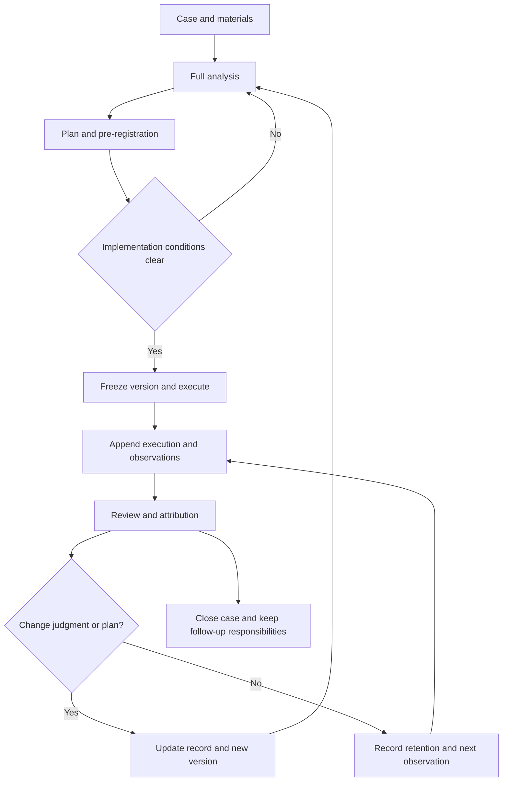

# Loop operating manual

Protocol: RP-2.0.0  |  Theory version: 2.0.0  |  Default time zone: Asia/Shanghai

> English translation of [02_闭环运行手册.md](02_闭环运行手册.md). Template and sheet names are given in English with the Chinese file names in parentheses where useful.

## 1. How one case goes through the loop

"Freezing" saves a snapshot of the prior commitment. It does not require you to stop learning, nor does it allow modifying the past to hide changes that happened later.

| Phase | File to fill in | Output required at the end | Corresponding workbook sheet |
|---|---|---|---|
| Set up the case | 00 Project index | Case ID, owner, time zone, dossier location | Cases overview |
| Full analysis | 01 Case and full analysis | All-module analysis, evidence boundaries, candidate plans, conditional recommendation | Analysis reference in Cases overview |
| Settle the plan | 02 Plan and pre-registration | Metrics, predictions, resources, actions, stop rules, permissions, review time | Plan versions, Predictions |
| Execution and observation | 03 Execution and observation log | Actual actions, deviations, raw data, sources and times | Execution log, Observations |
| Phase review | 04 Phase review and attribution | Results by original standard, current value, scope of attribution, items to verify | Reviews |
| Dynamic update | 05 Update record | Old value, new value, evidence, impact, future effective point, new version or retention | Update log |
| Closing | 06 Closing and follow-up responsibilities | Final outcome status, remaining obligations, rule candidates | Cases overview, Reviews |
| Cross-case distillation | 07 Rules and version records | Scoped rules, counterexamples, adoption and review conditions | Rule versions |
| Testing the method itself | 08 Theory and protocol validation plan | Fixed versions, comparison baseline, metrics, costs, evaluation and revision suggestions | Rule versions and Update log |

Validation template 08 is for dedicated method-validation tasks; it does not require redoing a research study for every routine decision.

## 2. Setting up a project

Each case gets its own directory and is assigned `RP-YYYYMMDD-NNN`. NNN is a non-repeating sequence number within the same day. Interdependent cases keep their own IDs, with links and shared resources recorded in the index.

You can start manually by copying `05_项目档案模板` (project dossier templates); you can also initialize with a local script of your own (this public edition ships no helper tools). Replace `{{CASE_ID}}` with the actual ID and fill in the owner, the real case and the deadline. "To be filled" in the templates is not a default fact or a satisfied condition.

Full analysis is the default mode. The theory's general outline and all twenty volumes are handled in the analysis template's coverage checklist. Module status may be shown as "applies / does not apply / carried over / to be confirmed", and a basis must be written; for "does not apply", no content needs to be invented.

## 3. How a full analysis ends

The analysis output must contain together: fact boundaries, value goals, actor conditions, causal hypotheses, competing explanations, implementable interfaces, baseline and alternative plans, rationale for trade-offs, risk boundaries, execution plan and feedback arrangements.

When no unique ranking is possible, record the value choice or key unknown the recommendation depends on. Give an information-gathering action, a minimal commitment or an explicit decision to wait, with a deadline. "Keep researching" cannot replace a concrete action, and numbers must not be fabricated just to complete a table.

Analysis records and action plans are saved separately. The analysis may propose several reasonable plans; the plan record states which one was finally adopted, who chose it, and under what conditions it takes effect. An AI's suggestion can be registered as settled only when it has actually been adopted or falls within an already explicitly authorized scope.

## 4. Pre-freezing and first implementation

Checks before freezing:

1. The current analysis version and information cut-off time are clear.
2. The case, goal version, chosen plan and executable actions are clear.
3. Metric definition, unit, direction, baseline, target, observation window and data source are handled; for parts that cannot be filled in, explain why the current action does not lose its basis.
4. Risk ceiling, total budget, phase budgets, review checkpoints, stop and escalation conditions are clear.
5. Executor, decision-maker and actual scope of authorization are clear; suggestions are not confused with adopted decisions.
6. Key predictions and alternative plans are registered before results are revealed; when reliable probabilities cannot be given, keep qualitative judgments.
7. A dossier snapshot with an explicit path has been saved.

Save copies of the analysis and plan to `归档/` (archive), using IDs such as AN001 and P001. Later changes create AN002 or P002; old files are not overwritten. Prediction IDs are fixed at registration; you cannot pick the most accurate version to take part in evaluation after results come out.

If the action already happened and the record is added afterwards, honestly fill in "retroactive entry", keeping the real action time and record time. A retroactive entry cannot gain the evidential status of a prior prediction or prior commitment.

## 5. Execution, observation and evidence

Each action registers an execution ID EX; each observation or piece of evidence registers an OB. Execution entries link the case, plan, action and observations. When results arrive, record the original content first, then write the interpretation.

Keep at minimum: time of occurrence, time recorded, plan ID, actual action or metric, value and unit, sample scope, source, quality status and correction relationships. Time spent, actual cash spending and returns are recorded separately; different currencies are not added directly. Workbook amount totals are limited to the same case and the same declared currency.

One original material may support several judgments but is registered under only one source ID. For corrections, add a new OB record pointing to the original OB without deleting the original. Repeated observations must state whether they are the same event or same-source information.

You may register logs directly in the workbook and cite the IDs in the Markdown log. Do not count the same expense both as execution spending and as a duplicate expense in another sheet. Amount metrics in the Observations sheet do not take part in the automatic cash-spending totals.

## 6. Phase review

Start a review on the scheduled date, or when a risk trigger, major counter-evidence, important new evidence or phase completion occurs. First fix this round's information cut-off time and snapshots of all input files.

Review order: check data and execution; compute achievement against the original goal; check counterfactuals and competing explanations; distinguish random fluctuation, execution deviation, environmental change, mechanism error and goal misfit; then evaluate current value and next actions.

Outcome assessment may use "achieved / not achieved / partially achieved / not yet due / undeterminable"; causal assessment uses "change observed / mechanism supported / limited causal support / insufficient evidence". These statuses do not form a single low-to-high score. Causal support may be filled in only when a concrete design and evidence support it.

When there is no data, record the reason and the next data task. One negative result does not automatically refute a mechanism, and one positive result does not automatically validate the whole theory. A risk stop triggered according to frozen rules can be reasonable even if the mechanism may still be valid.

## 7. How to update dynamically

| Object of update | Common triggers | Output and scope |
|---|---|---|
| Observation records | Definition or recording errors | New correcting OB citing the original OB |
| World model and beliefs | New evidence, changed weights of competing explanations | New analysis version or local update record |
| Actor and position | Changes in resources, capabilities, load, permissions | Evidence of actual change and model revision |
| Values and goals | Real preference changes, cost changes, proxy metric failure | New goal or value version, keeping evaluation by the old standard |
| Action plan and risk arrangements | New resources, mechanism failure, reaching double-down or withdrawal conditions | New P version and future effective time |
| Cross-case rules | Several pieces of local evidence, changed scope or counterexamples | Rule version: candidate, trial, adopted or retired |
| Theory and operating protocol | Conceptual contradictions, procedural defects, method comparison results | New theory or protocol version with migration notes |

Every review produces one update record, including the "keep unchanged" case. An update record states at least the old value, new value or retained content, supporting OB, triggering RV, scope of impact, adoption status, decision-maker, effective time and next verification.

When the action needs to change: first form the new plan, then save the frozen snapshot, and finally update the current pointer in the index. Never overwrite the index first without a new version. Major changes affecting goals, mechanisms, arena or scale require a new full analysis; otherwise run an all-module change scan.

Rule promotion does not happen automatically after a fixed number of successes. Review evidence independence, failure records, counterexamples, environmental differences and value relative to the baseline. Theory revisions take effect only after a candidate suggestion is explicitly adopted.

## 8. How to fill in the workbook

There are eight sheets: Cases overview, Plan versions, Execution log, Observations, Predictions, Reviews, Update log, Rule versions.

Light yellow cells are inputs; light grey columns are formulas. The first-row hint gives each sheet's record granularity. Headers are filterable; ID columns and headers are frozen. There is no demo business data; blank means not yet registered.

The evaluation date in `问题总览` (Cases overview) is entered manually and is used for due-date reminders; update the date each time you open the workbook for a review. The date is not automatically captured from real events. Dates entered by the user must be real Excel dates; amounts and probabilities must be numbers.

Each sheet is pre-set for 300 records, with summary formulas using rows 7 to 306. Do not keep registering at row 307 without extending the formulas. When capacity is exceeded, extend the table, formula columns, data validation and all cross-sheet ranges, or start a new volume and register its volume number in the project index; do not lose the old volume. Helper freeze tools do not automatically expand or modify the workbook.

The workbook's link checks only check IDs and some key fields; they cannot prove evidence is true, a plan is justified or the theory is valid. Automatically totaled spending, time and Brier scores need consistent definitions. Ordinary cells can be edited manually; historical protection relies on snapshots and correction conventions.

## 9. Closing and long-term accumulation

Formal closing must leave a closing record, a final review, an update or retention decision, and unfinished obligations with their owners. Results not yet due cannot be written as already verified. When action has ended but results are still awaited, execution may be paused while keeping the to-be-observed status.

When administrative closing is chosen while items are still pending, state it explicitly in the index and give follow-up items their own IDs, owners and dates. Closing does not forbid reopening; reopening requires a new status record and analysis version, keeping the original closing.

Across projects, distill only rules with scope and counterexamples. When evaluating rule effectiveness, record successes, failures, retirements, non-executions and unobservable cases together. Every rule has its own review deadline.

## 10. File snapshots and recovery

Manual method: copy this round's analysis, plan, review, update and related data files into a numbered archive directory, keeping original file names and actual save times. Later rounds add new directories.

Helper tool method (optional; this public edition ships no scripts): any script that only processes local files can be used to create projects, freeze files and record digests (such as SHA-256). Such a script should not go online, call models, replace human judgment or automatically read data from other locations. If the workbook is outside the project, first put this round's cut-off copy into the project directory, then freeze.

Digest checks detect file changes, losses and broken log chains. They provide no trusted third-party time and do not prevent someone with file permissions from rewriting both records and digests. Keep independent backups of important dossiers.
