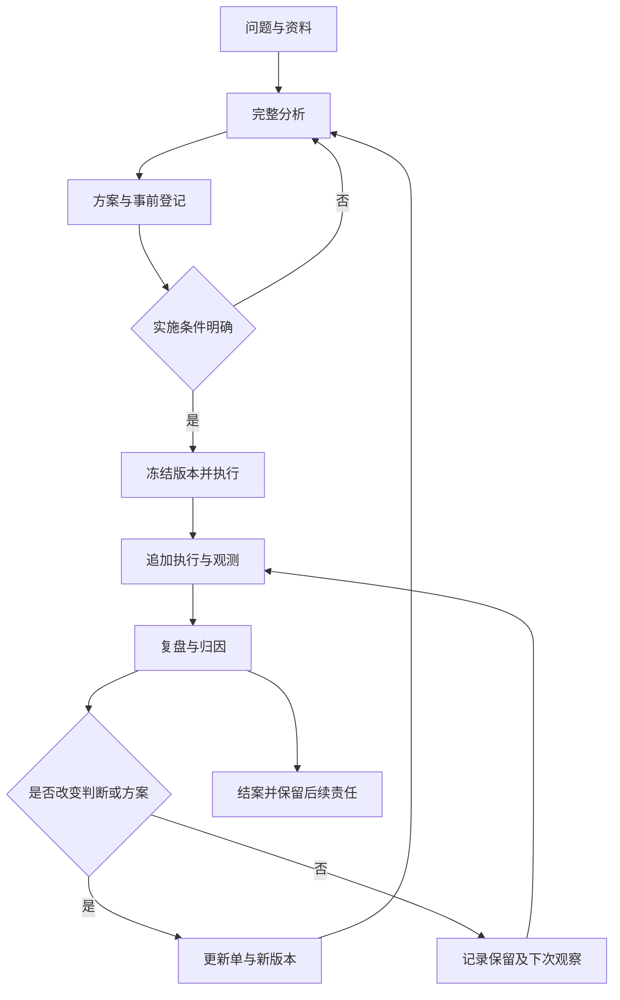

# 闭环运行手册

协议：RP-2.0.0　｜　适配理论：2.0.0　｜　默认时区：Asia/Shanghai

## 一、一个问题怎样走完闭环

“冻结”是保存事前承诺的快照。它不要求停止学习，也不允许修改过去来掩盖后来发生的变化。

| 阶段 | 填写文件 | 结束时必须拥有的输出 | 工作簿对应表 |
|---|---|---|---|
| 建立问题 | 00 项目索引 | 问题编号、负责人、时区、档案位置 | 问题总览 |
| 完整分析 | 01 问题与全量分析 | 全模块分析、证据边界、候选方案、条件性推荐 | 问题总览中的分析引用 |
| 方案定案 | 02 方案与事前登记 | 指标、预测、资源、动作、停止规则、权限、复盘时间 | 方案版本、预测登记 |
| 执行与观察 | 03 执行与观测日志 | 实际动作、偏差、原始数据、来源与时间 | 执行日志、观测证据 |
| 阶段复盘 | 04 阶段复盘与归因 | 原标准结果、当前价值、归因范围、待验证事项 | 复盘记录 |
| 动态更新 | 05 更新单 | 旧值、新值、证据、影响、未来生效点、新版本或保留 | 更新日志 |
| 结案 | 06 结案与后续责任 | 最终结果状态、剩余义务、规则候选 | 问题总览、复盘记录 |
| 跨问题沉淀 | 07 规则与版本记录 | 有范围的规则、反例、采用及复核条件 | 规则版本 |
| 检验方法本身 | 08 理论与协议验证计划 | 固定版本、比较基准、指标、成本、评价与修订意见 | 规则版本及更新日志 |

编号08的验证模板用于专门的方法验证任务，不要求每次日常决策重新做一套研究。

## 二、建立项目

每个问题独立建目录并分配 `RP-YYYYMMDD-NNN`。同一天的 NNN 为不重复序号。相互依赖的问题保留各自编号，在索引中记录关联关系和共享资源。

复制 `05_项目档案模板` 即可手动开始；也可以用自备的本地脚本初始化（本公开版未附带辅助工具）。用实际编号替换 `{{CASE_ID}}`，填写负责人、真实问题和期限。模板中的“待填写”不是默认事实或已满足条件。

以完整分析为默认模式。理论总纲和二十卷均在分析模板的覆盖清单中处理。可用“适用／不适用／沿用／待确认”表示模块状态，必须写依据；不适用不需要编造内容。

## 三、完整分析怎样结束

分析输出必须同时包含事实边界、价值目标、主体条件、因果假设、竞争解释、可实施接口、基准及备选方案、取舍依据、风险边界、执行计划和反馈安排。

不能唯一排序时，记录推荐依赖的价值选择或关键未知。给出信息获取动作、最小承诺或明确等待决定，并设置期限。不得用“继续研究”替代具体动作，也不得为了填完整表而伪造数字。

分析记录与行动计划分别保存。分析可以提出多种合理方案；方案记录明确最终采用了哪一个、谁作出选择、什么条件下生效。AI提出的建议只有在实际被采纳或属于已经明确授权的范围时，才能登记为已定案。

## 四、事前冻结与第一次实施

冻结前检查：

1. 当前分析版本和信息截止时间明确。
2. 问题、目标版本、选中方案和可执行动作明确。
3. 指标的口径、单位、方向、基线、目标、观察窗口与数据来源已处理；无法填写的部分说明为什么不会使当前动作失去依据。
4. 风险上限、总预算、阶段预算、复盘节点、停止与升级条件明确。
5. 执行人、决定人和实际授权范围明确；建议与已采用决定不混淆。
6. 关键预测和备选方案在结果揭晓前登记；无法给可靠概率时保留定性判断。
7. 具有明确路径的档案快照已经保存。

将分析和方案另存到 `归档/`，使用 AN001、P001 等编号。后续改动创建 AN002 或 P002；旧文件不覆盖。预测编号在登记时固定，不能在结果出来后挑选最准确的一版参与评价。

若行动已经发生再补记录，如实填“事后补录”，保存真实行动时间与记录时间。补录不能获得事前预测或事前承诺的证据资格。

## 五、执行、观测和证据

每次动作登记执行编号 EX；每条观察或证据登记 OB。执行条目连接问题、方案、动作和观察。收到结果时先记录原始内容，再写解释。

最少保留：发生时间、记录时间、方案编号、实际动作或指标、数值与单位、样本范围、来源、质量状态和更正关系。耗时、实际现金支出与收益分开记录；不同币种不直接相加。工作簿金额汇总限同一个问题、同一种声明币种。

一个原始材料可以支持多个判断，但只登记一个来源编号。若更正，新增 OB 记录指向原 OB，不删除原记录。重复观测需要说明是否同一事件或同源信息。

可以直接在工作簿中登记流水，并在Markdown日志中引用编号。不要把同一笔支出同时计入执行支出和其他表的重复支出。观测表里的金额指标不参与现金支出自动汇总。

## 六、阶段复盘

到预定日期，或发生风险触发、重大反证、重要新证据、阶段完成时启动复盘。先固定本轮信息截止时间和所有输入文件快照。

复盘顺序：核对数据与执行；按原目标计算达成情况；检查反事实和竞争解释；区分随机波动、执行偏差、环境变化、机制错误与目标不适配；再评价当前价值与后续行动。

结果评价可使用“达成／未达成／部分达成／未到期／无法判定”，因果评价使用“观察变化／机制支持／有限因果支持／证据不足”。这些状态不构成从低到高的统一分数。只有具体设计和证据支持时才能填写因果支持。

没有数据时记录原因和下一数据任务。一次负结果不自动否定机制，一次正结果不自动验证整套理论。根据冻结规则发生的风险停止可以合理，即使机制仍然可能有效。

## 七、如何动态更新

| 更新对象 | 常见触发 | 输出与范围 |
|---|---|---|
| 观测记录 | 口径或记录错误 | 新增更正OB，引用原OB |
| 世界模型与信念 | 新证据、竞争解释权重变化 | 新分析版本或局部更新记录 |
| 主体与站位 | 资源、能力、负荷、权限变化 | 实际变化证据和模型修订 |
| 价值与目标 | 真实偏好变化、代价变化、代理指标失效 | 新目标或价值版本，保留旧标准评价 |
| 行动方案与风险安排 | 新资源、机制失效、到达加码或撤回条件 | 新P版本及未来生效时间 |
| 跨问题规则 | 多项局部证据、适用范围变化或反例 | 候选、试行、采用或停用的规则版本 |
| 理论与运行协议 | 概念矛盾、程序缺陷、方法比较结果 | 新理论或协议版本及迁移说明 |

每次复盘形成一份更新单，包括“保留不变”的情况。更新单至少写旧值、新值或保留内容、依据OB、触发RV、影响范围、采纳状态、决定人、生效时间与下一验证。

需要改变行动时：先形成新方案，再保存冻结快照，最后更新索引中的当前指针。不要先覆盖索引却没有新版本。影响目标、机制、场域或规模的重大变化，重新完整分析；其他情况执行全模块变化扫描。

规则升格不按固定成功次数自动发生。应审查证据独立性、失败记录、反例、环境差异和相对基准价值。理论修订只在候选建议得到明确采纳后生效。

## 八、工作簿怎样填写

共有八个工作表：问题总览、方案版本、执行日志、观测证据、预测登记、复盘记录、更新日志、规则版本。

浅黄色单元格为输入，浅灰色列为公式。首行提示给出该表的记录粒度。表头可筛选，编号列和表头冻结。没有演示业务数据，空白代表尚未登记。

`问题总览` 的评估日期为手动输入，用于到期提醒；每次复盘打开工作簿先更新日期。日期不是自动抓取真实事件的时间。用户输入日期须为真实Excel日期，金额与概率须为数值。

预置每表300条记录，汇总公式使用第7至306行。不要直接在第307行继续登记而不扩展公式。超过容量时，扩展表格、公式列、数据验证和全部跨表范围，或建立新一册并在项目索引登记册号；不要把旧册遗失。辅助冻结工具不自动扩容或修改工作簿。

工作簿的关联检查只检查编号及部分关键字段，不能证明证据真实、方案正当或理论有效。自动汇总的支出、耗时和Brier分数需要保持相同口径。普通单元格可被人工修改，历史保护依赖快照和更正约定。

## 九、结案与长期积累

正式结案须留下结案记录、最终复盘、更新或保留决定、未完成义务及其责任人。未到期结果不能写成已经验证。行动结束而仍需等待结果时，可暂停执行并维持待观测状态。

有待处理事项仍选择行政关闭时，索引中明确说明，并将后续事项独立编号、分配责任与日期。结案不意味着禁止再打开；重新打开需新增状态记录和分析版本，保留原结案。

跨项目只沉淀带适用范围和反例的规则。评价规则有效性时同时记录成功、失败、弃用、未执行和无法观察的情况。每个规则都有独立的复核期限。

## 十、文件快照与恢复

手动方式：将本轮分析、方案、复盘、更新和相关数据文件复制到带编号的归档目录，保留原文件名和实际保存时间。以后追加新目录。

辅助工具方式（可选，本公开版未附带脚本）：可用任何只处理本地文件的脚本创建项目、冻结文件并记录摘要（如 SHA-256）。脚本不应联网、调用模型、代替人工判断或自动读取其他位置的数据。若工作簿在项目外，先把本次需要的截止时点副本放入项目目录，再冻结。

摘要校验用于发现文件改变、丢失和日志链断裂。它不提供第三方可信时间，不阻止拥有文件权限的人同时改写记录和摘要。重要档案另存独立备份。
